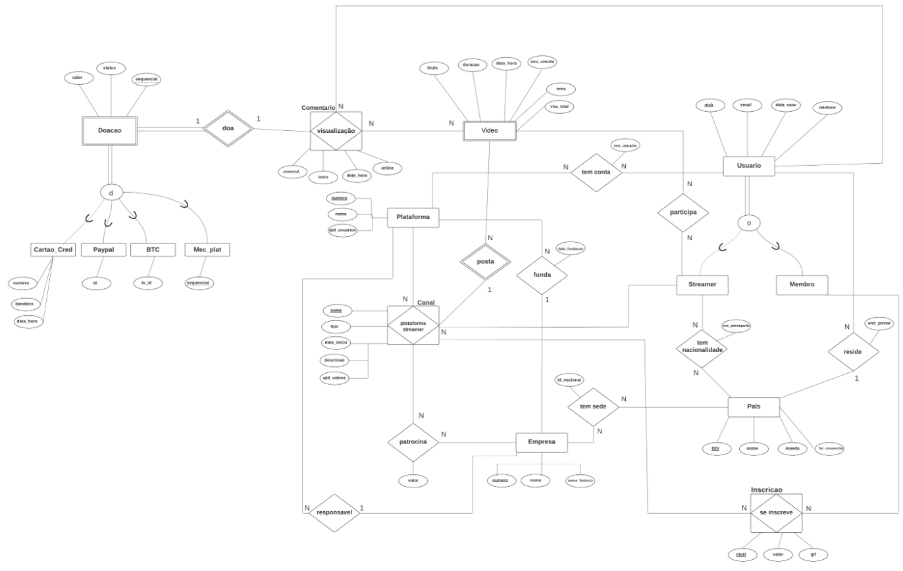

# Explicação didática do projeto

Este documento serve para o grupo **estudar** o trabalho, **revisar** o código e **responder às perguntas** do professor na apresentação.

## Como usar este documento

- **Leia primeiro a Parte 1:** é o enunciado do professor, transcrito na íntegra. Ela mostra o problema antes da solução.
- **Cada trecho de código aparece num menu que abre e fecha** ("Ver o código"). Clique para ver o código inteiro daquela parte sem trocar de arquivo. O título do menu diz de qual arquivo e de quais linhas ele veio.
- **Depois de cada trecho vem um quadro "Explicando do zero".** Ele explica o código como se você nunca tivesse ouvido falar do assunto, com comparações do dia a dia. Pode pular se já souber.
- **O texto normal (fora dos quadros) é a justificativa técnica,** com os conceitos da aula. É o que vale para o relatório e para a apresentação.
- **As aulas citadas:** 02 e 04 (índices e B+-tree), 03 (hash), 05 (índices no PostgreSQL), 06 (fragmentação horizontal), 12 (catálogo e estatísticas), 13 (PL/pgSQL e triggers), 14 (visões) e 15 (transações).

> **Para quem mexer no código:** os trechos dentro dos menus são copiados automaticamente dos arquivos `.sql`. Depois de alterar um `.sql`, rode `python3 dev/atualizar_explicacao.py` para atualizar este documento. O `./dev/testar.sh` avisa quando ele estiver desatualizado.

---

## Sumário

- [Parte 1 — O enunciado do trabalho](#parte-1--o-enunciado-do-trabalho)
- [Parte 2 — Mapa: o que foi pedido e onde está](#parte-2--mapa-o-que-foi-pedido-e-onde-está)
- [Parte 3 — A ordem do trabalho e como rodar](#parte-3--a-ordem-do-trabalho-e-como-rodar)
- [Parte 4 — Design físico (01_ddl.sql)](#parte-4--design-físico-01_ddlsql)
- [Parte 5 — Triggers (02_ddl_estendida.sql)](#parte-5--triggers-02_ddl_estendidasql)
- [Parte 6 — Functions de inserção e transações](#parte-6--functions-de-inserção-e-transações)
- [Parte 7 — Visões](#parte-7--visões)
- [Parte 8 — Povoamento (03_povoamento.sql)](#parte-8--povoamento-03_povoamentosql)
- [Parte 9 — Consultas (04_consultas.sql)](#parte-9--consultas-04_consultassql)
- [Parte 10 — Índices (05_indices.sql)](#parte-10--índices-05_indicessql)
- [Parte 11 — Como medimos os índices](#parte-11--como-medimos-os-índices)
- [Parte 12 — O que mudou em relação ao que o grupo já tinha](#parte-12--o-que-mudou-em-relação-ao-que-o-grupo-já-tinha)
- [Parte 13 — O que decidimos NÃO fazer, e por quê](#parte-13--o-que-decidimos-não-fazer-e-por-quê)
- [Parte 14 — Perguntas que o professor pode fazer](#parte-14--perguntas-que-o-professor-pode-fazer)
- [Parte 15 — Glossário rápido](#parte-15--glossário-rápido)

---

## Parte 1 — O enunciado do trabalho

Transcrição do PDF entregue pelo professor (*Projeto de Banco de Dados 2026/2, Prof. Marcos Bedo, Instituto de Computação da UFF*). O texto foi mantido como está no original, inclusive nomes de tabelas com grafia diferente ("Patrocionio", "refrencia").

### Trabalho final de disciplina

**Avisos importantes:**

- Trabalho vale 30% da Nota Final!
- Trabalho a ser realizado em grupo!
- Não compartilhem suas respostas. Haverá verificação de cópia entre os trabalhos (inclusive implementação e entregas de outras turmas, incluindo diferentes anos). Vocês podem ser os maiores prejudicados em casos de plágio!
- Não deixem de enviar o relatório por e-mail no prazo especificado em aula!

### Especificação do trabalho — Projeto de BD incrementando Princípios de BD

Implementar um projeto de banco de dados relacional **já mapeado para o relacional** onde será necessário:

1. Definir a construção de Visões Virtuais e Materializadas
2. Definir a construção de índices para melhorar o desempenho de buscas
3. Definir triggers para a movimentação de dados
4. Definir rotinas em PL/SQL para consultas aos dados via Linguagem Procedural

Deverá ser entregue um .zip com as implementações realizadas em Postgres, um arquivo README.md com o passo-a-passo para reproduzir a solução do grupo e um **pequeno relatório justificando as escolhas de implementação baseados nos conceitos vistos em aula**.

### Requisitos do banco de dados

Deseja-se projetar uma base de dados para catalogar informações sobre *streamers* de jogos *online* para responder questões sobre o alcance de público, quantidade de propagandas realizadas, arrecadação direta (doações), arrecadação indireta (membros inscritos), número de interações diretas (comentários *online*) e número de interações (comentários *online* + *offline*).

Construa o modelo ER referente à base de dados. A base de dados não deve conter redundância de dados. O modelo ER pode ser representado com a notação vista nas aulas. Mapeie o modelo ER para o modelo Relacional. Normalize o modelo relacional mapeado.

A base de dados deve incluir plataforma de *streaming* (ex., *Youtube* e *Twitch*), que são identificadas por um número sequencial único e possuem um nome, uma empresa fundadora, uma empresa responsável, uma data de fundação e uma quantidade de usuários.

Além disso, a base de dados deve incluir *streamers*, identificados por um único *nick*, número de usuário (que pode ser diferente em cada plataforma), endereço de email, data de nascimento e endereço postal, número de passaporte e país de passaporte. A base de dados também deve conter informações de usuários, identificados por um único *nick*, endereço de email, data de nascimento, um telefone para validação em duas vias, um endereço postal e um país de residência.

Cada país deve ser identificado por um número (DDI) e possuir um nome e uma moeda. Além disso, para cada moeda deve estar associada uma fator de conversão em dólar padrão (USD - dólares americanos) para conversão do valor da moeda estrangeira para dólares americanos.

Um ou mais canais estão associados a cada *streamers* em diferentes plataformas. Cada canal é identificado por seu nome único, data de início, descrição, quantidade de vídeos postados e tipo do canal que deve ser um entre {privado, público ou misto}. Um canal pode ser patrocinado por uma empresa, que é identificada um número sequencial único, um nome, um identificador nacional (ex: CNPJ), país de origem e um nome fantasia. Cada patrocínio tem um valor (em dólares americanos) e o sistema não armazena o histórico de patrocínios, ou seja, apenas os patrocinadores com patrocínios vigentes devem aparecer nos sistema. Um canal pode ter vários membros inscritos. Cada membro inscrito contribui com um valor mensal que depende do seu nível de membro. Existem cinco níveis de membros e os nomes e os valores de cada nível são definidos para cada canal e para cada nível existe um arquivo de imagem .gif associado. O sistema não armazena o histórico de membros, ou seja, apenas os membros vigentes devem aparecer no sistema.

Um vídeo postado é identificado por seu título e data/hora de postagem. Cada vídeo tem uma duração e está associado a um único canal, mas pode ter a participação de mais *streamers* do que apenas o dono do canal. Cada vídeo tem um tema, uma quantidade máxima de visualizações simultâneas e a quantidade total de visualizações. Cada vídeo pode ter comentários *online* e *offline*. Cada comentário tem um número sequencial que depende do vídeo e tem um usuário (que fez o comentário) associado. Cada comentário tem uma data/hora e pode trazer consigo uma doação ou não. Cada doação é identificada por um número sequencial que depende do vídeo, do usuário e do comentário. A doação pode ser feita de quatro formas: cartão de crédito, paypal, bitcoin ou mecanismo próprio da plataforma (ex.: Google SuperChat).

No caso da doação em bitcoin deve ser armazenada também a TxID (um código *hash*), além do valor associado à doação. Para doações via PayPal, deve-se armazenar o IDPayPal de pagamento, além do valor associado à doação. No caso de cartão de crédito, deve ser armazenado o número do cartão, a bandeira do cartão e a data e hora. Nos casos de mecanismo próprio da plataforma, deve-se ser associado um número sequencial que depende do usuário, do comentário e da plataforma, além do valor da doação. Para cada doação é necessário armazenar o *status* que só pode ser um dos três {recusado, recebido ou lido}.

### Modelo ER (do enunciado)



### Modelo relacional (do enunciado)

```text
Empresa(nro, nome, nome_fantasia)

-- Quantidade de usuários qtd_users é atributo derivado e requer atualização periódica
Plataforma(nro, nome, qtd_users, empresa_fund, empresa_respo, data_fund)
    empresa_fund referencia Empresa(nro)
    empresa_respo referencia Empresa(nro)

-- fator_conver é o fator de conversão para dólar
Conversao(moeda, nome, fator_conver)

Pais(DDI, nome, moeda)
    moeda referencia Conversao(moeda)

Usuario(nick, email, data_nasc, telefone, end_postal, pais_residencia)
    pais_residencia referencia Pais(ddi)

PlataformaUsuario(nro_plataforma, nick_usuario, nro_usuario)
    nro_plataforma referencia Plataforma(nro)
    nick_usuario referencia Usuario(nick)

StreamerPais(nick_streamer, ddi_pais, nro_passaporte)
    nick_streamer referencia Usuario(nick)
    ddi_pais referencia Pais(ddi)

EmpresaPais(nro_empresa, ddi_pais, id_nacional)

-- Quantidade de visualizações qtd_visualizações é atributo derivado e requer atualização
Canal(nome, tipo, data, desc, qtd_visualizacoes, nick_streamer, nro_plataforma)
    nro_plataforma referencia Plataforma(nro)
    nick_streamer referencia Usuario(nick)

Patrocionio(nro_empresa, nome_canal, nro_plataforma, valor)
    nro_empresa referencia Empresa(nro)
    nome_canal, nro_plataforma referencia Canal(nome, nro_plataforma)

NivelCanal(nome_canal, nro_plataforma, nivel, valor, gif)
    nome_canal, nro_plataforma referencia Canal(nome, nro_plataforma)

Inscrição(nome_canal, nro_plataforma, nick_membro, nivel)
    nick_membro refrencia Usuario(nick)
    (nome_canal, nro_plataforma, nivel) referencia NivelCanal(nome_canal, nro_plataforma, nivel)

-- Verificar a possibilidade do uso de identificador artificial (toda ou parte da chave)
Video(nome_canal, nro_plataforma, titulo, dataH, tema, duracao, visu_simul, visu_total)
    (nome_canal, nro_plataforma) referencia Canal(nome, nro_plataforma)

Participa(nome_canal, nro_plataforma, titulo_video, dataH_video, nick_streamer)
    (nome_canal, nro_plataforma, titulo_video, dataH_video) referencia
        Video(nome_canal, nro_plataforma, titulo_video, dataH_video)
    nick_streamer referencia Usuario(nick)

Comentario(nome_canal, nro_plataforma, titulo_video, dataH_video, nick_usuario, seq, texto, dataH, coment_on)
    (nome_canal, nro_plataforma, titulo_video, dataH_video) referencia Video(nome_canal, nro_plataforma, titulo, dataH)
    nick_usuario referencia Usuario(nick)

Doacao(nome_canal, nro_plataforma, titulo_video, dataH_video, nick_usuario, seq_comentario, seq_pg, valor, status)
    (nome_canal, nro_plataforma, titulo_video, dataH_video, nick_usuario, seq_comentario) referencia
        Comentario(nome_canal, nro_plataforma, titulo_video, dataH_video, nick_usuario, seq)

BitCoin(nome_canal, nro_plataforma, titulo_video, dataH_video, nick_usuario, seq_comentario, seq_doacao, TxID)
    (nome_canal, nro_plataforma, titulo_video, dataH_video, nick_usuario, seq_comentario, seq_doacao) referencia
        Doacao(nome_canal, nro_plataforma, titulo_video, dataH_video, nick_usuario, seq_comentario, seq_pg)

PayPal(nome_canal, nro_plataforma, titulo_video, dataH_video, nick_usuario, seq_comentario, seq_doacao, IdPayPal)
    (mesma referência a Doacao)

CartaoCredito(nome_canal, nro_plataforma, titulo_video, dataH_video, nick_usuario, seq_comentario, seq_doacao, nro, bandeira)
    (mesma referência a Doacao)

MecanismoPlat(nome_canal, nro_plataforma, titulo_video, dataH_video, nick_usuario, seq_comentario, seq_doacao, seq_plataforma)
    (mesma referência a Doacao)
```

No PDF, os atributos sublinhados formam a chave primária. Eles são os que aparecem antes do primeiro atributo comum de cada tabela (por exemplo, em `Video`, a chave é `nome_canal, nro_plataforma, titulo, dataH`).

### Itens mandatórios

1. Inserir entre 1000 e 10.000 tuplas por tabela (dados artificiais serão aceitos).
2. Construção criteriosa de identificadores artificiais e *constraints* UNIQUE e NOT NULL.
3. Construção de visões para otimizar o desempenho de buscas. Até 05 visões. Justifique suas escolhas (cada visão).
4. Construção de índices de apoio. Definir e criar índices de apoios. Considerar o *overhead* de inserção. Até 05 indices. Justificar suas escolhas (cada índice).
5. Definir triggers para manter a consistência do BD (todas as necessárias via requisitos).
6. Usar functions (ou stored procedures) para responder todas as consultas abaixo. As functions devem ser parametrizadas.

### Consultas a serem respondidas (na forma de functions/procedures)

1. Listar os streamers que possuem a maior quantidade de vídeos publicados, apresentando a quantidade total de vídeos e a soma das visualizações destes vídeos. Dar a opção de filtrar por plataforma como parâmetro opcional na forma de uma stored procedure.
2. Listar e ordenar os vídeos que possuem a maior quantidade de comentários, apresentando a quantidade de comentários online, offline e total. Dar a opção de filtrar por canal como parâmetro opcional na forma de uma stored procedure.
3. Listar e ordenar os canais pela quantidade total de interações, considerando os comentários online e offline de todos os seus vídeos. Apresentar também a média de interações por vídeo. Dar a opção de filtrar por streamer como parâmetro opcional na forma de uma stored procedure.
4. Listar e ordenar os canais pelo valor médio das doações recebidas por comentário. Apresentar também a quantidade de doações e o valor total recebido. Dar a opção de filtrar por plataforma como parâmetro opcional na forma de uma stored procedure.
5. Identificar quais são os canais patrocinados e os valores de patrocínio pagos por empresa. Dar a opção de filtrar os resultados por empresa como um parâmetro opcional na forma de uma stored procedure.
6. Descobrir de quantos canais cada usuário é membro e a soma do valor desembolsado por usuário por mês. Dar a opção de filtrar os resultados por usuário como um parâmetro opcional na forma de uma stored procedure.
7. Listar e ordenar os canais que já receberam doações e a soma dos valores recebidos em doação. Dar a opção de filtrar os resultados por canal como um parâmetro opcional na forma de uma stored procedure.
8. Listar e ordenar os *k* canais que mais recebem patrocínio e os valores recebidos.
9. Listar e ordenar os *k* canais que mais recebem aportes de membros e os valores recebidos.
10. Listar e ordenar os *k* canais que mais receberam doações considerando todos os vídeos.
11. Listar os *k* canais que mais faturam considerando as três fontes de receita: patrocínio, membros inscritos e doações.
12. **DESAFIO/PONTO-EXTRA:** Listar as top-*k* plataformas pela quantidade de streamers **E** canais. Dar a opção de filtrar por plataforma como parâmetro opcional na forma de uma stored procedure.

### O que o professor acrescentou na consultoria

Na consultoria (o áudio e a transcrição estão na pasta da matéria), o professor disse coisas que não estão no PDF e que entram na avaliação:

- **Ordem:** design físico, depois povoamento, depois consultas, e só então índices e visões.
- **Chaves primárias numéricas,** nunca string. Chaves compostas pequenas (2 ou 3 atributos no máximo) e poucas.
- **ENUMs, UNIQUE, NOT NULL e políticas de FK** "bem definidos".
- **Validação:** formato fica no front-end; regra que muda com o tempo, no back-end; regra estável (ex.: nível de 1 a 5), no banco.
- **Atributos derivados** precisam de um mecanismo (trigger) que garanta o valor certo.
- **Povoamento:** o valor do dado não importa, a **distribuição** sim. Precisa ser realista e concentrada, não uniforme.
- **Inserir por functions** que validam antes.
- **Índices:** só 5, escolhidos por prioridade e **medidos** com e sem. "Não é tentativa e erro."
- **Pelo menos uma function polimórfica.**
- **Visões:** justificar por que cada uma é materializada ou virtual.
- **Transações:** não são obrigatórias, mas ele gostaria de ver.
- **Entrega:** cerca de 5 arquivos SQL separados, com as decisões comentadas com `--`.

> **Explicando do zero: o que o trabalho pede, em palavras simples**
>
> Um **banco de dados** é um programa que guarda informações de forma organizada e responde perguntas sobre elas, como uma planilha gigante e muito rápida. Aqui o "mundo" a guardar são as plataformas de vídeo ao vivo (YouTube, Twitch): quem tem canal, quem assiste, quem comenta, quem doa dinheiro e quem patrocina.
>
> O professor já entregou o "desenho" do banco em dois formatos:
> - **Modelo ER** (o diagrama com retângulos e losangos): retângulos são as coisas que existem (usuário, vídeo, canal), e losangos são as ligações entre elas (um usuário *comenta* um vídeo).
> - **Modelo relacional:** o mesmo desenho escrito como **tabelas**. Cada tabela é como uma aba de planilha, com colunas (nome, e-mail...) e linhas (cada usuário é uma linha).
>
> O trabalho do grupo é **construir de verdade** esse banco no PostgreSQL (o programa de banco de dados que a matéria usa), enchê-lo de dados de mentira e escrever:
> - **visões:** consultas salvas com nome;
> - **índices:** atalhos para achar dados mais rápido, como o índice remissivo de um livro;
> - **triggers:** gatilhos que o banco executa sozinho quando algo acontece;
> - **functions:** pequenos programas guardados no banco que respondem às 12 perguntas da lista.

---

## Parte 2 — Mapa: o que foi pedido e onde está

| Pedido (enunciado ou consultoria) | Onde está |
|---|---|
| Entre 1.000 e 10.000 tuplas por tabela | `03_povoamento.sql`. O `dev/verificacoes.sql` confere as 20 tabelas. |
| Distribuição de dados realista, não uniforme | `03_povoamento.sql`, função `pop_concentrado` (Parte 8). |
| Identificadores artificiais, UNIQUE e NOT NULL criteriosos | `01_ddl.sql` (Parte 4). |
| PK numérica, nunca string | Todas as PKs são inteiras (Parte 4.1). |
| Chaves compostas colapsadas, no máximo 2 ou 3 atributos | Nenhuma PK passa de 2 atributos (Parte 4.2). |
| ENUMs bem definidos | 3 ENUMs (Parte 4.4). |
| Políticas ON DELETE e ON UPDATE em toda FK | Todas comentadas no `01_ddl.sql` (Parte 4.5). |
| Até 5 visões, justificando por que materializada ou virtual | `02`, parte 3 (Parte 7). |
| Até 5 índices, considerando o overhead de inserção | `05_indices.sql` e `medicoes/` (Parte 10). |
| Medir os índices com e sem, repetindo | `medicoes/medir_indices.sql` e `resultados.md` (Parte 11). |
| Triggers para todos os atributos derivados e regras | 7 triggers (Parte 5). |
| Inserções por functions que validam antes | 11 functions `inserir_*` (Parte 6). |
| Functions parametrizadas para as 12 consultas | `04_consultas.sql` (Parte 9). |
| Pelo menos uma function polimórfica | Consultas 5 e 12 (Parte 9.2). |
| Transações (opcional, mas o professor gostaria) | Carga numa transação única, `FOR UPDATE` nas triggers e atomicidade das functions (Parte 6.2). |
| Arquivos separados | 5 arquivos `sql/01` a `sql/05`. |
| Decisões comentadas no SQL com `--` | Todos os arquivos. |
| README com o passo a passo | `README.md` |

---

## Parte 3 — A ordem do trabalho e como rodar

O professor insistiu em uma ordem: **design físico, depois povoamento, depois consultas, e só então índices e visões**. A razão:

- O design é a primeira peça do dominó. Um erro nele "vira bola de neve" e se propaga para as consultas e os índices.
- Sem dados, não dá para saber quanto custa uma consulta.
- Sem as consultas, não dá para saber quais índices ajudam. O índice depende do predicado (o `WHERE`) da consulta.

Seguimos essa ordem, e os arquivos são numerados nela:

| Arquivo | O que faz | Quando roda |
|---|---|---|
| `sql/01_ddl.sql` | Cria os tipos e as 20 tabelas. | 1º |
| `sql/02_ddl_estendida.sql` | Cria triggers, functions de inserção e visões. | 2º |
| `sql/03_povoamento.sql` | Enche as tabelas de dados. | 3º |
| `sql/04_consultas.sql` | Cria as 12 consultas. | 4º |
| `sql/05_indices.sql` | Cria os 5 índices. | 5º |

O passo a passo com os comandos está no `README.md`.

> **Explicando do zero: por que essa ordem**
>
> Pense em montar uma loja. Primeiro você constrói as prateleiras (as **tabelas**), depois coloca os produtos (os **dados**), depois observa o que os clientes mais procuram (as **consultas**) e só então decide onde pôr placas indicando o caminho (os **índices**). Pôr placas antes de saber o que as pessoas procuram é chute.
>
> **DDL** quer dizer *Data Definition Language*: os comandos que criam a estrutura (`CREATE TABLE`, `CREATE INDEX`...). É o "projeto da obra", não os dados.

---

## Parte 4 — Design físico (01_ddl.sql)

O modelo relacional do enunciado já estava normalizado. O trabalho aqui foi transformá-lo em um **projeto físico para o PostgreSQL**: escolher tipos, chaves, constraints e políticas de FK.

### 4.1 Por que chaves primárias numéricas

No PostgreSQL, toda PK vira automaticamente um **índice B+-tree**. O professor disse que não quer ver PK em string, por três motivos:

1. **Comparar inteiros é mais barato que comparar strings.** Um inteiro se compara em uma instrução. Uma string se compara caractere por caractere e ainda depende de regras de ordenação de idioma (collation).
2. **A chave fica menor.** Um `INTEGER` ocupa 4 bytes; um nick `VARCHAR(63)` pode passar de 60. Chave menor significa mais entradas por nó da B+-tree, árvore mais baixa e menos acessos a disco (Aulas 02 e 04).
3. **Toda FK que aponta para a tabela carrega a chave.** Com nick como PK, cada comentário, inscrição e participação repetiria o nick. Com `nro_usuario`, repete um número de 8 bytes.

**Como fizemos:** cada tabela cuja chave natural era string, ou composta de muitos atributos, ganhou uma coluna `GENERATED ALWAYS AS IDENTITY`. É um contador que o próprio banco preenche.

- `ALWAYS`, e não `BY DEFAULT`, faz o banco **rejeitar** quem tentar informar o valor na mão. Isso evita conflito com o contador.
- **A chave natural antiga não some.** Ela vira `UNIQUE + NOT NULL`. O professor lembrou que a chave artificial precisa **preservar a unicidade** da original; sem o UNIQUE, poderiam existir dois usuários com o mesmo nick.

**Qual tipo inteiro para cada chave.** O professor perguntou isso na consultoria: "vou mudar para INTEGER, BIGINT, UUID?". Escolhemos pela cardinalidade esperada, mantendo o tamanho da chave proporcional ao volume real:

| Tabela | Chave | Tipo | Por quê |
|---|---|---|---|
| conversao | id | SMALLINT (2 bytes) | Existem menos de 200 moedas. |
| pais | ddi | SMALLINT | O DDI já é numérico e natural, com no máximo 4 dígitos. Não precisou de chave artificial. |
| empresa, plataforma | nro_* | INTEGER (4 bytes) | Milhares, talvez milhões. |
| canal | id_canal | INTEGER | Muito menos canais que vídeos. Economiza 4 bytes em cada FK para canal. |
| usuario | nro_usuario | BIGINT (8 bytes) | Plataformas reais passam de 2 bilhões de contas, o limite do INTEGER. |
| video, comentario, doacao | id_* | BIGINT | São as tabelas que crescem sem parar. |

**Por que não UUID:** o UUID ocupa 16 bytes e é aleatório. Inserções caem em pontos espalhados da B+-tree e causam muitos *splits*, divisões de nó (Aula 04). Ele vale a pena quando vários servidores geram ids sem se coordenar. Aqui o sistema é **monolítico e centralizado**, como o professor lembrou, então um contador sequencial basta e é mais eficiente.

> **Explicando do zero: chave primária e chave artificial**
>
> Cada linha de uma tabela precisa de um "RG": algo que a identifique sem confusão. Esse RG é a **chave primária (PK)**. Na escola, dois alunos podem se chamar João, mas cada um tem uma **matrícula** diferente. A matrícula é a chave primária.
>
> O professor quer que o RG seja um **número**, não um texto. Comparar `482 = 482` é instantâneo; comparar `"streamer_da_madrugada" = "streamer_da_madruga"` exige olhar letra por letra. E o banco faz essas comparações milhões de vezes.
>
> Quando o identificador natural é um texto (o *nick*), criamos um número só para isso, a **chave artificial**. É como a escola dar uma matrícula mesmo o aluno tendo nome. O nome continua existindo e continua sendo único (`UNIQUE`); só não é mais o RG.
>
> `GENERATED ALWAYS AS IDENTITY` é o "distribuidor de senhas" da padaria: o banco entrega 1, 2, 3... sozinho, e ninguém pode escolher a própria senha.
>
> **SMALLINT, INTEGER e BIGINT** são caixas de tamanhos diferentes para números: até ~32 mil, até ~2,1 bilhões e até ~9 quintilhões. Caixa maior ocupa mais espaço, então usamos a menor que dá conta com folga.

### 4.2 Colapso de chaves compostas

O professor pediu chaves compostas pequenas (2 ou 3 atributos no máximo) e poucas. Veja o que aconteceu com as maiores:

| Tabela | Chave no modelo relacional | Chave no físico |
|---|---|---|
| video | (nome_canal, nro_plataforma, titulo, dataH): 4 atributos | `id_video` (1). A antiga vira `UNIQUE (id_canal, titulo, dataH)`. |
| comentario | (nome_canal, nro_plataforma, titulo_video, dataH_video, nick_usuario, seq): 6 | `id_comentario` (1) + `UNIQUE (id_video, seq)`. |
| doacao | os 6 acima + seq_pg: 7 | `id_doacao` (1) + `UNIQUE (id_comentario, seq_doacao)`. |
| bitcoin, paypal, cartao, mecanismo | 7 atributos (os da doação) | `id_doacao` (1). |
| canal | (nome, nro_plataforma): 2 | `id_canal` (1) + `UNIQUE (nro_plataforma, nome_canal)`. |

O efeito em cascata é grande. No modelo relacional, cada linha de bitcoin carregaria 7 colunas só de chave. Agora carrega 1.

As PKs compostas que sobraram têm **2 atributos**, todos numéricos: plataforma_usuario, streamer_pais, empresa_pais, patrocinio, nivel_canal, inscricao e participa. São tabelas de junção (N:N), em que a PK composta é a forma natural de dizer "este par só pode aparecer uma vez". Criar um id artificial nelas só acrescentaria uma coluna e um índice sem ganho.

> **Explicando do zero: chave composta**
>
> Às vezes uma informação sozinha não identifica a linha, e é preciso juntar várias. No modelo do professor, para saber de qual comentário se fala, era preciso dizer: o canal, a plataforma, o título do vídeo, a data do vídeo, quem comentou e o número do comentário. São **6 informações** para apontar para **uma** linha. É como pedir um livro na biblioteca informando prédio, andar, corredor, estante, prateleira e posição.
>
> E toda tabela que quisesse apontar para um comentário (a doação, por exemplo) teria que copiar essas 6 informações. A doação acrescentava mais uma (7), e o bitcoin copiava as 7.
>
> **Colapsar** é trocar tudo isso por um número único, como dar a cada livro um código de barras. A combinação antiga continua garantida pelo `UNIQUE` (não podem existir dois comentários com o mesmo número no mesmo vídeo), mas as outras tabelas só precisam guardar o código de barras.

### 4.3 Escolha de tipos (os detalhes que o professor disse que "cada tabela tem")

- **Dinheiro é `NUMERIC`, nunca `FLOAT`/`REAL`.** Ponto flutuante não representa 0,1 exatamente, e somar milhares de doações acumularia erro de centavos. O `NUMERIC(14,2)` é exato.
- **Fator de conversão é `NUMERIC(18,6)`.** Taxas como 0,182345 precisam de 6 casas.
- **Telefone, CNPJ, passaporte e número do cartão são `VARCHAR`, não número.** Eles têm `+`, letras, pontuação e zeros à esquerda (que um número perderia), e ninguém faz conta com eles.
- **Código da moeda é `CHAR(3)`; TxID do bitcoin é `CHAR(64)`.** O tamanho é sempre fixo: o padrão ISO tem 3 letras, e um hash SHA-256 em hexadecimal tem 64 caracteres.
- **O GIF do nível guarda o caminho do arquivo (`VARCHAR`), não o arquivo (`BYTEA`).** Guardar imagens dentro do banco incha a tabela e os backups. O arquivo fica num servidor de arquivos.
- **`DATE` para nascimento e fundação, `TIMESTAMP` para vídeo, comentário e cartão.** A hora só importa nos eventos.
- **`coment_on` é `BOOLEAN`.** Só existem dois estados, online e offline.

> **Explicando do zero: tipos de dados**
>
> Cada coluna tem um **tipo**, que diz que tipo de coisa cabe nela. É como formulário de papel: no campo "data de nascimento" só cabe uma data, no campo "idade" só cabe um número.
>
> - `VARCHAR(n)`: texto de até n letras. `CHAR(n)`: texto de exatamente n letras.
> - `NUMERIC(14,2)`: número com até 14 dígitos, sendo 2 depois da vírgula. Perfeito para dinheiro.
> - `FLOAT`: número "aproximado". O computador guarda 0,1 como 0,1000000000000000055... Numa conta só, ninguém nota; somando um milhão de doações, os centavos começam a sumir ou aparecer.
> - `DATE` (só o dia), `TIMESTAMP` (dia e hora), `BOOLEAN` (verdadeiro ou falso), `TEXT` (texto sem limite).
>
> Por que o telefone é texto e não número? Porque ninguém soma telefones, e "021..." viraria "21..." como número (o zero da frente some).

### 4.4 ENUMs

O enunciado define três domínios fechados:
- tipo do canal: {privado, público, misto};
- status da doação: {recusado, recebido, lido};
- bandeira do cartão.

Para eles usamos `CREATE TYPE ... AS ENUM`. Comparado com `VARCHAR + CHECK`:

- O ENUM ocupa 4 bytes por linha, contra o texto inteiro repetido.
- O domínio fica documentado num lugar só e pode ser reaproveitado.
- Rejeita qualquer valor fora da lista.

**E se aparecer um valor novo?** O ENUM não fica engessado: `ALTER TYPE ... ADD VALUE` acrescenta o valor sem reescrever a tabela. Por isso a bandeira do cartão também virou ENUM: bandeiras novas são raras.

<!-- codigo: sql/01_ddl.sql | ^CREATE TYPE tipo_canal_enum | ^CREATE TYPE bandeira_cartao_enum -->
<details>
<summary>Ver o código: <code>sql/01_ddl.sql</code>, linhas 27–35</summary>

```sql
-- Tipo do canal: o enunciado define exatamente {privado, público, misto}.
CREATE TYPE tipo_canal_enum AS ENUM ('privado', 'publico', 'misto');

-- Status da doação: o enunciado define exatamente {recusado, recebido, lido}.
CREATE TYPE status_doacao_enum AS ENUM ('recusado', 'recebido', 'lido');

-- Bandeira do cartão: conjunto pequeno e estável. Se surgir uma bandeira nova, basta
--   ALTER TYPE bandeira_cartao_enum ADD VALUE 'nova' (não exige reescrever a tabela).
CREATE TYPE bandeira_cartao_enum AS ENUM ('visa', 'mastercard', 'amex', 'elo', 'hipercard', 'diners');
```

</details>
<!-- /codigo -->

> **Explicando do zero: ENUM**
>
> Um **ENUM** é uma lista fechada de opções, como um campo de formulário com botões de escolha em vez de espaço livre para escrever. No status da doação só existem três respostas possíveis: recusado, recebido ou lido. Se alguém tentar gravar "pago" ou "recebdo" (com erro de digitação), o banco recusa.
>
> `CREATE TYPE ... AS ENUM (...)` cria esse "tipo novo" uma vez, e depois qualquer tabela pode usá-lo como usaria `TEXT` ou `DATE`.

### 4.5 Políticas de FK: ON DELETE e ON UPDATE

O professor pediu as políticas "bem definidas para todas as chaves estrangeiras". A regra que usamos:

- **`ON UPDATE RESTRICT` em todas.** As PKs referenciadas são IDENTITY (ou DDI) e nunca mudam, então bloquear a alteração é coerente.
- **`ON DELETE CASCADE`** quando o filho **não tem sentido sem o pai** e não é registro importante:
  - níveis de um canal;
  - passaportes de um usuário;
  - contas nas plataformas;
  - inscrições;
  - participações;
  - comentários de um vídeo;
  - dados específicos de uma forma de pagamento.
- **`ON DELETE RESTRICT`** quando apagar o pai **destruiria informação importante em silêncio**:
  - não se apaga país com usuários, nem moeda usada por país;
  - não se apaga empresa que fundou plataforma ou que patrocina canal;
  - não se apaga canal com vídeos ou patrocínio vigente;
  - não se apaga comentário com doação, porque doação é registro financeiro.
- **`SET NULL` nunca foi usado:** todas as FKs são `NOT NULL`.

Um caso para notar: `comentario -> video` é CASCADE, mas `doacao -> comentario` é RESTRICT. Na prática, apagar um vídeo cujos comentários têm doação **é bloqueado**. É a intenção: doações não podem sumir junto com um vídeo.

> **Explicando do zero: chave estrangeira (FK) e o que acontece ao apagar**
>
> Uma **chave estrangeira** é uma coluna que aponta para a chave primária de outra tabela. O comentário tem a coluna `nro_usuario`, que aponta para o usuário que escreveu. É como o campo "turma" na ficha do aluno, que aponta para uma turma que precisa existir.
>
> A FK garante duas coisas:
> 1. Não dá para criar um comentário de um usuário que não existe.
> 2. Não dá para apagar um usuário e deixar comentários "órfãos" apontando para o nada.
>
> Para o item 2, você escolhe o que acontece quando alguém tenta apagar o "pai":
> - **RESTRICT:** proíbe. "Não pode apagar este país, ele ainda tem usuários." É a escolha segura para coisas importantes.
> - **CASCADE:** apaga junto, em efeito dominó. "Apagou o canal? Os níveis de membro dele vão junto", porque nível de um canal que não existe não serve para nada.
> - **SET NULL:** deixa o campo vazio. Não usamos, porque todas as nossas FKs são obrigatórias.
>
> `ON UPDATE` é o mesmo raciocínio para quando alguém muda o RG do pai. Como nossos RGs nunca mudam, proibimos (`RESTRICT`).

### 4.6 Onde fica cada validação (regra da consultoria)

O professor separou as verificações em três lugares:

| Tipo de regra | Onde fica | Exemplo no trabalho |
|---|---|---|
| Formato (data bem digitada, e-mail com @) | Front-end | Não validamos formato no banco. Seria peso a mais a cada inserção. |
| Regra de negócio que muda com o tempo | Back-end (aplicação) | Por exemplo, idade mínima para ter canal. Não pusemos no banco. |
| Regra de negócio estável, que "quase nunca muda" | Banco | Nível de 1 a 5 (`CHECK`), valores positivos, status em ENUM, unicidades, dono de canal precisa ser streamer (trigger T7), doação de uma só forma (trigger T6). |

O próprio professor usou o nível de 1 a 5 como exemplo de regra que deve ir direto para o banco.

> **Explicando do zero: front-end, back-end e banco**
>
> Um aplicativo tem três camadas, como um restaurante:
> - **Front-end** é o garçom: a tela que você vê. Ele confere se você escreveu o pedido direito ("esse e-mail está sem @").
> - **Back-end** é a cozinha: o programa no servidor, com as regras que mudam (o cardápio do dia, a idade mínima para algo).
> - **Banco de dados** é a despensa: guarda tudo. Ali ficam só as regras que nunca mudam, como "um nível de membro vai de 1 a 5".
>
> **CHECK** é uma regra simples dentro da tabela: `CHECK (valor > 0)` faz o banco recusar qualquer valor zero ou negativo.

### 4.7 A moeda das doações (uma decisão de interpretação)

O enunciado diz que o patrocínio é em dólares, mas não diz a moeda da doação. Se tudo estivesse em dólar, a tabela `conversao` não teria utilidade. Interpretamos assim:

- O valor da doação está na **moeda do país de residência de quem doou** (`usuario.pais_residencia -> pais.moeda_id -> conversao`).
- As consultas convertem para dólar multiplicando por `fator_conver`.

**Por que não guardar a moeda na própria doação?** Seria um atributo fora do modelo. Além disso, a moeda já é alcançável pelo usuário que comentou, e guardá-la de novo seria redundância.

**Limitação, para citar se perguntarem:** se o usuário mudar de país, as doações antigas passam a ser lidas na moeda nova. Como o sistema não guarda histórico (o mesmo vale para patrocínios e membros, pelo enunciado), aceitamos essa limitação.

Os níveis de membro foram assumidos em dólar, como o patrocínio.

> **Explicando do zero: conversão de moeda**
>
> Um brasileiro doa R$ 10 e um japonês doa ¥ 1.000. Para somar as doações de um canal, é preciso colocar tudo na mesma moeda. A tabela `conversao` guarda quanto vale 1 unidade de cada moeda em dólar (o real vale cerca de 0,18 dólar). Então R$ 10 × 0,18 = US$ 1,80.
>
> O banco descobre a moeda seguindo as setas: a doação veio de um comentário, que foi feito por um usuário, que mora num país, que usa uma moeda.

### 4.8 Tabela por tabela

As 20 tabelas, na ordem em que são criadas (uma tabela só pode apontar para outra que já existe).

#### EMPRESA

<!-- codigo: sql/01_ddl.sql | ^CREATE TABLE empresa\b | ^\);$ -->
<details>
<summary>Ver o código: <code>sql/01_ddl.sql</code>, linhas 38–53</summary>

```sql
-- ---------------------------------------------------------------------
-- EMPRESA
-- ---------------------------------------------------------------------
CREATE TABLE empresa(
    -- INTEGER: empresas são poucas perto de usuários e comentários; 4 bytes bastam (até ~2 bilhões).
    nro_empresa INTEGER GENERATED ALWAYS AS IDENTITY,
    -- NOT NULL: toda empresa precisa de nome.
    nome VARCHAR(255) NOT NULL,
    -- NOT NULL: o modelo exige que toda empresa tenha um.
    -- Sem UNIQUE: empresas diferentes podem usar o mesmo nome fantasia, então a unicidade aqui seria uma regra de negócio indevida.
    nome_fantasia VARCHAR(255) NOT NULL,

    CONSTRAINT pk_empresa PRIMARY KEY (nro_empresa),
    -- Garante que não existam duas empresas com o mesmo nome.
    CONSTRAINT uq_empresa_nome UNIQUE (nome)
);
```

</details>
<!-- /codigo -->

> **Explicando do zero:** `CREATE TABLE empresa (...)` cria uma "aba de planilha" chamada empresa, com três colunas:
> - `nro_empresa`: o número de identificação, gerado pelo banco;
> - `nome`: a razão social;
> - `nome_fantasia`: o nome que o público conhece.
>
> As linhas que começam com `CONSTRAINT` são regras:
> - `PRIMARY KEY (nro_empresa)` diz que o número é o RG da empresa.
> - `UNIQUE (nome)` proíbe duas empresas com o mesmo nome.
>
> O nome fantasia **não** é único de propósito: duas empresas diferentes podem usar a mesma marca em países diferentes.

#### PLATAFORMA

<!-- codigo: sql/01_ddl.sql | ^CREATE TABLE plataforma\b | ^\);$ -->
<details>
<summary>Ver o código: <code>sql/01_ddl.sql</code>, linhas 56–90</summary>

```sql
-- ---------------------------------------------------------------------
-- PLATAFORMA
-- ---------------------------------------------------------------------
CREATE TABLE plataforma(
    nro_plataforma INTEGER GENERATED ALWAYS AS IDENTITY,

    -- Nome da plataforma. NOT NULL + UNIQUE (abaixo): não deve haver duas plataformas com o mesmo nome.
    nome VARCHAR(100) NOT NULL,

    -- Quantidade de usuários: ATRIBUTO DERIVADO (= número de linhas em plataforma_usuario da plataforma).
    -- Mantido armazenado porque o enunciado o lista e porque evita um COUNT(*) a cada leitura.
    -- Quem mantém o valor correto é a trigger trg_plataforma_usuario_qtd (02_ddl_estendida.sql);
    --   a trigger trg_plataforma_protege_qtd impede que alguém altere o valor "na mão".
    -- BIGINT: uma plataforma real tem bilhões de contas (o YouTube passa de 2 bilhões).
    qtd_users BIGINT NOT NULL DEFAULT 0,

    -- NOT NULL: toda plataforma tem uma empresa fundadora.
    empresa_fund INTEGER NOT NULL,
    -- Pode ser a mesma da fundadora ou outra, por isso são duas colunas independentes para a mesma tabela.
    empresa_respo INTEGER NOT NULL,
    -- Data de fundação. NOT NULL: o modelo exige.
    data_fund DATE NOT NULL,

    CONSTRAINT pk_plataforma PRIMARY KEY (nro_plataforma),
    CONSTRAINT uq_plataforma_nome UNIQUE (nome),
    -- Rede de segurança: contagem negativa não existe.
    CONSTRAINT ck_plataforma_qtd_users CHECK (qtd_users >= 0),

    -- ON DELETE RESTRICT: não deixa apagar uma empresa que ainda é fundadora de alguma plataforma. É a escolha segura aqui, porque
    --   CASCADE apagaria plataformas inteiras e SET NULL é impossível (a coluna é NOT NULL).
    CONSTRAINT fk_plataforma_empresa_fund FOREIGN KEY (empresa_fund)
        REFERENCES empresa (nro_empresa) ON DELETE RESTRICT ON UPDATE RESTRICT,
    CONSTRAINT fk_plataforma_empresa_respo FOREIGN KEY (empresa_respo)
        REFERENCES empresa (nro_empresa) ON DELETE RESTRICT ON UPDATE RESTRICT
);
```

</details>
<!-- /codigo -->

> **Explicando do zero:** cada linha é uma plataforma, como YouTube ou Twitch. Duas colunas apontam para a tabela empresa:
> - `empresa_fund`: quem fundou;
> - `empresa_respo`: quem é responsável hoje.
>
> As duas são **chaves estrangeiras** (`FOREIGN KEY ... REFERENCES empresa`) e podem apontar para a mesma empresa ou para empresas diferentes.
>
> `qtd_users` é o número de contas da plataforma. Ninguém digita esse número: ele é **calculado** contando as contas, e uma trigger (Parte 5) o mantém sempre certo. `DEFAULT 0` quer dizer "se ninguém informar, comece com zero", e `CHECK (qtd_users >= 0)` impede número negativo.

#### CONVERSAO

<!-- codigo: sql/01_ddl.sql | ^CREATE TABLE conversao\b | ^\);$ -->
<details>
<summary>Ver o código: <code>sql/01_ddl.sql</code>, linhas 93–117</summary>

```sql
-- ---------------------------------------------------------------------
-- CONVERSAO (moeda)
-- ---------------------------------------------------------------------
CREATE TABLE conversao(
    -- Chave artificial que substitui "moeda" (CHAR(3)) como PK, pois a PK não deve ser string.
    -- SMALLINT (2 bytes, até 32.767): existem menos de 200 moedas no mundo; sobra espaço.
    id SMALLINT GENERATED ALWAYS AS IDENTITY,

    -- Código da moeda (ex.: BRL). CHAR(3): sempre 3 letras (padrão ISO 4217), então não precisa de VARCHAR.
    -- UNIQUE: preserva a unicidade da chave original. Sem isso, a troca de PK permitiria dois "BRL", o que quebraria o modelo.
    moeda CHAR(3) NOT NULL,

    -- UNIQUE: duas moedas não devem ter o mesmo nome.
    nome VARCHAR(63) NOT NULL,

    -- Fator de conversão para dólar (USD = 1): valor_em_usd = valor_na_moeda * fator_conver.
    -- NUMERIC(18, 6) e não FLOAT: dinheiro exige precisão exata; 6 casas bastam para taxas como 0,182345.
    -- CHECK (> 0): fator zero ou negativo não faz sentido e zeraria ou inverteria todo valor convertido.
    fator_conver NUMERIC(18, 6) NOT NULL,

    CONSTRAINT pk_conversao PRIMARY KEY (id),
    CONSTRAINT uq_conversao_moeda UNIQUE (moeda),
    CONSTRAINT uq_conversao_nome UNIQUE (nome),
    CONSTRAINT ck_conversao_fator CHECK (fator_conver > 0)
);
```

</details>
<!-- /codigo -->

> **Explicando do zero:** cada linha é uma moeda: o código de 3 letras (`BRL`), o nome ("Real") e quanto 1 unidade vale em dólar (`fator_conver`).
>
> O código `BRL` poderia ser o RG, mas é texto. Então ganhou um número (`id`), e o código continua único (`UNIQUE`).
>
> `CHECK (fator_conver > 0)`: uma moeda que vale zero ou negativo apagaria ou inverteria todas as doações convertidas.

#### PAIS

<!-- codigo: sql/01_ddl.sql | ^CREATE TABLE pais\b | ^\);$ -->
<details>
<summary>Ver o código: <code>sql/01_ddl.sql</code>, linhas 120–139</summary>

```sql
-- ---------------------------------------------------------------------
-- PAIS
-- ---------------------------------------------------------------------
CREATE TABLE pais(
    -- O DDI já é uma chave natural NUMÉRICA e estável, por isso não precisou de chave artificial.
    -- SMALLINT: DDIs têm no máximo 4 dígitos.
    ddi SMALLINT,
    nome VARCHAR(127) NOT NULL,
    -- FK para a moeda do país.
    moeda_id SMALLINT NOT NULL,

    CONSTRAINT pk_pais PRIMARY KEY (ddi),
    -- UNIQUE: dois países não devem ter o mesmo nome.
    CONSTRAINT uq_pais_nome UNIQUE (nome),
    CONSTRAINT ck_pais_ddi CHECK (ddi > 0),

    -- ON DELETE RESTRICT: não deixa apagar uma moeda que ainda é usada por algum país.
    CONSTRAINT fk_pais_conversao FOREIGN KEY (moeda_id)
        REFERENCES conversao (id) ON DELETE RESTRICT ON UPDATE RESTRICT
);
```

</details>
<!-- /codigo -->

> **Explicando do zero:** cada linha é um país, identificado pelo **DDI**, o código de telefone internacional (55 é o Brasil, 1 os EUA). Como o DDI já é um número e não muda, ele mesmo é o RG; não precisou criar outro.
>
> `moeda_id` aponta para a moeda que o país usa. `RESTRICT` impede apagar uma moeda que algum país ainda usa.

#### USUARIO

<!-- codigo: sql/01_ddl.sql | ^CREATE TABLE usuario\b | ^\);$ -->
<details>
<summary>Ver o código: <code>sql/01_ddl.sql</code>, linhas 142–182</summary>

```sql
-- ---------------------------------------------------------------------
-- USUARIO
-- Streamers e membros são usuários (especialização com sobreposição no modelo ER).
-- O streamer é o usuário que tem passaporte em streamer_pais.
-- ---------------------------------------------------------------------
CREATE TABLE usuario (
    -- Chave artificial que substitui "nick" (VARCHAR) como PK.
    -- BIGINT: é a tabela de pessoas, a de maior cardinalidade entre os cadastros (plataformas reais têm bilhões de contas).
    nro_usuario BIGINT GENERATED ALWAYS AS IDENTITY,

    -- Antiga PK natural, agora chave candidata.
    -- NOT NULL + UNIQUE: preserva a unicidade da chave original.
    nick VARCHAR(63) NOT NULL,

    -- NOT NULL + UNIQUE: uma conta por e-mail. 254 é o tamanho máximo de um e-mail válido.
    email VARCHAR(254) NOT NULL,

    -- DATE e não TIMESTAMP: a hora do nascimento não importa.
    data_nasc DATE NOT NULL,

    -- Telefone para validação em duas vias. VARCHAR e não numérico: tem "+", parênteses e zeros à esquerda,
    --   e ninguém faz conta com ele.
    -- Nulável: assumimos que é opcional.
    -- Sem UNIQUE: é comum compartilhar telefone.
    telefone VARCHAR(20),

    -- Endereço postal. Nulável: assumimos que é opcional.
    end_postal VARCHAR(255),

    -- SMALLINT: o mesmo tipo de pais.ddi.
    pais_residencia SMALLINT NOT NULL,

    CONSTRAINT pk_usuario PRIMARY KEY (nro_usuario),
    CONSTRAINT uq_usuario_nick UNIQUE (nick),
    CONSTRAINT uq_usuario_email UNIQUE (email),

    -- RESTRICT: não permite apagar um país que ainda tem usuários.
    -- CASCADE seria perigoso aqui, pois apagaria todos os usuários do país.
    CONSTRAINT fk_usuario_pais FOREIGN KEY (pais_residencia)
        REFERENCES pais (ddi) ON DELETE RESTRICT ON UPDATE RESTRICT
);
```

</details>
<!-- /codigo -->

> **Explicando do zero:** cada linha é uma pessoa cadastrada. Streamers também são usuários; o que os diferencia é ter passaporte cadastrado (próxima tabela).
>
> - `nick` e `email` são `UNIQUE`: não pode haver dois iguais.
> - `NOT NULL` quer dizer **obrigatório**: o banco recusa um usuário sem e-mail.
> - `telefone` e `end_postal` **não** têm `NOT NULL`, então podem ficar vazios (o valor vazio no banco se chama `NULL`).
> - `pais_residencia` aponta para o país onde a pessoa mora. `RESTRICT`: não dá para apagar um país que tem moradores.

#### PLATAFORMA_USUARIO

<!-- codigo: sql/01_ddl.sql | ^CREATE TABLE plataforma_usuario\b | ^\);$ -->
<details>
<summary>Ver o código: <code>sql/01_ddl.sql</code>, linhas 185–211</summary>

```sql
-- ---------------------------------------------------------------------
-- PLATAFORMA_USUARIO (conta do usuário em cada plataforma)
-- ---------------------------------------------------------------------
CREATE TABLE plataforma_usuario (
    nro_plataforma INTEGER NOT NULL,

    -- É o BIGINT nro_usuario: a FK guarda um inteiro de 8 bytes em vez do nick.
    nro_usuario BIGINT NOT NULL,

    -- Número da conta do usuário dentro da plataforma ("número de usuário que pode ser diferente em cada plataforma").
    -- Renomeado para não confundir com nro_usuario.
    nro_conta BIGINT NOT NULL,

    -- PK composta com 2 atributos: garante que um usuário não se vincule duas vezes à mesma plataforma.
    CONSTRAINT pk_plataforma_usuario PRIMARY KEY (nro_plataforma, nro_usuario),

    -- Dentro de uma plataforma, cada número de conta é de um só usuário.
    CONSTRAINT uq_plataforma_usuario_conta UNIQUE (nro_plataforma, nro_conta),

    -- CASCADE: o vínculo não tem sentido sem a plataforma. Se a plataforma for removida, os vínculos vão junto.
    CONSTRAINT fk_pu_plataforma FOREIGN KEY (nro_plataforma)
        REFERENCES plataforma (nro_plataforma) ON DELETE CASCADE ON UPDATE RESTRICT,

    -- CASCADE: se a conta do usuário for removida, seus vínculos também.
    CONSTRAINT fk_pu_usuario FOREIGN KEY (nro_usuario)
        REFERENCES usuario (nro_usuario) ON DELETE CASCADE ON UPDATE RESTRICT
);
```

</details>
<!-- /codigo -->

> **Explicando do zero:** esta tabela liga usuários a plataformas: "o usuário 42 tem conta no YouTube com o número 123456". Um usuário pode ter conta em várias plataformas, e uma plataforma tem vários usuários. Isso se chama relação **N:N** (muitos para muitos), e sempre vira uma tabela no meio.
>
> - **A chave primária é o par** (plataforma, usuário): o mesmo usuário não pode ter duas contas na mesma plataforma.
> - `UNIQUE (nro_plataforma, nro_conta)`: dentro do YouTube, o número de conta 123456 é de uma pessoa só.
> - `CASCADE` nas duas FKs: se a plataforma ou o usuário for apagado, a conta some junto, porque conta sem dono ou sem plataforma não faz sentido.

#### STREAMER_PAIS

<!-- codigo: sql/01_ddl.sql | ^CREATE TABLE streamer_pais\b | ^\);$ -->
<details>
<summary>Ver o código: <code>sql/01_ddl.sql</code>, linhas 214–241</summary>

```sql
-- ---------------------------------------------------------------------
-- STREAMER_PAIS (passaporte do streamer)
-- ---------------------------------------------------------------------
CREATE TABLE streamer_pais (
    -- Substitui nick_streamer. Aponta para a PK artificial de usuario.
    nro_streamer BIGINT NOT NULL,

    -- País emissor do passaporte. SMALLINT, o mesmo tipo de pais.ddi.
    ddi_pais SMALLINT NOT NULL,

    -- VARCHAR e não numérico, pois passaportes têm letras.
    nro_passaporte VARCHAR(20) NOT NULL,

    -- PK composta com 2 atributos: um único passaporte por streamer em cada país.
    CONSTRAINT pk_streamer_pais PRIMARY KEY (nro_streamer, ddi_pais),

    -- Um número de passaporte é único dentro do país que o emitiu.
    -- O mesmo número pode existir em países diferentes, então a unicidade é do par, e não do número isolado.
    CONSTRAINT uq_streamer_pais_passaporte UNIQUE (ddi_pais, nro_passaporte),

    -- CASCADE: se o usuário for removido, seus dados de passaporte não devem permanecer no banco.
    CONSTRAINT fk_sp_usuario FOREIGN KEY (nro_streamer)
        REFERENCES usuario (nro_usuario) ON DELETE CASCADE ON UPDATE RESTRICT,

    -- RESTRICT: país é dado de domínio. Não pode ser apagado enquanto houver passaporte emitido por ele.
    CONSTRAINT fk_sp_pais FOREIGN KEY (ddi_pais)
        REFERENCES pais (ddi) ON DELETE RESTRICT ON UPDATE RESTRICT
);
```

</details>
<!-- /codigo -->

> **Explicando do zero:** guarda o passaporte de cada streamer: de qual país ele é e o número.
>
> O número do passaporte é único **dentro do país que emitiu** (`UNIQUE (ddi_pais, nro_passaporte)`). O Brasil e a França podem, por coincidência, emitir o mesmo número, mas o Brasil não emite o mesmo número duas vezes.
>
> É também a tabela que diz **quem é streamer**: se o usuário tem linha aqui, ele é streamer.

#### EMPRESA_PAIS

<!-- codigo: sql/01_ddl.sql | ^CREATE TABLE empresa_pais\b | ^\);$ -->
<details>
<summary>Ver o código: <code>sql/01_ddl.sql</code>, linhas 244–268</summary>

```sql
-- ---------------------------------------------------------------------
-- EMPRESA_PAIS (sede da empresa e seu identificador nacional, ex.: CNPJ)
-- ---------------------------------------------------------------------
CREATE TABLE empresa_pais (
    nro_empresa INTEGER NOT NULL,
    ddi_pais SMALLINT NOT NULL,

    -- Identificador nacional da empresa (CNPJ, EIN...). VARCHAR: cada país usa um formato, com letras e pontuação.
    id_nacional VARCHAR(50) NOT NULL,

    -- PK composta com 2 atributos: uma empresa tem um só identificador nacional por país.
    CONSTRAINT pk_empresa_pais PRIMARY KEY (nro_empresa, ddi_pais),

    -- O mesmo identificador nacional não pode ser de duas empresas no mesmo país.
    -- O mesmo identificador pode existir em países diferentes.
    CONSTRAINT uq_empresa_pais_id_nacional UNIQUE (ddi_pais, id_nacional),

    -- CASCADE: se uma empresa for removida, seus identificadores nacionais também devem ser removidos.
    CONSTRAINT fk_ep_empresa FOREIGN KEY (nro_empresa)
        REFERENCES empresa (nro_empresa) ON DELETE CASCADE ON UPDATE RESTRICT,

    -- RESTRICT: não permite apagar um país que ainda possui identificadores nacionais de empresas associados.
    CONSTRAINT fk_ep_pais FOREIGN KEY (ddi_pais)
        REFERENCES pais (ddi) ON DELETE RESTRICT ON UPDATE RESTRICT
);
```

</details>
<!-- /codigo -->

> **Explicando do zero:** liga cada empresa aos países onde ela tem sede, com o documento nacional dela em cada um (o CNPJ no Brasil, por exemplo).
>
> A mesma lógica do passaporte: o mesmo número de documento não pode aparecer duas vezes no mesmo país.

#### CANAL

<!-- codigo: sql/01_ddl.sql | ^CREATE TABLE canal\b | ^\);$ -->
<details>
<summary>Ver o código: <code>sql/01_ddl.sql</code>, linhas 271–316</summary>

```sql
-- ---------------------------------------------------------------------
-- CANAL
-- ---------------------------------------------------------------------
CREATE TABLE canal (
    -- Chave artificial numérica que substitui o par (nome, nro_plataforma) como PK.
    -- INTEGER e não BIGINT: canais são ordens de grandeza menos numerosos que vídeos e comentários;
    --   4 bytes a menos em cada FK que aponta para canal (video, patrocinio, nivel_canal, inscricao).
    id_canal INTEGER GENERATED ALWAYS AS IDENTITY,

    -- NOT NULL + UNIQUE (com a plataforma) para preservar a unicidade da chave original.
    nome_canal VARCHAR(255) NOT NULL,

    -- ENUM permite apenas privado, publico ou misto.
    tipo tipo_canal_enum NOT NULL,

    data_inicio DATE NOT NULL,

    -- TEXT: descrição livre, sem tamanho máximo conhecido.
    descricao TEXT NOT NULL,

    -- Quantidade de visualizações: ATRIBUTO DERIVADO (= soma de video.visu_total dos vídeos do canal).
    -- Mantido armazenado e atualizado pela trigger trg_video_qtd_visualizacoes (02_ddl_estendida.sql);
    --   a trigger trg_canal_protege_qtd impede alteração manual.
    qtd_visualizacoes BIGINT NOT NULL DEFAULT 0,

    -- Dono do canal (um streamer).
    nro_streamer BIGINT NOT NULL,

    nro_plataforma INTEGER NOT NULL,

    CONSTRAINT pk_canal PRIMARY KEY (id_canal),

    -- Chave natural do modelo relacional: o nome é único dentro da plataforma.
    CONSTRAINT uq_canal_plataforma_nome UNIQUE (nro_plataforma, nome_canal),

    -- Impede quantidade negativa de visualizações.
    CONSTRAINT ck_canal_qtd_visualizacoes CHECK (qtd_visualizacoes >= 0),

    -- RESTRICT: impede excluir um usuário que seja dono de um canal.
    CONSTRAINT fk_canal_usuario FOREIGN KEY (nro_streamer)
        REFERENCES usuario (nro_usuario) ON DELETE RESTRICT ON UPDATE RESTRICT,

    -- RESTRICT: impede excluir uma plataforma que tenha canais.
    CONSTRAINT fk_canal_plataforma FOREIGN KEY (nro_plataforma)
        REFERENCES plataforma (nro_plataforma) ON DELETE RESTRICT ON UPDATE RESTRICT
);
```

</details>
<!-- /codigo -->

> **Explicando do zero:** cada linha é um canal: o nome, o tipo (privado, público ou misto), quando começou, a descrição, quem é o dono (`nro_streamer`) e em qual plataforma está.
>
> - O nome é único **dentro da plataforma** (`UNIQUE (nro_plataforma, nome_canal)`): pode existir um "Canal do Zé" no YouTube e outro na Twitch.
> - `tipo tipo_canal_enum` usa a lista fechada criada lá em cima.
> - `qtd_visualizacoes` é a soma das visualizações de todos os vídeos do canal. Como `qtd_users`, é calculado e mantido por uma trigger.
> - `RESTRICT`: não dá para apagar um usuário que é dono de canal nem uma plataforma que tem canais.

#### PATROCINIO

<!-- codigo: sql/01_ddl.sql | ^CREATE TABLE patrocinio\b | ^\);$ -->
<details>
<summary>Ver o código: <code>sql/01_ddl.sql</code>, linhas 319–345</summary>

```sql
-- ---------------------------------------------------------------------
-- PATROCINIO
-- ---------------------------------------------------------------------
CREATE TABLE patrocinio (
    nro_empresa INTEGER NOT NULL,
    id_canal INTEGER NOT NULL,

    -- Valor em dólares americanos (o enunciado define assim).
    -- NUMERIC(14, 2): precisão exata para dinheiro, com 2 casas decimais; nunca FLOAT/REAL.
    valor NUMERIC(14, 2) NOT NULL,

    -- PK composta com 2 atributos: cada empresa patrocina um canal no máximo uma vez
    --   (o sistema guarda só o patrocínio vigente, sem histórico).
    CONSTRAINT pk_patrocinio PRIMARY KEY (nro_empresa, id_canal),

    -- Regra de domínio: o valor é positivo.
    CONSTRAINT ck_patrocinio_valor CHECK (valor > 0),

    -- RESTRICT: o sistema não guarda histórico, só patrocínios vigentes. Mesmo assim, uma empresa não pode
    --   sumir enquanto tiver um patrocínio vigente; para encerrar o patrocínio, apaga-se a linha daqui antes.
    CONSTRAINT fk_patrocinio_empresa FOREIGN KEY (nro_empresa)
        REFERENCES empresa (nro_empresa) ON DELETE RESTRICT ON UPDATE RESTRICT,

    -- RESTRICT também: apagar um canal não deve apagar patrocínios vigentes silenciosamente.
    CONSTRAINT fk_patrocinio_canal FOREIGN KEY (id_canal)
        REFERENCES canal (id_canal) ON DELETE RESTRICT ON UPDATE RESTRICT
);
```

</details>
<!-- /codigo -->

> **Explicando do zero:** registra qual empresa patrocina qual canal e quanto paga, em dólares.
>
> A chave é o par (empresa, canal): uma empresa patrocina um canal no máximo uma vez. Como o sistema só guarda patrocínios **vigentes**, quando o patrocínio acaba a linha é simplesmente apagada.
>
> `NUMERIC(14, 2)` é o tipo para dinheiro: exato, com 2 casas de centavos.

#### NIVEL_CANAL

<!-- codigo: sql/01_ddl.sql | ^CREATE TABLE nivel_canal\b | ^\);$ -->
<details>
<summary>Ver o código: <code>sql/01_ddl.sql</code>, linhas 348–383</summary>

```sql
-- ---------------------------------------------------------------------
-- NIVEL_CANAL (os 5 níveis de membro de cada canal)
-- ---------------------------------------------------------------------
CREATE TABLE nivel_canal (
    -- Substitui o par (nome_canal, nro_plataforma).
    id_canal INTEGER NOT NULL,

    -- SMALLINT: só vai de 1 a 5.
    nivel SMALLINT NOT NULL,

    -- Nome do nível, definido por canal.
    nome VARCHAR(50) NOT NULL,

    -- Valor mensal do nível, em dólares americanos (assumido: o enunciado não cita moeda e os relatórios são em USD).
    valor NUMERIC(10, 2) NOT NULL,

    -- VARCHAR e não BYTEA: guardar o arquivo dentro do banco incha a tabela e os backups.
    --   O arquivo fica em um storage e o banco guarda só a referência (caminho ou URL).
    gif VARCHAR(500) NOT NULL,

    -- PK composta com 2 atributos: um canal não tem dois níveis com o mesmo número.
    CONSTRAINT pk_nivel_canal PRIMARY KEY (id_canal, nivel),

    -- Dentro de um canal, cada nível tem um nome diferente.
    CONSTRAINT uq_nivel_canal_nome UNIQUE (id_canal, nome),

    -- Regra de negócio estável (exemplo citado pelo professor): existem exatamente cinco níveis, de 1 a 5.
    CONSTRAINT ck_nivel_canal_nivel CHECK (nivel BETWEEN 1 AND 5),

    -- Regra de domínio: o valor é positivo.
    CONSTRAINT ck_nivel_canal_valor CHECK (valor > 0),

    -- CASCADE: o nível não existe sem o canal. Se o canal for removido, seus níveis vão junto.
    CONSTRAINT fk_nivel_canal_canal FOREIGN KEY (id_canal)
        REFERENCES canal (id_canal) ON DELETE CASCADE ON UPDATE RESTRICT
);
```

</details>
<!-- /codigo -->

> **Explicando do zero:** cada canal define seus 5 níveis de membro, como os planos de uma assinatura: nível 1 "Bronze" por US$ 2, nível 5 "Diamante" por US$ 50, cada um com um GIF.
>
> - `CHECK (nivel BETWEEN 1 AND 5)`: o banco recusa um "nível 6". Foi o exemplo que o próprio professor deu de regra que nunca muda e por isso fica no banco.
> - O GIF não é guardado dentro do banco; só o **endereço** do arquivo. Imagens dentro do banco deixariam tudo pesado.
> - `CASCADE`: apagou o canal, os níveis dele vão junto.

#### INSCRICAO

<!-- codigo: sql/01_ddl.sql | ^CREATE TABLE inscricao\b | ^\);$ -->
<details>
<summary>Ver o código: <code>sql/01_ddl.sql</code>, linhas 386–405</summary>

```sql
-- ---------------------------------------------------------------------
-- INSCRICAO (membro vigente de um canal; sem histórico)
-- ---------------------------------------------------------------------
CREATE TABLE inscricao (
    id_canal INTEGER NOT NULL,
    nro_usuario BIGINT NOT NULL,
    nivel SMALLINT NOT NULL,

    -- PK composta com 2 atributos: um usuário tem só uma inscrição vigente em cada canal.
    CONSTRAINT pk_inscricao PRIMARY KEY (id_canal, nro_usuario),

    -- CASCADE: se o usuário for removido, suas inscrições também devem ser removidas.
    CONSTRAINT fk_inscricao_usuario FOREIGN KEY (nro_usuario)
        REFERENCES usuario (nro_usuario) ON DELETE CASCADE ON UPDATE RESTRICT,

    -- RESTRICT: impede excluir um nível de canal enquanto existirem inscrições nele.
    -- Esta FK também garante que o canal existe (o nível pertence ao canal).
    CONSTRAINT fk_inscricao_nivel_canal FOREIGN KEY (id_canal, nivel)
        REFERENCES nivel_canal (id_canal, nivel) ON DELETE RESTRICT ON UPDATE RESTRICT
);
```

</details>
<!-- /codigo -->

> **Explicando do zero:** registra quem é membro de qual canal, e em qual nível.
>
> A FK `(id_canal, nivel) REFERENCES nivel_canal` é composta: aponta para "o nível 3 **deste** canal". Ela impede alguém de se inscrever num nível que o canal não criou.
>
> A chave (canal, usuário) garante uma inscrição por pessoa por canal. Para mudar de nível, a linha é alterada, não duplicada.

#### VIDEO

<!-- codigo: sql/01_ddl.sql | ^CREATE TABLE video\b | ^\);$ -->
<details>
<summary>Ver o código: <code>sql/01_ddl.sql</code>, linhas 408–452</summary>

```sql
-- ---------------------------------------------------------------------
-- VIDEO
-- ---------------------------------------------------------------------
CREATE TABLE video (
    -- Chave artificial numérica que substitui (nome_canal, nro_plataforma, titulo, dataH): 4 atributos viram 1.
    -- BIGINT: vídeos crescem sem parar (centenas de milhões numa plataforma real).
    id_video BIGINT GENERATED ALWAYS AS IDENTITY,

    titulo VARCHAR(255) NOT NULL,

    -- TIMESTAMP: data e hora de postagem. Faz parte do identificador natural (UNIQUE abaixo).
    dataH TIMESTAMP NOT NULL,

    tema VARCHAR(127) NOT NULL,

    -- Duração em segundos.
    duracao INTEGER NOT NULL,

    -- Pico de visualizações simultâneas. Dado medido pela plataforma, não derivado de outra tabela
    --   (não existe tabela de sessões de visualização), por isso não precisa de trigger.
    -- DEFAULT 0: o vídeo começa sem nenhuma visualização.
    visu_simul INTEGER NOT NULL DEFAULT 0,

    -- Total de visualizações. Também é dado medido. BIGINT: mesmo tipo de canal.qtd_visualizacoes.
    visu_total BIGINT NOT NULL DEFAULT 0,

    id_canal INTEGER NOT NULL,

    CONSTRAINT pk_video PRIMARY KEY (id_video),

    -- Preserva o identificador natural. Sem id_canal na chave, só poderia existir um vídeo com aquele
    --   título e horário em todo o banco.
    CONSTRAINT uq_video_canal_titulo_data UNIQUE (id_canal, titulo, dataH),

    -- Duração zero ou negativa não faz sentido.
    CONSTRAINT ck_video_duracao CHECK (duracao > 0),

    -- O pico simultâneo nunca é negativo nem maior que o total de visualizações.
    CONSTRAINT ck_video_visu CHECK (visu_simul >= 0 AND visu_total >= visu_simul),

    -- RESTRICT: não deixa apagar um canal que ainda tem vídeos, pois os vídeos têm comentários e doações
    --   associados. CASCADE apagaria esse histórico.
    CONSTRAINT fk_video_canal FOREIGN KEY (id_canal)
        REFERENCES canal (id_canal) ON DELETE RESTRICT ON UPDATE RESTRICT
);
```

</details>
<!-- /codigo -->

> **Explicando do zero:** cada linha é um vídeo: título, data e hora de postagem, tema, duração, pico de espectadores ao mesmo tempo (`visu_simul`), total de visualizações (`visu_total`) e o canal.
>
> - No modelo do professor, o vídeo era identificado por 4 informações. Aqui ganhou um número (`id_video`), e a combinação antiga continua única.
> - `CHECK (visu_simul >= 0 AND visu_total >= visu_simul)`: o pico de pessoas assistindo ao mesmo tempo não pode ser maior que o total de visualizações. Seria como dizer que 100 pessoas estavam numa sala onde só entraram 50.

#### PARTICIPA

<!-- codigo: sql/01_ddl.sql | ^CREATE TABLE participa\b | ^\);$ -->
<details>
<summary>Ver o código: <code>sql/01_ddl.sql</code>, linhas 455–473</summary>

```sql
-- ---------------------------------------------------------------------
-- PARTICIPA (streamers convidados de um vídeo)
-- ---------------------------------------------------------------------
CREATE TABLE participa (
    -- Substitui (nome_canal, nro_plataforma, titulo_video, dataH_video).
    id_video BIGINT NOT NULL,
    nro_streamer BIGINT NOT NULL,

    -- PK composta com 2 atributos numéricos: um streamer aparece uma única vez em cada vídeo.
    CONSTRAINT pk_participa PRIMARY KEY (id_video, nro_streamer),

    -- CASCADE: a participação não existe sem o vídeo.
    CONSTRAINT fk_participa_video FOREIGN KEY (id_video)
        REFERENCES video (id_video) ON DELETE CASCADE ON UPDATE RESTRICT,

    -- CASCADE: se o usuário for removido, suas participações também.
    CONSTRAINT fk_participa_usuario FOREIGN KEY (nro_streamer)
        REFERENCES usuario (nro_usuario) ON DELETE CASCADE ON UPDATE RESTRICT
);
```

</details>
<!-- /codigo -->

> **Explicando do zero:** lista os streamers convidados de cada vídeo ("o streamer 7 participou do vídeo 120"). É outra tabela de ligação N:N: um vídeo tem vários convidados, e um streamer participa de vários vídeos.
>
> A chave (vídeo, streamer) impede listar o mesmo convidado duas vezes no mesmo vídeo.

#### COMENTARIO

<!-- codigo: sql/01_ddl.sql | ^CREATE TABLE comentario\b | ^\);$ -->
<details>
<summary>Ver o código: <code>sql/01_ddl.sql</code>, linhas 476–519</summary>

```sql
-- ---------------------------------------------------------------------
-- COMENTARIO
-- ---------------------------------------------------------------------
CREATE TABLE comentario (
    -- Chave artificial numérica: a chave do modelo relacional tinha 6 atributos
    --   (nome_canal, nro_plataforma, titulo_video, dataH_video, nick_usuario, seq).
    -- BIGINT: é a tabela de maior volume do modelo (vários comentários por vídeo).
    id_comentario BIGINT GENERATED ALWAYS AS IDENTITY,

    -- FK para o vídeo pela chave artificial (1 atributo em vez de 4).
    id_video BIGINT NOT NULL,

    -- Número sequencial do comentário dentro do vídeo (1, 2, 3...).
    -- Gerado pela trigger trg_comentario_seq: quem insere não informa.
    seq INTEGER NOT NULL,

    -- Usuário que fez o comentário.
    nro_usuario BIGINT NOT NULL,

    texto TEXT NOT NULL,

    dataH TIMESTAMP NOT NULL,

    -- TRUE = comentário online (durante a transmissão); FALSE = offline.
    -- BOOLEAN e não ENUM: só existem dois estados.
    coment_on BOOLEAN NOT NULL,

    CONSTRAINT pk_comentario PRIMARY KEY (id_comentario),

    -- Preserva o identificador natural: o sequencial é único dentro do vídeo.
    CONSTRAINT uq_comentario_video_seq UNIQUE (id_video, seq),

    -- O sequencial começa em 1.
    CONSTRAINT ck_comentario_seq CHECK (seq > 0),

    -- CASCADE: o comentário não existe sem o vídeo.
    -- (Na prática a FK de doacao, que é RESTRICT, impede apagar vídeo que tenha comentário com doação.)
    CONSTRAINT fk_comentario_video FOREIGN KEY (id_video)
        REFERENCES video (id_video) ON DELETE CASCADE ON UPDATE RESTRICT,

    -- RESTRICT: não apaga um usuário que tem comentários (eles alimentam as métricas de interação).
    CONSTRAINT fk_comentario_usuario FOREIGN KEY (nro_usuario)
        REFERENCES usuario (nro_usuario) ON DELETE RESTRICT ON UPDATE RESTRICT
);
```

</details>
<!-- /codigo -->

> **Explicando do zero:** cada linha é um comentário: em qual vídeo, o número dele dentro do vídeo (`seq`: 1º, 2º, 3º...), quem escreveu, o texto, quando, e se foi durante a transmissão ao vivo (`coment_on` verdadeiro) ou depois (falso).
>
> - O `seq` ninguém informa: uma trigger calcula sozinha (Parte 5).
> - `UNIQUE (id_video, seq)` garante que não existam dois "comentário nº 5" no mesmo vídeo.
> - `CASCADE` no vídeo: apagou o vídeo, os comentários vão junto. `RESTRICT` no usuário: não dá para apagar quem comentou, porque os comentários alimentam as estatísticas.

#### DOACAO

<!-- codigo: sql/01_ddl.sql | ^CREATE TABLE doacao\b | ^\);$ -->
<details>
<summary>Ver o código: <code>sql/01_ddl.sql</code>, linhas 522–557</summary>

```sql
-- ---------------------------------------------------------------------
-- DOACAO (superclasse da especialização disjunta: bitcoin, paypal, cartão, mecanismo da plataforma)
-- ---------------------------------------------------------------------
CREATE TABLE doacao (
    -- Chave artificial: a chave do modelo relacional tinha 7 atributos
    --   (nome_canal, nro_plataforma, titulo_video, dataH_video, nick_usuario, seq_comentario, seq_pg).
    -- Com ela, as 4 subclasses passam a ter PK de 1 atributo.
    id_doacao BIGINT GENERATED ALWAYS AS IDENTITY,

    -- Comentário que trouxe a doação. O comentário já identifica o vídeo e o usuário, por isso eles não se repetem aqui.
    id_comentario BIGINT NOT NULL,

    -- Número sequencial da doação dentro do comentário (o modelo relacional chama de seq_pg).
    -- Gerado pela trigger trg_doacao_seq.
    seq_doacao INTEGER NOT NULL,

    -- Valor na MOEDA DO PAÍS DE RESIDÊNCIA de quem doou (usuario -> pais -> conversao).
    -- As consultas convertem para dólar com conversao.fator_conver. Assim a tabela conversao tem uso real.
    -- NUMERIC(14, 2): dinheiro, precisão exata.
    valor NUMERIC(14, 2) NOT NULL,

    -- ENUM: só recusado, recebido ou lido.
    status status_doacao_enum NOT NULL,

    CONSTRAINT pk_doacao PRIMARY KEY (id_doacao),

    -- Preserva o identificador natural do modelo relacional: o sequencial é único dentro do comentário.
    CONSTRAINT uq_doacao_comentario_seq UNIQUE (id_comentario, seq_doacao),

    CONSTRAINT ck_doacao_valor CHECK (valor > 0),
    CONSTRAINT ck_doacao_seq CHECK (seq_doacao > 0),

    -- RESTRICT: doação é registro financeiro; apagar o comentário não pode apagar dinheiro recebido em silêncio.
    CONSTRAINT fk_doacao_comentario FOREIGN KEY (id_comentario)
        REFERENCES comentario (id_comentario) ON DELETE RESTRICT ON UPDATE RESTRICT
);
```

</details>
<!-- /codigo -->

> **Explicando do zero:** cada linha é uma doação feita junto com um comentário: o valor, o status e o número dela dentro do comentário (`seq_doacao`).
>
> - A doação aponta só para o comentário. Não precisa repetir vídeo e usuário, porque o comentário já sabe quais são.
> - `status` usa a lista fechada: recusado, recebido ou lido.
> - O valor está na moeda do país de quem doou (Parte 4.7).
> - `RESTRICT` no comentário: dinheiro não pode sumir porque alguém apagou um comentário.

#### BITCOIN, PAYPAL, CARTAO_CREDITO e MECANISMO_PLAT

<!-- codigo: sql/01_ddl.sql | ^CREATE TABLE bitcoin\b | ^\);$ -->
<details>
<summary>Ver o código: <code>sql/01_ddl.sql</code>, linhas 567–578</summary>

```sql
CREATE TABLE bitcoin (
    id_doacao BIGINT NOT NULL,

    -- TxID: hash SHA-256 em hexadecimal, sempre 64 caracteres, por isso CHAR(64).
    -- UNIQUE: uma transação da blockchain não pode ser registrada como duas doações.
    txid CHAR(64) NOT NULL,

    CONSTRAINT pk_bitcoin PRIMARY KEY (id_doacao),
    CONSTRAINT uq_bitcoin_txid UNIQUE (txid),
    CONSTRAINT fk_bitcoin_doacao FOREIGN KEY (id_doacao)
        REFERENCES doacao (id_doacao) ON DELETE CASCADE ON UPDATE RESTRICT
);
```

</details>
<!-- /codigo -->

<!-- codigo: sql/01_ddl.sql | ^CREATE TABLE paypal\b | ^\);$ -->
<details>
<summary>Ver o código: <code>sql/01_ddl.sql</code>, linhas 580–590</summary>

```sql
CREATE TABLE paypal (
    id_doacao BIGINT NOT NULL,

    -- Id do pagamento no PayPal (alfanumérico). UNIQUE: um pagamento não vira duas doações.
    id_paypal VARCHAR(30) NOT NULL,

    CONSTRAINT pk_paypal PRIMARY KEY (id_doacao),
    CONSTRAINT uq_paypal_id UNIQUE (id_paypal),
    CONSTRAINT fk_paypal_doacao FOREIGN KEY (id_doacao)
        REFERENCES doacao (id_doacao) ON DELETE CASCADE ON UPDATE RESTRICT
);
```

</details>
<!-- /codigo -->

<!-- codigo: sql/01_ddl.sql | ^CREATE TABLE cartao_credito\b | ^\);$ -->
<details>
<summary>Ver o código: <code>sql/01_ddl.sql</code>, linhas 592–609</summary>

```sql
CREATE TABLE cartao_credito (
    id_doacao BIGINT NOT NULL,

    -- Número do cartão. VARCHAR e não numérico: até 19 dígitos e zeros à esquerda.
    -- Sem UNIQUE: o mesmo cartão pode fazer várias doações.
    -- Observação: num sistema real se guardaria só um token ou os 4 últimos dígitos (norma PCI-DSS);
    --   aqui seguimos o enunciado, que pede o número.
    nro_cartao VARCHAR(19) NOT NULL,

    bandeira bandeira_cartao_enum NOT NULL,

    -- Data e hora da transação no cartão (o enunciado pede).
    dataH TIMESTAMP NOT NULL,

    CONSTRAINT pk_cartao_credito PRIMARY KEY (id_doacao),
    CONSTRAINT fk_cartao_doacao FOREIGN KEY (id_doacao)
        REFERENCES doacao (id_doacao) ON DELETE CASCADE ON UPDATE RESTRICT
);
```

</details>
<!-- /codigo -->

<!-- codigo: sql/01_ddl.sql | ^CREATE TABLE mecanismo_plat\b | ^\);$ -->
<details>
<summary>Ver o código: <code>sql/01_ddl.sql</code>, linhas 611–623</summary>

```sql
CREATE TABLE mecanismo_plat (
    id_doacao BIGINT NOT NULL,

    -- Número sequencial que depende do usuário e da plataforma (ex.: 5º Super Chat do usuário no YouTube).
    -- Gerado pela trigger trg_mecanismo_plat_seq. Usuário e plataforma não ficam guardados aqui porque
    --   já são alcançados pelo comentário (doacao -> comentario -> video -> canal -> plataforma); guardá-los seria redundância.
    seq_plataforma INTEGER NOT NULL,

    CONSTRAINT pk_mecanismo_plat PRIMARY KEY (id_doacao),
    CONSTRAINT ck_mecanismo_plat_seq CHECK (seq_plataforma > 0),
    CONSTRAINT fk_mecanismo_doacao FOREIGN KEY (id_doacao)
        REFERENCES doacao (id_doacao) ON DELETE CASCADE ON UPDATE RESTRICT
);
```

</details>
<!-- /codigo -->

> **Explicando do zero: especialização**
>
> Toda doação tem valor e status, mas cada forma de pagamento tem dados próprios:
> - bitcoin tem o código da transação (TxID);
> - PayPal tem o id do pagamento;
> - cartão tem número, bandeira e data/hora;
> - o mecanismo da plataforma (Super Chat) tem um número sequencial.
>
> Isso se chama **especialização**: a doação é a "categoria geral", e as quatro formas são "tipos específicos". É como "veículo" e seus tipos carro, moto e caminhão: todos têm placa, mas só o caminhão tem capacidade de carga.
>
> A solução é uma tabela para a parte comum (`doacao`) e uma tabela para cada tipo, só com o que é exclusivo dele. A chave de cada tabela de tipo é o próprio `id_doacao`, que também aponta para a doação. Assim, a linha de bitcoin nº 15 é "a parte bitcoin" da doação nº 15.
>
> No modelo ER essa especialização tem um "d" de **disjunta**: uma doação é de um tipo só. Uma trigger garante isso (Parte 5, T6).

---

## Parte 5 — Triggers (02_ddl_estendida.sql)

A Aula 13 define uma trigger por três coisas:
- **evento**: INSERT, UPDATE ou DELETE;
- **timing**: BEFORE ou AFTER;
- **nível**: ROW, uma vez por linha, ou STATEMENT, uma vez por comando.

Cada trigger abaixo é explicada nesses termos.

> **Explicando do zero: o que é uma trigger**
>
> Uma **trigger** (gatilho) é uma regra do tipo "**quando** acontecer X, **faça** Y", que o banco executa sozinho. É como o sensor da porta do mercado: ninguém aperta botão, a porta abre porque alguém chegou.
>
> Ela tem duas partes:
> 1. Uma **função** com o que fazer (`CREATE FUNCTION ... RETURNS trigger`).
> 2. O **gatilho** que liga a função a um evento numa tabela (`CREATE TRIGGER ... ON tabela`).
>
> Os três ajustes:
> - **Evento:** o que dispara. Inserir (`INSERT`), alterar (`UPDATE`) ou apagar (`DELETE`).
> - **Timing:** `BEFORE` roda **antes** de gravar, e por isso pode corrigir ou barrar a linha. `AFTER` roda **depois**, para reagir ao que já foi gravado.
> - **Nível:** `FOR EACH ROW` roda uma vez para cada linha afetada.
>
> Dentro da função, `NEW` é a linha nova (como ela vai ficar) e `OLD` é a linha antiga (como ela era). `TG_OP` diz qual foi o evento (`'INSERT'`, `'UPDATE'` ou `'DELETE'`).
>
> O código usa a linguagem **PL/pgSQL**: o SQL normal mais comandos de programação, como `IF` (se), `LOOP` (repita) e variáveis (`DECLARE`).

### 5.1 T1 e T2: os dois atributos derivados

O professor disse na consultoria: "tem duas tabelas que têm atributos derivados armazenados; a gente tem que garantir que o valor armazenado corresponde ao valor real". São elas:

- `plataforma.qtd_users`, que é o número de contas em `plataforma_usuario`;
- `canal.qtd_visualizacoes`, que é a soma de `visu_total` dos vídeos do canal.

**Por que manter a coluna, em vez de calcular sempre?** O enunciado lista esses atributos, e eles são **lidos muito mais vezes do que mudam**: toda página de canal mostra as visualizações. Calcular `SUM` a cada leitura seria caro. Guardar e manter por trigger é uma **redundância controlada**.

| | T1 (`trg_plataforma_usuario_qtd`) | T2 (`trg_video_qtd_visualizacoes`) |
|---|---|---|
| Evento | INSERT, DELETE e UPDATE de nro_plataforma em plataforma_usuario | INSERT, DELETE e UPDATE de visu_total ou id_canal em video |
| Timing | AFTER: só mexe no contador depois que a linha foi gravada de fato; se o INSERT falhar, o contador não muda | AFTER |
| Nível | ROW: cada conta soma ou subtrai 1 | ROW: soma a diferença (delta) |
| Ideia | `qtd_users + 1` ou `- 1` | `qtd_visualizacoes - OLD.visu_total + NEW.visu_total` |

**Por que somar a diferença e não recalcular o total?** Recalcular faria um `SUM` sobre todos os vídeos do canal a cada vídeo novo. Somar a diferença tem custo constante.

**Proteção contra alteração manual:** o par `trg_plataforma_protege_qtd` e `trg_canal_protege_qtd` (BEFORE INSERT/UPDATE) faz duas coisas:
- No INSERT, força o contador a começar em 0.
- No UPDATE, recusa qualquer mudança no contador que não venha de dentro de outra trigger.

Como sabemos de onde veio? `pg_trigger_depth()` vale 1 quando o UPDATE veio direto do usuário e 2 quando veio de dentro da T1 ou da T2. Sem essa proteção, um `UPDATE plataforma SET qtd_users = 0` deixaria o valor errado para sempre.

**T1, o contador de contas:**

<!-- codigo: sql/02_ddl_estendida.sql | ^CREATE OR REPLACE FUNCTION fn_atualiza_qtd_users | EXECUTE PROCEDURE fn_atualiza_qtd_users -->
<details>
<summary>Ver o código: <code>sql/02_ddl_estendida.sql</code>, linhas 19–44</summary>

```sql
-- ---------------------------------------------------------------------
-- T1. plataforma.qtd_users — atributo derivado (= nº de contas em plataforma_usuario)
-- Evento: INSERT, DELETE e UPDATE de nro_plataforma em plataforma_usuario.
-- Timing: AFTER — só atualiza o contador depois que a conta foi de fato gravada (se o INSERT falhar, nada muda).
-- Nível: ROW — cada conta criada/removida soma/subtrai 1.
-- Alternativa considerada: recalcular COUNT(*) a cada leitura (sem coluna). Descartada porque o enunciado
--   pede o atributo e a leitura do total é muito mais frequente que a criação de contas.
-- ---------------------------------------------------------------------
CREATE OR REPLACE FUNCTION fn_atualiza_qtd_users() RETURNS trigger AS $$
BEGIN
    IF TG_OP = 'INSERT' THEN
        UPDATE plataforma SET qtd_users = qtd_users + 1 WHERE nro_plataforma = NEW.nro_plataforma;
    ELSIF TG_OP = 'DELETE' THEN
        UPDATE plataforma SET qtd_users = qtd_users - 1 WHERE nro_plataforma = OLD.nro_plataforma;
    ELSIF TG_OP = 'UPDATE' AND NEW.nro_plataforma <> OLD.nro_plataforma THEN
        -- A conta mudou de plataforma: sai de uma e entra na outra.
        UPDATE plataforma SET qtd_users = qtd_users - 1 WHERE nro_plataforma = OLD.nro_plataforma;
        UPDATE plataforma SET qtd_users = qtd_users + 1 WHERE nro_plataforma = NEW.nro_plataforma;
    END IF;
    RETURN NULL; -- em trigger AFTER o retorno é ignorado
END;
$$ LANGUAGE plpgsql;

CREATE TRIGGER trg_plataforma_usuario_qtd
AFTER INSERT OR DELETE OR UPDATE OF nro_plataforma ON plataforma_usuario
FOR EACH ROW EXECUTE PROCEDURE fn_atualiza_qtd_users();
```

</details>
<!-- /codigo -->

> **Explicando do zero:** toda vez que uma conta é criada (`INSERT`) numa plataforma, o banco soma 1 no contador dela. Quando uma conta é apagada (`DELETE`), subtrai 1. Se a conta mudar de plataforma (`UPDATE`), subtrai de uma e soma na outra.
>
> É como a catraca de um estádio: em vez de contar todo mundo lá dentro a cada minuto, ela soma 1 a cada pessoa que entra e subtrai 1 a cada uma que sai.
>
> `AFTER` porque só faz sentido contar depois que a conta foi gravada de verdade. `RETURN NULL` é exigência da linguagem: numa trigger AFTER, o valor de retorno é ignorado.

**Proteção do contador de contas:**

<!-- codigo: sql/02_ddl_estendida.sql | ^CREATE OR REPLACE FUNCTION fn_protege_qtd_users | EXECUTE PROCEDURE fn_protege_qtd_users -->
<details>
<summary>Ver o código: <code>sql/02_ddl_estendida.sql</code>, linhas 47–63</summary>

```sql
-- Proteção: ninguém altera qtd_users "na mão"; só a trigger acima.
-- Evento: INSERT e UPDATE em plataforma. Timing: BEFORE (corrige/bloqueia antes de gravar). Nível: ROW.
-- pg_trigger_depth() = 1 quando o UPDATE veio direto do usuário; = 2 quando veio de dentro da trigger T1.
CREATE OR REPLACE FUNCTION fn_protege_qtd_users() RETURNS trigger AS $$
BEGIN
    IF TG_OP = 'INSERT' THEN
        NEW.qtd_users := 0; -- toda plataforma nasce sem contas
    ELSIF NEW.qtd_users IS DISTINCT FROM OLD.qtd_users AND pg_trigger_depth() < 2 THEN
        RAISE EXCEPTION 'qtd_users é derivado de plataforma_usuario e não pode ser alterado diretamente';
    END IF;
    RETURN NEW;
END;
$$ LANGUAGE plpgsql;

CREATE TRIGGER trg_plataforma_protege_qtd
BEFORE INSERT OR UPDATE ON plataforma
FOR EACH ROW EXECUTE PROCEDURE fn_protege_qtd_users();
```

</details>
<!-- /codigo -->

> **Explicando do zero:** é o "segurança" do contador.
> - Quando uma plataforma nasce (`INSERT`), ele zera o contador: ninguém pode criar uma plataforma dizendo que ela já tem 1 milhão de contas.
> - Quando alguém tenta mudar o contador (`UPDATE`), ele verifica **quem** está mudando. Se foi uma pessoa digitando o comando, ele barra com uma mensagem de erro (`RAISE EXCEPTION`). Se foi a trigger T1, ele deixa passar.
>
> Como ele sabe? `pg_trigger_depth()` diz "quantas triggers de profundidade" estamos. Comando digitado direto: profundidade 1. Comando feito de dentro da T1: profundidade 2.
>
> `IS DISTINCT FROM` é um "diferente de" que também funciona com valores vazios (`NULL`).

**T2, a soma de visualizações:**

<!-- codigo: sql/02_ddl_estendida.sql | ^CREATE OR REPLACE FUNCTION fn_atualiza_qtd_visualizacoes | EXECUTE PROCEDURE fn_atualiza_qtd_visualizacoes -->
<details>
<summary>Ver o código: <code>sql/02_ddl_estendida.sql</code>, linhas 66–85</summary>

```sql
-- ---------------------------------------------------------------------
-- T2. canal.qtd_visualizacoes — atributo derivado (= soma de video.visu_total do canal)
-- Evento: INSERT, DELETE e UPDATE de visu_total/id_canal em video. Timing: AFTER. Nível: ROW.
-- Soma a diferença (delta) em vez de recalcular a soma inteira: custo constante por vídeo.
-- ---------------------------------------------------------------------
CREATE OR REPLACE FUNCTION fn_atualiza_qtd_visualizacoes() RETURNS trigger AS $$
BEGIN
    IF TG_OP IN ('UPDATE', 'DELETE') THEN
        UPDATE canal SET qtd_visualizacoes = qtd_visualizacoes - OLD.visu_total WHERE id_canal = OLD.id_canal;
    END IF;
    IF TG_OP IN ('INSERT', 'UPDATE') THEN
        UPDATE canal SET qtd_visualizacoes = qtd_visualizacoes + NEW.visu_total WHERE id_canal = NEW.id_canal;
    END IF;
    RETURN NULL;
END;
$$ LANGUAGE plpgsql;

CREATE TRIGGER trg_video_qtd_visualizacoes
AFTER INSERT OR DELETE OR UPDATE OF visu_total, id_canal ON video
FOR EACH ROW EXECUTE PROCEDURE fn_atualiza_qtd_visualizacoes();
```

</details>
<!-- /codigo -->

> **Explicando do zero:** mesma ideia da T1, mas com visualizações. Quando um vídeo entra, soma as visualizações dele no canal. Quando sai, subtrai. Quando o número de visualizações muda (de 100 para 150), o código primeiro tira as 100 antigas (`OLD.visu_total`) e depois soma as 150 novas (`NEW.visu_total`). O efeito final é somar a diferença de 50.

**Proteção da soma de visualizações:**

<!-- codigo: sql/02_ddl_estendida.sql | ^CREATE OR REPLACE FUNCTION fn_protege_qtd_visualizacoes | EXECUTE PROCEDURE fn_protege_qtd_visualizacoes -->
<details>
<summary>Ver o código: <code>sql/02_ddl_estendida.sql</code>, linhas 88–102</summary>

```sql
-- Proteção de canal.qtd_visualizacoes (mesma ideia da proteção de qtd_users).
CREATE OR REPLACE FUNCTION fn_protege_qtd_visualizacoes() RETURNS trigger AS $$
BEGIN
    IF TG_OP = 'INSERT' THEN
        NEW.qtd_visualizacoes := 0; -- todo canal nasce sem vídeos
    ELSIF NEW.qtd_visualizacoes IS DISTINCT FROM OLD.qtd_visualizacoes AND pg_trigger_depth() < 2 THEN
        RAISE EXCEPTION 'qtd_visualizacoes é derivado de video.visu_total e não pode ser alterado diretamente';
    END IF;
    RETURN NEW;
END;
$$ LANGUAGE plpgsql;

CREATE TRIGGER trg_canal_protege_qtd
BEFORE INSERT OR UPDATE ON canal
FOR EACH ROW EXECUTE PROCEDURE fn_protege_qtd_visualizacoes();
```

</details>
<!-- /codigo -->

> **Explicando do zero:** o mesmo "segurança" da T1, agora para o total de visualizações do canal.

### 5.2 T3, T4 e T5: os números sequenciais

O enunciado pede três sequenciais que **recomeçam** em cada contexto:

| Trigger | Sequencial | Recomeça em cada... |
|---|---|---|
| T3 `trg_comentario_seq` | `comentario.seq` | vídeo |
| T4 `trg_doacao_seq` | `doacao.seq_doacao` | comentário |
| T5 `trg_mecanismo_plat_seq` | `mecanismo_plat.seq_plataforma` | par (usuário, plataforma) |

- **Evento:** INSERT.
- **Timing:** BEFORE, porque precisamos preencher `NEW.seq` antes de a linha ser gravada.
- **Nível:** ROW.

O cálculo é `MAX(seq) + 1` dentro do contexto.

**Por que não usar uma SEQUENCE do PostgreSQL?** A SEQUENCE é um contador **global**. Ela daria 1, 2, 3 para comentários de vídeos diferentes, e não recomeçaria em cada vídeo.

**O problema da concorrência, ligado à Aula 15 (Transações).** Imagine duas pessoas comentando no mesmo vídeo no mesmo instante. As duas transações calculam `MAX(seq) + 1 = 8` ao mesmo tempo e tentam gravar 8. Para evitar isso, a trigger primeiro faz `SELECT ... FOR UPDATE` na linha do vídeo:
- Isso **trava** a linha até o fim da transação.
- A segunda transação espera a primeira terminar e então calcula 9.
- O `UNIQUE (id_video, seq)` continua como rede de segurança.

**Por que o MAX é barato?** O `UNIQUE (id_video, seq)` cria uma B+-tree ordenada por vídeo e depois por seq. Achar o maior seq de um vídeo é ir até a última folha daquele vídeo, sem varrer a tabela.

**Bloqueio de alteração:** T3 e T4 também recusam um UPDATE que tente trocar o vídeo/comentário ou o próprio seq. Isso quebraria a numeração.

**T3, número do comentário dentro do vídeo:**

<!-- codigo: sql/02_ddl_estendida.sql | ^CREATE OR REPLACE FUNCTION fn_comentario_seq | EXECUTE PROCEDURE fn_comentario_seq -->
<details>
<summary>Ver o código: <code>sql/02_ddl_estendida.sql</code>, linhas 105–132</summary>

```sql
-- ---------------------------------------------------------------------
-- T3. comentario.seq — sequencial do comentário dentro do vídeo (1, 2, 3...)
-- Evento: INSERT. Timing: BEFORE — precisamos preencher NEW.seq antes de gravar. Nível: ROW.
-- Por que não uma SEQUENCE? Uma SEQUENCE é global; aqui a contagem recomeça em cada vídeo.
-- Concorrência: SELECT ... FOR UPDATE trava a linha do vídeo até o fim da transação; dois comentários
--   simultâneos no mesmo vídeo esperam um pelo outro e não recebem o mesmo seq (Aula 15 — Transações).
-- O MAX(seq) usa o índice da constraint UNIQUE (id_video, seq), então é barato.
-- ---------------------------------------------------------------------
CREATE OR REPLACE FUNCTION fn_comentario_seq() RETURNS trigger AS $$
BEGIN
    IF TG_OP = 'UPDATE' THEN
        IF NEW.seq <> OLD.seq OR NEW.id_video <> OLD.id_video THEN
            RAISE EXCEPTION 'O vídeo e o sequencial de um comentário não podem ser alterados';
        END IF;
        RETURN NEW;
    END IF;

    PERFORM 1 FROM video WHERE id_video = NEW.id_video FOR UPDATE;
    SELECT COALESCE(MAX(seq), 0) + 1 INTO NEW.seq
      FROM comentario
     WHERE id_video = NEW.id_video;
    RETURN NEW;
END;
$$ LANGUAGE plpgsql;

CREATE TRIGGER trg_comentario_seq
BEFORE INSERT OR UPDATE ON comentario
FOR EACH ROW EXECUTE PROCEDURE fn_comentario_seq();
```

</details>
<!-- /codigo -->

> **Explicando do zero:** quando chega um comentário novo, a trigger olha qual é o maior número de comentário que aquele vídeo já tem (`MAX(seq)`) e dá ao novo o próximo (`+ 1`). `COALESCE(..., 0)` cobre o primeiro comentário: se o vídeo ainda não tem nenhum, o máximo é "nada", e o `COALESCE` troca "nada" por 0, então o primeiro vira 1.
>
> **O problema das senhas repetidas:** imagine duas pessoas comentando no mesmíssimo instante. As duas olham "o maior é 7" e as duas pegam o 8. Para evitar, a trigger primeiro **tranca** o vídeo (`FOR UPDATE`), como quem pega a única caneta da fila: a segunda pessoa espera a primeira terminar e só então olha o número, que agora já é 8, e pega o 9.
>
> `PERFORM` executa uma consulta sem guardar o resultado (aqui só interessa o efeito de trancar). `SELECT ... INTO NEW.seq` guarda o resultado direto no campo da linha nova.
>
> Na parte do `UPDATE`, a trigger proíbe trocar o número ou o vídeo de um comentário que já existe, porque isso bagunçaria a numeração.

**T4, número da doação dentro do comentário:**

<!-- codigo: sql/02_ddl_estendida.sql | ^CREATE OR REPLACE FUNCTION fn_doacao_seq | EXECUTE PROCEDURE fn_doacao_seq -->
<details>
<summary>Ver o código: <code>sql/02_ddl_estendida.sql</code>, linhas 135–158</summary>

```sql
-- ---------------------------------------------------------------------
-- T4. doacao.seq_doacao — sequencial da doação dentro do comentário
-- Mesma lógica de T3, travando a linha do comentário.
-- ---------------------------------------------------------------------
CREATE OR REPLACE FUNCTION fn_doacao_seq() RETURNS trigger AS $$
BEGIN
    IF TG_OP = 'UPDATE' THEN
        IF NEW.seq_doacao <> OLD.seq_doacao OR NEW.id_comentario <> OLD.id_comentario THEN
            RAISE EXCEPTION 'O comentário e o sequencial de uma doação não podem ser alterados';
        END IF;
        RETURN NEW;
    END IF;

    PERFORM 1 FROM comentario WHERE id_comentario = NEW.id_comentario FOR UPDATE;
    SELECT COALESCE(MAX(seq_doacao), 0) + 1 INTO NEW.seq_doacao
      FROM doacao
     WHERE id_comentario = NEW.id_comentario;
    RETURN NEW;
END;
$$ LANGUAGE plpgsql;

CREATE TRIGGER trg_doacao_seq
BEFORE INSERT OR UPDATE ON doacao
FOR EACH ROW EXECUTE PROCEDURE fn_doacao_seq();
```

</details>
<!-- /codigo -->

> **Explicando do zero:** a mesma lógica da T3, um nível abaixo. Agora quem é trancado é o comentário, e a contagem recomeça em cada comentário: a 1ª doação daquele comentário é 1, a 2ª é 2.

**T5, número do Super Chat por usuário e plataforma:**

<!-- codigo: sql/02_ddl_estendida.sql | ^CREATE OR REPLACE FUNCTION fn_mecanismo_plat_seq | EXECUTE PROCEDURE fn_mecanismo_plat_seq -->
<details>
<summary>Ver o código: <code>sql/02_ddl_estendida.sql</code>, linhas 161–200</summary>

```sql
-- ---------------------------------------------------------------------
-- T5. mecanismo_plat.seq_plataforma — sequencial por (usuário, plataforma)
-- Ex.: o 5º Super Chat que o usuário fez no YouTube recebe 5.
-- Evento: INSERT. Timing: BEFORE. Nível: ROW.
-- Usuário e plataforma são descobertos pelo caminho doacao -> comentario -> video -> canal.
-- Trava a linha do usuário para dois Super Chats simultâneos não pegarem o mesmo número.
-- ---------------------------------------------------------------------
CREATE OR REPLACE FUNCTION fn_mecanismo_plat_seq() RETURNS trigger AS $$
DECLARE
    v_usuario    usuario.nro_usuario%TYPE;
    v_plataforma plataforma.nro_plataforma%TYPE;
BEGIN
    SELECT c.nro_usuario, ca.nro_plataforma INTO v_usuario, v_plataforma
      FROM doacao d
      JOIN comentario c ON c.id_comentario = d.id_comentario
      JOIN video v      ON v.id_video = c.id_video
      JOIN canal ca     ON ca.id_canal = v.id_canal
     WHERE d.id_doacao = NEW.id_doacao;

    IF NOT FOUND THEN
        RAISE EXCEPTION 'Doação % não existe', NEW.id_doacao;
    END IF;

    PERFORM 1 FROM usuario WHERE nro_usuario = v_usuario FOR UPDATE;

    SELECT COALESCE(MAX(m.seq_plataforma), 0) + 1 INTO NEW.seq_plataforma
      FROM mecanismo_plat m
      JOIN doacao d     ON d.id_doacao = m.id_doacao
      JOIN comentario c ON c.id_comentario = d.id_comentario
      JOIN video v      ON v.id_video = c.id_video
      JOIN canal ca     ON ca.id_canal = v.id_canal
     WHERE c.nro_usuario = v_usuario
       AND ca.nro_plataforma = v_plataforma;
    RETURN NEW;
END;
$$ LANGUAGE plpgsql;

CREATE TRIGGER trg_mecanismo_plat_seq
BEFORE INSERT ON mecanismo_plat
FOR EACH ROW EXECUTE PROCEDURE fn_mecanismo_plat_seq();
```

</details>
<!-- /codigo -->

> **Explicando do zero:** o Super Chat (doação pelo próprio sistema da plataforma) precisa de um número que conta "quantos Super Chats este usuário já fez nesta plataforma". O 5º Super Chat do João no YouTube recebe 5.
>
> O problema é que a tabela `mecanismo_plat` não guarda quem é o usuário nem qual é a plataforma. Então a trigger vai "seguindo as setas" com `JOIN` (juntar tabelas): a doação leva ao comentário, que leva ao vídeo, que leva ao canal, que diz a plataforma.
>
> - `DECLARE v_usuario usuario.nro_usuario%TYPE` cria uma variável "do mesmo tipo da coluna nro_usuario". Se o tipo da coluna mudar um dia, a variável acompanha.
> - `IF NOT FOUND`: se a consulta não achou nada, a doação não existe, e a trigger para com erro.
>
> Por fazer esses `JOIN`s, ela era a operação mais lenta do banco. Foi ela que motivou o índice mais importante (Parte 10, I1).

### 5.3 T6: a especialização disjunta das doações

No modelo ER, a doação se especializa com um "d" (disjunta) em cartão, PayPal, bitcoin e mecanismo da plataforma. Ou seja, **uma doação é de uma forma só**.

- A PK de cada subtabela já impede repetir a mesma doação **dentro** dela.
- Nenhuma constraint declarativa (PK, UNIQUE, CHECK, FK) consegue olhar **outra** tabela. Só uma trigger consegue impedir a mesma doação em bitcoin e em PayPal ao mesmo tempo.

Como funciona:
- **Evento:** INSERT e UPDATE de id_doacao em cada uma das 4 subtabelas.
- **Timing:** BEFORE, para bloquear antes de gravar.
- **Nível:** ROW.
- **Uma função para 4 tabelas:** a variável automática `TG_TABLE_NAME` (Aula 13, "variáveis automáticas") diz qual tabela disparou, e a função verifica as outras três.

**E a doação sem nenhuma forma?** Ela é evitada pelas functions de inserção (Parte 6): toda forma de inserir doação grava a superclasse e a subclasse juntas.

<!-- codigo: sql/02_ddl_estendida.sql | ^CREATE OR REPLACE FUNCTION fn_doacao_forma_unica | antes:^-- T7\. -->
<details>
<summary>Ver o código: <code>sql/02_ddl_estendida.sql</code>, linhas 203–231</summary>

```sql
-- ---------------------------------------------------------------------
-- T6. Especialização DISJUNTA de doacao ("d" no modelo ER)
-- Uma doação é de UMA só forma: bitcoin OU paypal OU cartão OU mecanismo da plataforma.
-- A PK de cada subtabela já impede repetir a doação na mesma subtabela; esta trigger impede
--   que ela apareça em duas subtabelas diferentes, o que nenhuma constraint declarativa consegue.
-- Evento: INSERT e UPDATE de id_doacao nas 4 subtabelas. Timing: BEFORE (bloqueia antes de gravar). Nível: ROW.
-- Uma só função serve as 4 tabelas: a variável automática TG_TABLE_NAME diz qual delas disparou.
-- ---------------------------------------------------------------------
CREATE OR REPLACE FUNCTION fn_doacao_forma_unica() RETURNS trigger AS $$
BEGIN
    IF (TG_TABLE_NAME <> 'bitcoin'        AND EXISTS (SELECT 1 FROM bitcoin        WHERE id_doacao = NEW.id_doacao))
    OR (TG_TABLE_NAME <> 'paypal'         AND EXISTS (SELECT 1 FROM paypal         WHERE id_doacao = NEW.id_doacao))
    OR (TG_TABLE_NAME <> 'cartao_credito' AND EXISTS (SELECT 1 FROM cartao_credito WHERE id_doacao = NEW.id_doacao))
    OR (TG_TABLE_NAME <> 'mecanismo_plat' AND EXISTS (SELECT 1 FROM mecanismo_plat WHERE id_doacao = NEW.id_doacao))
    THEN
        RAISE EXCEPTION 'A doação % já tem outra forma de pagamento (a especialização é disjunta)', NEW.id_doacao;
    END IF;
    RETURN NEW;
END;
$$ LANGUAGE plpgsql;

CREATE TRIGGER trg_bitcoin_forma_unica BEFORE INSERT OR UPDATE OF id_doacao ON bitcoin
FOR EACH ROW EXECUTE PROCEDURE fn_doacao_forma_unica();
CREATE TRIGGER trg_paypal_forma_unica BEFORE INSERT OR UPDATE OF id_doacao ON paypal
FOR EACH ROW EXECUTE PROCEDURE fn_doacao_forma_unica();
CREATE TRIGGER trg_cartao_forma_unica BEFORE INSERT OR UPDATE OF id_doacao ON cartao_credito
FOR EACH ROW EXECUTE PROCEDURE fn_doacao_forma_unica();
CREATE TRIGGER trg_mecanismo_forma_unica BEFORE INSERT OR UPDATE OF id_doacao ON mecanismo_plat
FOR EACH ROW EXECUTE PROCEDURE fn_doacao_forma_unica();
```

</details>
<!-- /codigo -->

> **Explicando do zero:** uma doação não pode ser paga por bitcoin **e** por PayPal ao mesmo tempo. Quando alguém tenta gravar a parte "PayPal" da doação 15, a trigger pergunta nas outras três tabelas: "a doação 15 já está em alguma de vocês?". Se estiver, barra.
>
> - `EXISTS (SELECT 1 FROM ...)` pergunta "existe pelo menos uma linha assim?" e responde sim ou não.
> - `TG_TABLE_NAME` diz em qual tabela a trigger disparou, para ela não perguntar à própria tabela.
>
> A mesma função é ligada às 4 tabelas, por isso há 4 `CREATE TRIGGER`.

### 5.4 T7: dono de canal e participante precisam ser streamers

O requisito diz que "canais estão associados a streamers em plataformas". No ER, o streamer é uma especialização do usuário. No físico, **streamer = usuário com passaporte em `streamer_pais`**. Duas triggers BEFORE garantem a regra:

- `trg_canal_valida_dono`:
  - O dono do canal tem passaporte, ou seja, é streamer.
  - Ele tem conta (`plataforma_usuario`) na plataforma do canal.
- `trg_participa_valida_streamer`: quem participa de um vídeo também é streamer.

É uma regra estável, então vai no banco (Parte 4.6).

<!-- codigo: sql/02_ddl_estendida.sql | ^CREATE OR REPLACE FUNCTION fn_valida_dono_canal | EXECUTE PROCEDURE fn_valida_participante -->
<details>
<summary>Ver o código: <code>sql/02_ddl_estendida.sql</code>, linhas 234–271</summary>

```sql
-- ---------------------------------------------------------------------
-- T7. Dono de canal e participante de vídeo precisam ser STREAMERS
-- Requisito: "um ou mais canais estão associados a cada streamer em diferentes plataformas".
-- Streamer = usuário com passaporte em streamer_pais. Além disso, o dono precisa ter conta
--   (plataforma_usuario) na plataforma do canal.
-- É uma regra de negócio estável, por isso fica no banco (orientação da consultoria).
-- Evento: INSERT e UPDATE das colunas envolvidas. Timing: BEFORE. Nível: ROW.
-- ---------------------------------------------------------------------
CREATE OR REPLACE FUNCTION fn_valida_dono_canal() RETURNS trigger AS $$
BEGIN
    IF NOT EXISTS (SELECT 1 FROM streamer_pais WHERE nro_streamer = NEW.nro_streamer) THEN
        RAISE EXCEPTION 'Usuário % não é streamer (não tem passaporte cadastrado)', NEW.nro_streamer;
    END IF;
    IF NOT EXISTS (SELECT 1 FROM plataforma_usuario
                    WHERE nro_usuario = NEW.nro_streamer AND nro_plataforma = NEW.nro_plataforma) THEN
        RAISE EXCEPTION 'Streamer % não tem conta na plataforma %', NEW.nro_streamer, NEW.nro_plataforma;
    END IF;
    RETURN NEW;
END;
$$ LANGUAGE plpgsql;

CREATE TRIGGER trg_canal_valida_dono
BEFORE INSERT OR UPDATE OF nro_streamer, nro_plataforma ON canal
FOR EACH ROW EXECUTE PROCEDURE fn_valida_dono_canal();


CREATE OR REPLACE FUNCTION fn_valida_participante() RETURNS trigger AS $$
BEGIN
    IF NOT EXISTS (SELECT 1 FROM streamer_pais WHERE nro_streamer = NEW.nro_streamer) THEN
        RAISE EXCEPTION 'Usuário % não é streamer e não pode participar de vídeo', NEW.nro_streamer;
    END IF;
    RETURN NEW;
END;
$$ LANGUAGE plpgsql;

CREATE TRIGGER trg_participa_valida_streamer
BEFORE INSERT OR UPDATE OF nro_streamer ON participa
FOR EACH ROW EXECUTE PROCEDURE fn_valida_participante();
```

</details>
<!-- /codigo -->

> **Explicando do zero:** antes de criar um canal, o banco confere duas coisas: o dono é streamer (tem passaporte cadastrado)? E ele tem conta naquela plataforma? Não dá para ter canal no YouTube sem conta no YouTube. Se alguma resposta for "não", o canal não é criado.
>
> A segunda trigger faz a conferência parecida para os convidados de um vídeo: só streamers podem ser convidados.

### 5.5 Por que ROW e não STATEMENT?

Com nível STATEMENT, a trigger roda uma vez por comando e precisaria descobrir sozinha quais linhas mudaram. Em todas as nossas triggers a lógica é "para esta linha, faça X", então ROW é o natural.

Numa carga em massa, uma trigger STATEMENT com *transition tables* (`REFERENCING NEW TABLE`) seria mais eficiente. Com 10.000 linhas a carga inteira leva poucos segundos, então não compensou a complexidade.

---

## Parte 6 — Functions de inserção e transações

### 6.1 Por que inserir por functions

O professor pediu: "inserir um streamer: garantir que existe a plataforma, existe tal coisa, para depois inserir o streamer". Criamos 11 functions:

| Function | O que faz além do INSERT |
|---|---|
| `inserir_usuario` | Confere se o país existe e se o nick está livre, com mensagem clara. |
| `inserir_streamer` | Grava usuário + passaporte **juntos**. |
| `inserir_conta_plataforma` | Confere se usuário e plataforma existem. A T1 atualiza o contador. |
| `inserir_canal` | Confere a plataforma. A T7 confere se o dono é streamer com conta lá. |
| `inserir_video` | Confere o canal. A T2 soma as visualizações. |
| `inserir_comentario` | Confere vídeo e usuário. A T3 gera o seq. |
| `inserir_doacao_bitcoin`, `_paypal`, `_cartao`, `_plataforma` | Gravam doação + forma de pagamento **juntas**. |
| `inserir_doacao_base` | Parte comum das 4 acima (não é para ser chamada sozinha). |

O ganho:
- **Mensagens claras.** "País de residência com DDI 9999 não existe", em vez do erro genérico de violação de FK.
- **Operações de várias tabelas viram uma só.** Ninguém consegue gravar meio streamer.
- **Encapsulamento.** O seq não é parâmetro: quem chama nem precisa saber que ele existe.

Tabelas de domínio simples (país, moeda, empresa, níveis, patrocínios...) são inseridas com `INSERT` direto no povoamento. Nelas a FK e os CHECKs já bastam e não há regra entre várias tabelas.

> **Explicando do zero: o que é uma function**
>
> Uma **function** é um pequeno programa guardado dentro do banco, com nome e "espaços para preencher" (os **parâmetros**). É como uma receita: "faça um bolo com (farinha, ovos, açúcar)". Você chama a receita passando os ingredientes, e ela devolve o resultado.
>
> A estrutura de toda function do trabalho é a da Aula 13:
>
> ```sql
> CREATE OR REPLACE FUNCTION nome(parametro TIPO, ...) RETURNS tipo_do_resultado AS $$
> DECLARE
>     -- variáveis (opcional)
> BEGIN
>     -- o que fazer
> END;
> $$ LANGUAGE plpgsql;
> ```
>
> - `CREATE OR REPLACE` cria, ou substitui se já existir.
> - `$$ ... $$` marca onde começa e termina o corpo da função.
> - `RETURNING ... INTO v_id` pega o número que o banco acabou de gerar para a linha nova e guarda numa variável, para devolver a quem chamou.
> - `RAISE EXCEPTION 'mensagem %', valor` para tudo e mostra um erro. O `%` é substituído pelo valor.

**Inserir usuário:**

<!-- codigo: sql/02_ddl_estendida.sql | ^CREATE OR REPLACE FUNCTION inserir_usuario\( | ^\$\$ LANGUAGE plpgsql; -->
<details>
<summary>Ver o código: <code>sql/02_ddl_estendida.sql</code>, linhas 284–304</summary>

```sql
-- Usuário comum. Retorna o nro_usuario gerado.
CREATE OR REPLACE FUNCTION inserir_usuario(
    p_nick VARCHAR, p_email VARCHAR, p_data_nasc DATE, p_telefone VARCHAR,
    p_end_postal VARCHAR, p_ddi_residencia SMALLINT
) RETURNS BIGINT AS $$
DECLARE
    v_id usuario.nro_usuario%TYPE;
BEGIN
    IF NOT EXISTS (SELECT 1 FROM pais WHERE ddi = p_ddi_residencia) THEN
        RAISE EXCEPTION 'País de residência com DDI % não existe', p_ddi_residencia;
    END IF;
    IF EXISTS (SELECT 1 FROM usuario WHERE nick = p_nick) THEN
        RAISE EXCEPTION 'Já existe usuário com o nick %', p_nick;
    END IF;

    INSERT INTO usuario (nick, email, data_nasc, telefone, end_postal, pais_residencia)
    VALUES (p_nick, p_email, p_data_nasc, p_telefone, p_end_postal, p_ddi_residencia)
    RETURNING nro_usuario INTO v_id;
    RETURN v_id;
END;
$$ LANGUAGE plpgsql;
```

</details>
<!-- /codigo -->

> **Explicando do zero:** antes de cadastrar a pessoa, a função confere se o país informado existe e se o nick já está em uso. Se algo estiver errado, ela para com uma mensagem clara, em vez do erro técnico que o banco daria. Se estiver tudo certo, grava e devolve o número que o usuário recebeu.

**Inserir streamer:**

<!-- codigo: sql/02_ddl_estendida.sql | ^CREATE OR REPLACE FUNCTION inserir_streamer\( | ^\$\$ LANGUAGE plpgsql; -->
<details>
<summary>Ver o código: <code>sql/02_ddl_estendida.sql</code>, linhas 307–325</summary>

```sql
-- Streamer = usuário + passaporte, gravados juntos (ou nenhum dos dois).
CREATE OR REPLACE FUNCTION inserir_streamer(
    p_nick VARCHAR, p_email VARCHAR, p_data_nasc DATE, p_telefone VARCHAR, p_end_postal VARCHAR,
    p_ddi_residencia SMALLINT, p_ddi_passaporte SMALLINT, p_nro_passaporte VARCHAR
) RETURNS BIGINT AS $$
DECLARE
    v_id usuario.nro_usuario%TYPE;
BEGIN
    IF NOT EXISTS (SELECT 1 FROM pais WHERE ddi = p_ddi_passaporte) THEN
        RAISE EXCEPTION 'País do passaporte com DDI % não existe', p_ddi_passaporte;
    END IF;

    v_id := inserir_usuario(p_nick, p_email, p_data_nasc, p_telefone, p_end_postal, p_ddi_residencia);

    INSERT INTO streamer_pais (nro_streamer, ddi_pais, nro_passaporte)
    VALUES (v_id, p_ddi_passaporte, p_nro_passaporte);
    RETURN v_id;
END;
$$ LANGUAGE plpgsql;
```

</details>
<!-- /codigo -->

> **Explicando do zero:** um streamer é um usuário com passaporte. Esta função faz as duas coisas de uma vez: chama a `inserir_usuario` (reaproveitando as conferências dela) e grava o passaporte.
>
> O ponto importante é o "**ou tudo, ou nada**": se o passaporte der erro (número repetido, por exemplo), o usuário que tinha acabado de ser criado também é desfeito. Nunca sobra "meio streamer" no banco.

**Inserir conta numa plataforma:**

<!-- codigo: sql/02_ddl_estendida.sql | ^CREATE OR REPLACE FUNCTION inserir_conta_plataforma\( | ^\$\$ LANGUAGE plpgsql; -->
<details>
<summary>Ver o código: <code>sql/02_ddl_estendida.sql</code>, linhas 328–343</summary>

```sql
-- Conta do usuário numa plataforma (a trigger T1 atualiza qtd_users).
CREATE OR REPLACE FUNCTION inserir_conta_plataforma(
    p_nro_usuario BIGINT, p_nro_plataforma INTEGER, p_nro_conta BIGINT
) RETURNS VOID AS $$
BEGIN
    IF NOT EXISTS (SELECT 1 FROM usuario WHERE nro_usuario = p_nro_usuario) THEN
        RAISE EXCEPTION 'Usuário % não existe', p_nro_usuario;
    END IF;
    IF NOT EXISTS (SELECT 1 FROM plataforma WHERE nro_plataforma = p_nro_plataforma) THEN
        RAISE EXCEPTION 'Plataforma % não existe', p_nro_plataforma;
    END IF;

    INSERT INTO plataforma_usuario (nro_plataforma, nro_usuario, nro_conta)
    VALUES (p_nro_plataforma, p_nro_usuario, p_nro_conta);
END;
$$ LANGUAGE plpgsql;
```

</details>
<!-- /codigo -->

> **Explicando do zero:** confere se o usuário e a plataforma existem e cria a conta. Ela devolve `VOID`, que quer dizer "nada": é uma ação, não uma pergunta. Logo depois, a trigger T1 soma 1 no contador da plataforma, sem a função precisar fazer nada.

**Inserir canal:**

<!-- codigo: sql/02_ddl_estendida.sql | ^CREATE OR REPLACE FUNCTION inserir_canal\( | ^\$\$ LANGUAGE plpgsql; -->
<details>
<summary>Ver o código: <code>sql/02_ddl_estendida.sql</code>, linhas 346–363</summary>

```sql
-- Canal. A trigger T7 confere se o dono é streamer e tem conta na plataforma.
CREATE OR REPLACE FUNCTION inserir_canal(
    p_nro_streamer BIGINT, p_nro_plataforma INTEGER, p_nome VARCHAR,
    p_tipo tipo_canal_enum, p_data_inicio DATE, p_descricao TEXT
) RETURNS INTEGER AS $$
DECLARE
    v_id canal.id_canal%TYPE;
BEGIN
    IF NOT EXISTS (SELECT 1 FROM plataforma WHERE nro_plataforma = p_nro_plataforma) THEN
        RAISE EXCEPTION 'Plataforma % não existe', p_nro_plataforma;
    END IF;

    INSERT INTO canal (nome_canal, tipo, data_inicio, descricao, nro_streamer, nro_plataforma)
    VALUES (p_nome, p_tipo, p_data_inicio, p_descricao, p_nro_streamer, p_nro_plataforma)
    RETURNING id_canal INTO v_id;
    RETURN v_id;
END;
$$ LANGUAGE plpgsql;
```

</details>
<!-- /codigo -->

> **Explicando do zero:** confere a plataforma e cria o canal. A regra "o dono precisa ser streamer com conta na plataforma" não está aqui: está na trigger T7. Assim ela vale para qualquer forma de criar canal, até um `INSERT` digitado direto, e não só para quem usa esta função.

**Inserir vídeo:**

<!-- codigo: sql/02_ddl_estendida.sql | ^CREATE OR REPLACE FUNCTION inserir_video\( | ^\$\$ LANGUAGE plpgsql; -->
<details>
<summary>Ver o código: <code>sql/02_ddl_estendida.sql</code>, linhas 366–383</summary>

```sql
-- Vídeo. A trigger T2 soma visu_total em canal.qtd_visualizacoes.
CREATE OR REPLACE FUNCTION inserir_video(
    p_id_canal INTEGER, p_titulo VARCHAR, p_dataH TIMESTAMP, p_tema VARCHAR,
    p_duracao INTEGER, p_visu_simul INTEGER, p_visu_total BIGINT
) RETURNS BIGINT AS $$
DECLARE
    v_id video.id_video%TYPE;
BEGIN
    IF NOT EXISTS (SELECT 1 FROM canal WHERE id_canal = p_id_canal) THEN
        RAISE EXCEPTION 'Canal % não existe', p_id_canal;
    END IF;

    INSERT INTO video (titulo, dataH, tema, duracao, visu_simul, visu_total, id_canal)
    VALUES (p_titulo, p_dataH, p_tema, p_duracao, p_visu_simul, p_visu_total, p_id_canal)
    RETURNING id_video INTO v_id;
    RETURN v_id;
END;
$$ LANGUAGE plpgsql;
```

</details>
<!-- /codigo -->

> **Explicando do zero:** confere o canal e grava o vídeo. A trigger T2 soma as visualizações dele no total do canal.

**Inserir comentário:**

<!-- codigo: sql/02_ddl_estendida.sql | ^CREATE OR REPLACE FUNCTION inserir_comentario\( | ^\$\$ LANGUAGE plpgsql; -->
<details>
<summary>Ver o código: <code>sql/02_ddl_estendida.sql</code>, linhas 386–406</summary>

```sql
-- Comentário. O seq é gerado pela trigger T3 (não é parâmetro).
CREATE OR REPLACE FUNCTION inserir_comentario(
    p_id_video BIGINT, p_nro_usuario BIGINT, p_texto TEXT, p_dataH TIMESTAMP, p_online BOOLEAN
) RETURNS BIGINT AS $$
DECLARE
    v_id comentario.id_comentario%TYPE;
BEGIN
    IF NOT EXISTS (SELECT 1 FROM video WHERE id_video = p_id_video) THEN
        RAISE EXCEPTION 'Vídeo % não existe', p_id_video;
    END IF;
    IF NOT EXISTS (SELECT 1 FROM usuario WHERE nro_usuario = p_nro_usuario) THEN
        RAISE EXCEPTION 'Usuário % não existe', p_nro_usuario;
    END IF;

    -- seq recebe 0 só para satisfazer o NOT NULL na sintaxe; a trigger BEFORE INSERT sobrescreve.
    INSERT INTO comentario (id_video, seq, nro_usuario, texto, dataH, coment_on)
    VALUES (p_id_video, 0, p_nro_usuario, p_texto, p_dataH, p_online)
    RETURNING id_comentario INTO v_id;
    RETURN v_id;
END;
$$ LANGUAGE plpgsql;
```

</details>
<!-- /codigo -->

> **Explicando do zero:** confere o vídeo e o usuário e grava o comentário. Repare que o número do comentário (`seq`) **não** é um dos ingredientes da receita: a função passa 0 só porque a coluna é obrigatória, e a trigger T3 troca esse 0 pelo número certo antes de gravar.

**Inserir doação (a parte comum e as quatro formas):**

<!-- codigo: sql/02_ddl_estendida.sql | ^CREATE OR REPLACE FUNCTION inserir_doacao_base\( | antes:^-- PARTE 3 -->
<details>
<summary>Ver o código: <code>sql/02_ddl_estendida.sql</code>, linhas 409–477</summary>

```sql
-- Parte comum das 4 formas de doação: grava a linha em doacao e devolve o id.
-- Não é para ser chamada sozinha: uma doação sem forma de pagamento ficaria incompleta.
CREATE OR REPLACE FUNCTION inserir_doacao_base(
    p_id_comentario BIGINT, p_valor NUMERIC, p_status status_doacao_enum
) RETURNS BIGINT AS $$
DECLARE
    v_id doacao.id_doacao%TYPE;
BEGIN
    IF NOT EXISTS (SELECT 1 FROM comentario WHERE id_comentario = p_id_comentario) THEN
        RAISE EXCEPTION 'Comentário % não existe', p_id_comentario;
    END IF;

    INSERT INTO doacao (id_comentario, seq_doacao, valor, status)
    VALUES (p_id_comentario, 0, p_valor, p_status) -- seq_doacao é gerado pela trigger T4
    RETURNING id_doacao INTO v_id;
    RETURN v_id;
END;
$$ LANGUAGE plpgsql;

-- As 4 functions abaixo gravam superclasse + subclasse juntas: ou as duas linhas entram, ou nenhuma.
CREATE OR REPLACE FUNCTION inserir_doacao_bitcoin(
    p_id_comentario BIGINT, p_valor NUMERIC, p_status status_doacao_enum, p_txid CHAR(64)
) RETURNS BIGINT AS $$
DECLARE
    v_id doacao.id_doacao%TYPE;
BEGIN
    v_id := inserir_doacao_base(p_id_comentario, p_valor, p_status);
    INSERT INTO bitcoin (id_doacao, txid) VALUES (v_id, p_txid);
    RETURN v_id;
END;
$$ LANGUAGE plpgsql;

CREATE OR REPLACE FUNCTION inserir_doacao_paypal(
    p_id_comentario BIGINT, p_valor NUMERIC, p_status status_doacao_enum, p_id_paypal VARCHAR
) RETURNS BIGINT AS $$
DECLARE
    v_id doacao.id_doacao%TYPE;
BEGIN
    v_id := inserir_doacao_base(p_id_comentario, p_valor, p_status);
    INSERT INTO paypal (id_doacao, id_paypal) VALUES (v_id, p_id_paypal);
    RETURN v_id;
END;
$$ LANGUAGE plpgsql;

CREATE OR REPLACE FUNCTION inserir_doacao_cartao(
    p_id_comentario BIGINT, p_valor NUMERIC, p_status status_doacao_enum,
    p_nro_cartao VARCHAR, p_bandeira bandeira_cartao_enum, p_dataH TIMESTAMP
) RETURNS BIGINT AS $$
DECLARE
    v_id doacao.id_doacao%TYPE;
BEGIN
    v_id := inserir_doacao_base(p_id_comentario, p_valor, p_status);
    INSERT INTO cartao_credito (id_doacao, nro_cartao, bandeira, dataH)
    VALUES (v_id, p_nro_cartao, p_bandeira, p_dataH);
    RETURN v_id;
END;
$$ LANGUAGE plpgsql;

CREATE OR REPLACE FUNCTION inserir_doacao_plataforma(
    p_id_comentario BIGINT, p_valor NUMERIC, p_status status_doacao_enum
) RETURNS BIGINT AS $$
DECLARE
    v_id doacao.id_doacao%TYPE;
BEGIN
    v_id := inserir_doacao_base(p_id_comentario, p_valor, p_status);
    INSERT INTO mecanismo_plat (id_doacao, seq_plataforma) VALUES (v_id, 0); -- seq gerado pela trigger T5
    RETURN v_id;
END;
$$ LANGUAGE plpgsql;
```

</details>
<!-- /codigo -->

> **Explicando do zero:** toda doação tem uma parte comum (valor e status, na tabela `doacao`) e uma parte específica (na tabela da forma de pagamento).
> - `inserir_doacao_base` grava a parte comum e devolve o número da doação.
> - Cada uma das quatro funções seguintes chama a base e logo depois grava a parte específica com aquele número.
>
> Se a parte específica falhar (um id do PayPal repetido, por exemplo), a parte comum também é desfeita. Assim nunca existe uma doação "sem forma de pagamento".

### 6.2 Onde entram as transações (Aula 15)

O professor disse que transação não é obrigatória, mas que gostaria de ver. Elas aparecem em três lugares:

1. **Toda function é atômica.** Ela roda dentro da transação de quem a chamou. Se o INSERT da subclasse falhar em `inserir_doacao_paypal`, por exemplo por um `id_paypal` repetido, o INSERT da doação feito antes **também é desfeito**. É o "A" de ACID: tudo ou nada.
2. **O povoamento inteiro está entre `BEGIN` e `COMMIT`.** Se qualquer etapa falhar, o banco volta a ficar vazio, sem carga pela metade.
3. **`SELECT ... FOR UPDATE` nas triggers de sequencial.** É controle de concorrência: trava a linha para duas transações simultâneas não gerarem o mesmo número. Essa é a parte de "isolamento" (o "I" de ACID).

O `dev/verificacoes.sql` também usa transação: faz uma inserção completa de teste e no fim dá `ROLLBACK`, deixando o banco como estava.

> **Explicando do zero: transação**
>
> Uma **transação** é um pacote de operações que acontece por inteiro ou não acontece. O exemplo clássico é a transferência bancária: tirar R$ 100 da sua conta e pôr na do seu amigo. Se o sistema cair no meio, não pode o dinheiro sair de uma conta e não chegar na outra.
>
> - `BEGIN` abre o pacote.
> - `COMMIT` confirma tudo de uma vez.
> - `ROLLBACK` desfaz tudo, como se nada tivesse acontecido.
>
> As letras **ACID** resumem o que uma transação garante. Aqui usamos duas:
> - **Atomicidade** (o "A"): tudo ou nada.
> - **Isolamento** (o "I"): duas pessoas mexendo ao mesmo tempo não atrapalham uma à outra, por isso o `FOR UPDATE` faz uma esperar a outra.

---

## Parte 7 — Visões

### 7.1 Virtual ou materializada: o critério

O professor pediu para justificar cada uma ("por que essa é materializada? por que essa é virtual?").

- **Visão virtual** (Aula 14) é uma consulta guardada com nome. Toda vez que alguém faz `SELECT` nela, o banco roda a consulta de novo.
  - Vantagens: está sempre atualizada e não ocupa disco.
  - Desvantagem: custa o mesmo que a consulta original, toda vez.
- **Visão materializada** grava o **resultado** em disco, como uma tabela.
  - Vantagem: a leitura é barata.
  - Desvantagem: o dado só muda quando alguém roda `REFRESH MATERIALIZED VIEW`. Entre um refresh e outro, ela pode ficar desatualizada.

O critério que usamos:
- **Materializada** quando a consulta é cara (junções e agregações nas tabelas grandes) **e** o resultado é lido muito mais do que muda **e** um pequeno atraso é aceitável. Rankings e relatórios de faturamento são assim.
- **Virtual** quando a consulta é barata, ou quando o dado precisa estar sempre atualizado.

| Visão | Tipo | Usada nas consultas | Por que esse tipo |
|---|---|---|---|
| `vw_canal_info` | Virtual | 3, 4 (exibição de nomes) | Só junta 3 tabelas pela PK, o que é barato. Um canal novo precisa aparecer na hora. |
| `mv_interacoes_video` | **Materializada** | 2, 3 | Agrega a tabela `comentario`, a maior do banco. Contagem de interações para ranking tolera minutos de atraso. |
| `mv_doacoes_canal` | **Materializada** | 4, 7, 10, 11 | A mais cara do trabalho: junta 6 tabelas para converter cada doação para dólar. Um único cálculo serve 4 consultas. |
| `vw_membros_canal` | Virtual | 9, 11 | Junta só inscrição e nível pela PK do nível. Membros entram e saem todo dia. |
| `vw_faturamento_canal` | Virtual | 11 | Só combina resultados já agregados: patrocínio (tabela pequena), `vw_membros_canal` e `mv_doacoes_canal`, que já é materializada. Materializar de novo duplicaria dados e exigiria mais um REFRESH. |

<!-- codigo: sql/02_ddl_estendida.sql | ^-- PARTE 3 — VISÕES | antes:^-- V1 -->
<details>
<summary>Ver o código: <code>sql/02_ddl_estendida.sql</code>, linhas 480–492</summary>

```sql
-- #####################################################################
-- PARTE 3 — VISÕES (5 no total, limite do enunciado)
--
-- Critério de escolha entre VIRTUAL e MATERIALIZADA:
--   VIRTUAL: é só uma consulta guardada; roda de novo a cada uso (Aula 14). Sempre atual, não ocupa disco.
--     Boa quando a consulta por trás é barata (poucas tabelas, tabelas pequenas) ou quando o dado
--     precisa estar sempre atualizado.
--   MATERIALIZADA: o resultado é gravado em disco e só muda no REFRESH. Leitura muito barata, mas o
--     dado pode ficar desatualizado entre um refresh e outro. Boa quando a consulta é cara (junções e
--     agregações sobre as tabelas grandes) e é lida muito mais vezes do que os dados mudam.
-- Política de atualização das materializadas: REFRESH periódico (ex.: a cada hora ou de madrugada, via
--   agendador) e ao final da carga, pela function atualizar_visoes_materializadas().
--   Não usamos trigger de REFRESH: a cada comentário inserido o banco recalcularia tudo, anulando o ganho.
```

</details>
<!-- /codigo -->

> **Explicando do zero: visão virtual e materializada**
>
> Uma **visão** é uma consulta que ganhou um nome, para ser usada como se fosse uma tabela.
>
> - A **visão virtual** é como uma **receita**: cada vez que alguém pede o prato, a cozinha prepara do zero. Sai sempre fresquinho, mas leva o tempo de preparo todas as vezes.
> - A **visão materializada** é como um **prato pronto na geladeira**: preparado uma vez e servido na hora. Muito mais rápido, mas se os ingredientes mudarem, o prato da geladeira continua o antigo até alguém preparar de novo (o `REFRESH`).
>
> Por isso usamos a "geladeira" só para os pratos que dão muito trabalho e que podem estar um pouco desatualizados sem problema, como o ranking dos canais que mais recebem doações.

### 7.2 As 5 visões

**V1, `vw_canal_info` (virtual):**

<!-- codigo: sql/02_ddl_estendida.sql | ^CREATE OR REPLACE VIEW vw_canal_info | ;\s*(--.*)?$ -->
<details>
<summary>Ver o código: <code>sql/02_ddl_estendida.sql</code>, linhas 495–510</summary>

```sql
-- V1 (VIRTUAL) vw_canal_info — canal com o nick do dono e o nome da plataforma.
-- Usada para exibir os resultados das consultas com nomes legíveis.
-- Virtual porque é só uma junção de 3 tabelas por chave primária (barata) e não pode ficar desatualizada
--   (um canal novo precisa aparecer na hora).
CREATE OR REPLACE VIEW vw_canal_info AS
SELECT ca.id_canal,
       ca.nome_canal,
       ca.tipo,
       ca.qtd_visualizacoes,
       ca.nro_plataforma,
       p.nome  AS nome_plataforma,
       ca.nro_streamer,
       u.nick  AS nick_streamer
  FROM canal ca
  JOIN plataforma p ON p.nro_plataforma = ca.nro_plataforma
  JOIN usuario u    ON u.nro_usuario = ca.nro_streamer;
```

</details>
<!-- /codigo -->

> **Explicando do zero:** junta, numa "tabela de mentira", o canal com o nome da plataforma e o nick do dono. Sem ela, toda consulta que quisesse mostrar "Canal X, da Twitch, do streamer Y" teria que fazer essas junções de novo.
>
> - `JOIN` junta duas tabelas pela coluna que elas têm em comum, como cruzar duas listas pelo número de matrícula.
> - `AS nome_plataforma` dá um apelido à coluna no resultado.

**V2, `mv_interacoes_video` (materializada):**

<!-- codigo: sql/02_ddl_estendida.sql | ^CREATE MATERIALIZED VIEW mv_interacoes_video | ;\s*(--.*)?$ -->
<details>
<summary>Ver o código: <code>sql/02_ddl_estendida.sql</code>, linhas 513–527</summary>

```sql
-- V2 (MATERIALIZADA) mv_interacoes_video — comentários online, offline e total de cada vídeo.
-- Usada nas consultas 2 e 3. Agrega a tabela comentario, a maior do banco.
-- Materializada porque: a agregação sobre comentario é a parte mais cara dessas consultas, e métricas de
--   interação para ranking toleram alguns minutos de atraso.
-- LEFT JOIN: vídeos sem comentário aparecem com 0 (importa para a média de interações por vídeo da consulta 3).
CREATE MATERIALIZED VIEW mv_interacoes_video AS
SELECT v.id_video,
       v.id_canal,
       COUNT(c.id_comentario) FILTER (WHERE c.coment_on)     AS qtd_online,
       COUNT(c.id_comentario) FILTER (WHERE NOT c.coment_on) AS qtd_offline,
       COUNT(c.id_comentario)                                AS qtd_total
  FROM video v
  LEFT JOIN comentario c ON c.id_video = v.id_video
 GROUP BY v.id_video, v.id_canal
WITH NO DATA; -- os dados entram no REFRESH ao final do povoamento (03)
```

</details>
<!-- /codigo -->

> **Explicando do zero:** para cada vídeo, conta quantos comentários ele tem online, offline e no total, e guarda o resultado.
>
> - `GROUP BY v.id_video` agrupa os comentários por vídeo, como separar provas em pilhas por turma antes de contar.
> - `COUNT(...) FILTER (WHERE c.coment_on)` conta só os da pilha que são online.
> - `LEFT JOIN` mantém também os vídeos **sem nenhum comentário** (com contagem 0). Um `JOIN` comum os deixaria de fora, e a média de comentários por vídeo sairia inflada.
> - `WITH NO DATA`: a visão é criada vazia, porque ainda não há dados. Ela é preenchida no fim do povoamento.

**V3, `mv_doacoes_canal` (materializada):**

<!-- codigo: sql/02_ddl_estendida.sql | ^CREATE MATERIALIZED VIEW mv_doacoes_canal | ;\s*(--.*)?$ -->
<details>
<summary>Ver o código: <code>sql/02_ddl_estendida.sql</code>, linhas 530–548</summary>

```sql
-- V3 (MATERIALIZADA) mv_doacoes_canal — doações recebidas por canal, já convertidas para dólar.
-- Usada nas consultas 4, 7, 10 e 11. É a consulta mais cara do trabalho: junta 6 tabelas
--   (doacao, comentario, video, usuario, pais, conversao) para converter cada doação para USD.
-- Materializada porque o mesmo resultado serve 4 consultas e o cálculo é pesado.
-- Só entram doações com status 'recebido' ou 'lido': a doação 'recusado' não gerou dinheiro.
CREATE MATERIALIZED VIEW mv_doacoes_canal AS
SELECT v.id_canal,
       COUNT(*)                                   AS qtd_doacoes,
       COUNT(DISTINCT d.id_comentario)            AS qtd_comentarios_com_doacao,
       SUM(d.valor * cv.fator_conver)::NUMERIC(16, 2) AS total_usd
  FROM doacao d
  JOIN comentario c ON c.id_comentario = d.id_comentario
  JOIN video v      ON v.id_video = c.id_video
  JOIN usuario u    ON u.nro_usuario = c.nro_usuario
  JOIN pais pa      ON pa.ddi = u.pais_residencia
  JOIN conversao cv ON cv.id = pa.moeda_id
 WHERE d.status IN ('recebido', 'lido')
 GROUP BY v.id_canal
WITH NO DATA;
```

</details>
<!-- /codigo -->

> **Explicando do zero:** para cada canal, soma as doações já convertidas para dólar.
>
> É a conta mais trabalhosa do banco: para cada doação, descobre o comentário, o vídeo, o canal, quem doou, o país dele, a moeda e o fator de conversão. São 6 tabelas juntas. Por isso o resultado fica guardado.
>
> - `WHERE d.status IN ('recebido', 'lido')`: doação recusada não entra, porque o dinheiro não chegou.
> - `COUNT(DISTINCT d.id_comentario)` conta comentários **diferentes**: se um comentário trouxe duas doações, ele conta uma vez só.
> - `::NUMERIC(16, 2)` arredonda o resultado para 2 casas de centavos.

**V4, `vw_membros_canal` (virtual):**

<!-- codigo: sql/02_ddl_estendida.sql | ^CREATE OR REPLACE VIEW vw_membros_canal | ;\s*(--.*)?$ -->
<details>
<summary>Ver o código: <code>sql/02_ddl_estendida.sql</code>, linhas 551–561</summary>

```sql
-- V4 (VIRTUAL) vw_membros_canal — quantos membros e quanto cada canal recebe por mês de membros.
-- Usada nas consultas 9 e 11.
-- Virtual porque junta só 2 tabelas (inscricao e nivel_canal) pela chave (id_canal, nivel), que é a PK
--   de nivel_canal; o custo é baixo e o valor de membros muda todo dia (entradas e saídas).
CREATE OR REPLACE VIEW vw_membros_canal AS
SELECT i.id_canal,
       COUNT(*)     AS qtd_membros,
       SUM(n.valor) AS total_mensal_usd
  FROM inscricao i
  JOIN nivel_canal n ON n.id_canal = i.id_canal AND n.nivel = i.nivel
 GROUP BY i.id_canal;
```

</details>
<!-- /codigo -->

> **Explicando do zero:** para cada canal, conta os membros e soma quanto eles pagam por mês. Cada inscrição diz o nível, e o nível diz o preço. É uma conta leve (duas tabelas), e membros entram e saem todo dia, então vale a pena calcular na hora.

**V5, `vw_faturamento_canal` (virtual):**

<!-- codigo: sql/02_ddl_estendida.sql | ^CREATE OR REPLACE VIEW vw_faturamento_canal | ;\s*(--.*)?$ -->
<details>
<summary>Ver o código: <code>sql/02_ddl_estendida.sql</code>, linhas 564–578</summary>

```sql
-- V5 (VIRTUAL) vw_faturamento_canal — as três fontes de receita de cada canal lado a lado.
-- Usada na consulta 11 (e reaproveita V3 e V4).
-- Virtual porque só combina resultados já agregados (patrocinio é pequena, V4 é barata, V3 já é materializada).
-- Materializar de novo duplicaria dados e criaria mais um REFRESH para manter.
CREATE OR REPLACE VIEW vw_faturamento_canal AS
SELECT ca.id_canal,
       COALESCE(pt.total_patrocinio, 0) AS receita_patrocinio,
       COALESCE(m.total_mensal_usd, 0)  AS receita_membros,
       COALESCE(d.total_usd, 0)         AS receita_doacoes,
       COALESCE(pt.total_patrocinio, 0) + COALESCE(m.total_mensal_usd, 0) + COALESCE(d.total_usd, 0) AS receita_total
  FROM canal ca
  LEFT JOIN (SELECT id_canal, SUM(valor) AS total_patrocinio FROM patrocinio GROUP BY id_canal) pt
         ON pt.id_canal = ca.id_canal
  LEFT JOIN vw_membros_canal m ON m.id_canal = ca.id_canal
  LEFT JOIN mv_doacoes_canal d ON d.id_canal = ca.id_canal;
```

</details>
<!-- /codigo -->

> **Explicando do zero:** põe lado a lado as três fontes de dinheiro de cada canal (patrocínio, membros e doações) e soma o total.
>
> - Ela reaproveita as visões V3 e V4 em vez de refazer as contas.
> - `COALESCE(valor, 0)` troca "vazio" por zero: um canal sem patrocínio teria o patrocínio vazio, e qualquer soma com vazio dá vazio. Com o `COALESCE`, o canal sem patrocínio soma 0 nessa parte.
> - O `LEFT JOIN` a partir de `canal` mantém todos os canais, até os que não faturam nada.

**Atualizar as materializadas:**

<!-- codigo: sql/02_ddl_estendida.sql | ^CREATE OR REPLACE FUNCTION atualizar_visoes_materializadas | ^\$\$ LANGUAGE plpgsql; -->
<details>
<summary>Ver o código: <code>sql/02_ddl_estendida.sql</code>, linhas 581–587</summary>

```sql
-- Atualiza as duas visões materializadas. Chamada ao fim do povoamento e, em produção, por um agendador.
CREATE OR REPLACE FUNCTION atualizar_visoes_materializadas() RETURNS VOID AS $$
BEGIN
    REFRESH MATERIALIZED VIEW mv_interacoes_video;
    REFRESH MATERIALIZED VIEW mv_doacoes_canal;
END;
$$ LANGUAGE plpgsql;
```

</details>
<!-- /codigo -->

> **Explicando do zero:** é o botão "preparar os pratos da geladeira de novo". Roda no fim do povoamento e, num sistema real, seria agendado para rodar de tempos em tempos (de hora em hora, ou de madrugada).

### 7.3 Detalhes que podem ser perguntados

- **Política de refresh:** periódica (por exemplo, a cada hora ou de madrugada, por um agendador como o pg_cron) e após cargas grandes.
- **Por que não um REFRESH por trigger a cada comentário?** O banco recalcularia a visão inteira a cada inserção, o que é muito pior do que não ter visão.
- **Doações "recusado" ficam de fora de `mv_doacoes_canal`:** não geraram dinheiro.

---

## Parte 8 — Povoamento (03_povoamento.sql)

### 8.1 O que o professor pediu

"O valor do dado não tem importância; a distribuição do dado é importante." Dados uniformes (cada canal com o mesmo número de vídeos, cada vídeo com o mesmo número de comentários) não refletem o mundo real e **distorcem a escolha dos índices**.

Por quê? O otimizador decide entre usar um índice e varrer a tabela pela **seletividade** do predicado, ou seja, quantas linhas o filtro devolve. Num canal gigante, o filtro devolve muitas linhas e varrer pode ser melhor. Num canal pequeno, o índice ganha. Com dados uniformes, essa diferença some e o teste de índices fica artificial.

### 8.2 Como geramos a concentração

A função `pop_concentrado(n, e)` sorteia um número de 1 a n com `1 + floor(n * random()^e)`:

- Com `e = 1`, o sorteio é uniforme.
- Com `e = 3`, cerca de **46% dos sorteios caem nos primeiros 10%** dos itens, porque 0,1^(1/3) ≈ 0,46.

Ela foi usada em quase tudo:
- poucas plataformas (YouTube, Twitch) concentram as contas;
- poucos canais concentram vídeos, membros e patrocínio;
- os vídeos mais vistos concentram os comentários;
- poucos usuários comentam muito;
- o nível 1 de membro, o mais barato, é o mais comum;
- os valores (visualizações, patrocínio, doação) seguem uma exponencial: muitos valores pequenos e poucos enormes (cauda longa).

Resultado medido:
- O canal mais forte tem 708 vídeos e 1.026 membros.
- Mais da metade dos vídeos (5.214) não tem comentário.
- **1% dos vídeos concentra 22,5% dos comentários.**
- O YouTube tem 907 contas; centenas de plataformas fictícias têm poucas ou nenhuma.

Todas as tabelas ficam entre 1.000 e 10.000 tuplas (o `dev/verificacoes.sql` confere). As subtabelas de doação foram o que mais pesou no dimensionamento: para cada uma ter pelo menos 1.000 linhas, foram necessárias pelo menos 4.000 doações. Geramos 5.000, com 1.250 de cada forma.

`SELECT setseed(0.2026)` fixa a semente do `random()`. Rodar o povoamento de novo gera **exatamente os mesmos dados**, o que permite ao professor reproduzir os mesmos números.

<!-- codigo: sql/03_povoamento.sql | ^-- 03_povoamento\.sql | ^\$\$ LANGUAGE plpgsql VOLATILE; -->
<details>
<summary>Ver o código: <code>sql/03_povoamento.sql</code>, linhas 1–31</summary>

```sql
-- =====================================================================
-- 03_povoamento.sql — POVOAMENTO (dados artificiais)
-- Rodar depois de 01_ddl.sql e 02_ddl_estendida.sql, num banco vazio.
--
-- Metas do enunciado e da consultoria:
--   * entre 1.000 e 10.000 tuplas em CADA uma das 20 tabelas;
--   * o valor do dado não importa, mas a DISTRIBUIÇÃO importa: no mundo real poucos canais e vídeos
--     concentram muita audiência, comentários e dinheiro, e a maioria tem pouco (cauda longa).
--     Distribuição uniforme distorceria a seletividade dos predicados e, portanto, a escolha dos índices;
--   * inserir pelas functions de inserção do 02 (validam e disparam as triggers).
--
-- Como a concentração é gerada: pop_concentrado(n, e) = 1 + floor(n * random()^e).
--   Com e = 1 a escolha é uniforme. Com e = 3, cerca de 46% dos sorteios caem nos primeiros 10% dos itens
--   (porque 0,1^(1/3) ≈ 0,46). Quanto maior o expoente, mais concentrado.
--
-- setseed: fixa a semente do random(); rodar de novo gera exatamente os mesmos dados (reprodutível).
--
-- TRANSAÇÃO: a carga inteira roda entre BEGIN e COMMIT. Se qualquer passo falhar, o banco volta ao
--   estado vazio, sem dados pela metade (atomicidade — Aula 15).
-- =====================================================================

BEGIN;

SELECT setseed(0.2026);

-- Função auxiliar só da carga (é removida no final).
CREATE FUNCTION pop_concentrado(n INTEGER, expoente NUMERIC) RETURNS INTEGER AS $$
BEGIN
    RETURN 1 + floor(n * power(random(), expoente))::INTEGER;
END;
$$ LANGUAGE plpgsql VOLATILE;
```

</details>
<!-- /codigo -->

> **Explicando do zero: dados realistas**
>
> No YouTube real, alguns canais têm milhões de inscritos e a grande maioria tem pouquíssimos. Alguns vídeos têm milhares de comentários e muitos têm zero. Se enchêssemos o banco com "todo canal tem 3 vídeos e todo vídeo tem 1 comentário", o banco seria um mundo de mentira, e as decisões tomadas olhando para ele (como quais índices criar) seriam erradas.
>
> A função `pop_concentrado` é um **sorteio viciado de propósito**. `random()` sorteia um número entre 0 e 1. Elevar ao cubo (`^3`) empurra os resultados para perto de 0: 0,5 vira 0,125, e 0,1 vira 0,001. Multiplicando pelo tamanho da lista, os primeiros itens saem muito mais vezes. É como um dado em que o 1 cai quase metade das vezes.
>
> `setseed` fixa o "embaralhamento": o sorteio é sempre o mesmo, como um baralho que sempre sai na mesma ordem. Assim o professor obtém exatamente os mesmos dados que nós.
>
> `BEGIN` no início e `COMMIT` no final fazem a carga inteira ser uma transação: se algo der errado no meio, nada fica gravado pela metade.

### 8.3 A carga, etapa por etapa

**1. Moedas:**

<!-- codigo: sql/03_povoamento.sql | ^-- 1\. CONVERSAO | antes:^-- 2\. PAIS -->
<details>
<summary>Ver o código: <code>sql/03_povoamento.sql</code>, linhas 34–50</summary>

```sql
-- ---------------------------------------------------------------------
-- 1. CONVERSAO — 1.000 moedas (5 reais + 995 fictícias com códigos de 3 letras)
-- ---------------------------------------------------------------------
INSERT INTO conversao (moeda, nome, fator_conver) VALUES
    ('USD', 'Dólar americano', 1.000000),
    ('BRL', 'Real',            0.180000),
    ('EUR', 'Euro',            1.080000),
    ('GBP', 'Libra esterlina', 1.270000),
    ('JPY', 'Iene',            0.006700);

INSERT INTO conversao (moeda, nome, fator_conver)
SELECT codigo, 'Moeda ' || codigo, round(exp(random() * 6 - 4)::NUMERIC, 6)  -- fatores entre ~0,018 e ~7,4
  FROM (SELECT chr(65 + (i / 676) % 26) || chr(65 + (i / 26) % 26) || chr(65 + i % 26) AS codigo
          FROM generate_series(0, 17575) i) s
 WHERE codigo NOT IN ('USD', 'BRL', 'EUR', 'GBP', 'JPY')
 ORDER BY random()
 LIMIT 995;
```

</details>
<!-- /codigo -->

> **Explicando do zero:** primeiro entram 5 moedas reais (dólar, real, euro, libra e iene). Depois o banco gera todas as combinações de 3 letras de AAA a ZZZ (`generate_series` cria uma lista de números, e `chr` transforma número em letra), embaralha (`ORDER BY random()`) e pega 995 (`LIMIT 995`), inventando um fator de conversão para cada.

**2. Países:**

<!-- codigo: sql/03_povoamento.sql | ^-- 2\. PAIS | antes:^-- 3\. EMPRESA -->
<details>
<summary>Ver o código: <code>sql/03_povoamento.sql</code>, linhas 53–70</summary>

```sql
-- ---------------------------------------------------------------------
-- 2. PAIS — 1.000 países (7 reais + 993 fictícios)
-- Os DDIs reais são baixos; como a escolha de país nas próximas etapas favorece os primeiros DDIs,
--   EUA (1) e Brasil (55) acabam concentrando usuários, como na vida real.
-- ---------------------------------------------------------------------
INSERT INTO pais (ddi, nome, moeda_id)
SELECT r.ddi, r.nome, c.id
  FROM (VALUES (1, 'Estados Unidos', 'USD'), (55, 'Brasil', 'BRL'), (44, 'Reino Unido', 'GBP'),
               (81, 'Japão', 'JPY'), (49, 'Alemanha', 'EUR'), (33, 'França', 'EUR'),
               (351, 'Portugal', 'EUR')) AS r(ddi, nome, moeda)
  JOIN conversao c ON c.moeda = r.moeda;

INSERT INTO pais (ddi, nome, moeda_id)
SELECT d, 'País ' || d, m.ids[1 + floor(random() * array_length(m.ids, 1))::INTEGER]
  FROM generate_series(2, 2000) d,
       (SELECT array_agg(id) AS ids FROM conversao) m
 WHERE d NOT IN (1, 55, 44, 81, 49, 33, 351)
 LIMIT 993;
```

</details>
<!-- /codigo -->

> **Explicando do zero:** entram 7 países reais com seus DDIs e moedas verdadeiros, e depois 993 países fictícios ("País 2", "País 3"...), cada um com uma moeda sorteada. `array_agg` junta todos os ids de moeda numa lista, e o sorteio escolhe uma posição dessa lista.

**3 a 5. Empresas, sedes e plataformas:**

<!-- codigo: sql/03_povoamento.sql | ^-- 3\. EMPRESA | antes:^-- 6 e 7\. -->
<details>
<summary>Ver o código: <code>sql/03_povoamento.sql</code>, linhas 73–107</summary>

```sql
-- ---------------------------------------------------------------------
-- 3. EMPRESA — 1.000
-- ---------------------------------------------------------------------
INSERT INTO empresa (nome, nome_fantasia)
SELECT 'Empresa ' || i || ' S.A.', 'Marca ' || (1 + floor(random() * 700))::INTEGER  -- nomes fantasia se repetem de propósito
  FROM generate_series(1, 1000) i;


-- ---------------------------------------------------------------------
-- 4. EMPRESA_PAIS — sede de cada empresa (concentrada nos países grandes) + 2ª sede para ~metade
-- ---------------------------------------------------------------------
INSERT INTO empresa_pais (nro_empresa, ddi_pais, id_nacional)
SELECT e.nro_empresa, pa.ddis[pop_concentrado(array_length(pa.ddis, 1), 2)], 'ID' || lpad(e.nro_empresa::TEXT, 10, '0')
  FROM empresa e, (SELECT array_agg(ddi ORDER BY ddi) AS ddis FROM pais) pa;

INSERT INTO empresa_pais (nro_empresa, ddi_pais, id_nacional)
SELECT e.nro_empresa, pa.ddis[pop_concentrado(array_length(pa.ddis, 1), 2)], 'ID' || lpad(e.nro_empresa::TEXT, 10, '0')
  FROM empresa e, (SELECT array_agg(ddi ORDER BY ddi) AS ddis FROM pais) pa
 WHERE random() < 0.5
ON CONFLICT DO NOTHING; -- se sortear o mesmo país da 1ª sede, ignora


-- ---------------------------------------------------------------------
-- 5. PLATAFORMA — 1.000 (5 reais + 995 fictícias). qtd_users nasce 0 (trigger T1 conta depois).
-- ---------------------------------------------------------------------
INSERT INTO plataforma (nome, empresa_fund, empresa_respo, data_fund)
SELECT nome, f, CASE WHEN random() < 0.7 THEN f ELSE 1 + floor(random() * 1000)::INTEGER END, data_fund
  FROM (SELECT nome, data_fund, 1 + floor(random() * 1000)::INTEGER AS f
          FROM (VALUES ('YouTube', DATE '2005-02-14'), ('Twitch', DATE '2011-06-06'), ('Kick', DATE '2022-12-06'),
                       ('Facebook Gaming', DATE '2018-06-01'), ('TikTok Live', DATE '2016-09-01')) AS r(nome, data_fund)) s;

INSERT INTO plataforma (nome, empresa_fund, empresa_respo, data_fund)
SELECT 'Plataforma ' || i, f, CASE WHEN random() < 0.7 THEN f ELSE 1 + floor(random() * 1000)::INTEGER END,
       DATE '1998-01-01' + floor(random() * 9500)::INTEGER
  FROM (SELECT i, 1 + floor(random() * 1000)::INTEGER AS f FROM generate_series(1, 995) i) s;
```

</details>
<!-- /codigo -->

> **Explicando do zero:**
> - **1.000 empresas.** O nome fantasia é sorteado entre 700 marcas, então alguns se repetem de propósito. Isso testa que o banco aceita nomes fantasia iguais.
> - **Sedes.** Cada empresa ganha uma sede, concentrada nos países com DDI baixo (EUA, França, Reino Unido...). Metade ganha uma segunda sede. `ON CONFLICT DO NOTHING` quer dizer "se sortear o mesmo país da primeira sede, ignore em vez de dar erro".
> - **1.000 plataformas:** 5 reais e 995 fictícias, cada uma com empresa fundadora e responsável sorteadas (70% das vezes a mesma empresa).

**6 e 7. Usuários e streamers:**

<!-- codigo: sql/03_povoamento.sql | ^-- 6 e 7\. | antes:^-- 8\. PLATAFORMA_USUARIO -->
<details>
<summary>Ver o código: <code>sql/03_povoamento.sql</code>, linhas 110–146</summary>

```sql
-- ---------------------------------------------------------------------
-- 6 e 7. USUARIO (10.000) e STREAMER_PAIS (2.000)
-- 2.000 streamers por inserir_streamer (usuário + passaporte) e 8.000 usuários comuns por inserir_usuario.
-- País de residência concentrado nos primeiros DDIs.
-- ---------------------------------------------------------------------
DO $$
DECLARE
    v_paises SMALLINT[];
    v_pais   SMALLINT;
    i        INTEGER;
BEGIN
    SELECT array_agg(ddi ORDER BY ddi) INTO v_paises FROM pais;

    FOR i IN 1..2000 LOOP
        v_pais := v_paises[pop_concentrado(1000, 3)];
        PERFORM inserir_streamer(
            ('streamer_' || i)::VARCHAR,
            ('streamer' || i || '@exemplo.com')::VARCHAR,
            DATE '1975-01-01' + floor(random() * 11000)::INTEGER,
            CASE WHEN random() < 0.8 THEN ('+' || v_pais || ' 9' || lpad(i::TEXT, 8, '0'))::VARCHAR END,
            CASE WHEN random() < 0.9 THEN ('Rua dos Streamers, ' || i)::VARCHAR END,
            v_pais,
            v_pais,
            ('P' || lpad(i::TEXT, 8, '0'))::VARCHAR);
    END LOOP;

    FOR i IN 1..8000 LOOP
        v_pais := v_paises[pop_concentrado(1000, 3)];
        PERFORM inserir_usuario(
            ('usuario_' || i)::VARCHAR,
            ('usuario' || i || '@exemplo.com')::VARCHAR,
            DATE '1960-01-01' + floor(random() * 17000)::INTEGER,
            CASE WHEN random() < 0.8 THEN ('+' || v_pais || ' 8' || lpad(i::TEXT, 8, '0'))::VARCHAR END,
            CASE WHEN random() < 0.9 THEN ('Avenida Principal, ' || i)::VARCHAR END,
            v_pais);
    END LOOP;
END $$;
```

</details>
<!-- /codigo -->

> **Explicando do zero:** `DO $$ ... $$` é um "programa de uso único": roda uma vez e não fica guardado como função. Dentro dele, dois `FOR i IN 1..N LOOP` repetem um comando N vezes:
> - 2.000 vezes `inserir_streamer` (usuário + passaporte);
> - 8.000 vezes `inserir_usuario`.
>
> Assim, toda a carga passa pelas conferências das funções de inserção.
>
> `CASE WHEN random() < 0.8 THEN ... END` é um "se": 80% das pessoas ganham telefone e as outras ficam sem (o campo é opcional). O país é sorteado com concentração, então EUA e Brasil ficam com muita gente.

**8. Contas nas plataformas:**

<!-- codigo: sql/03_povoamento.sql | ^-- 8\. PLATAFORMA_USUARIO | antes:^-- 9\. CANAL -->
<details>
<summary>Ver o código: <code>sql/03_povoamento.sql</code>, linhas 149–180</summary>

```sql
-- ---------------------------------------------------------------------
-- 8. PLATAFORMA_USUARIO — até 10.000 contas
-- Plataformas concentradas (expoente 3): YouTube e Twitch (ids 1 e 2) ficam com a maioria das contas
--   e centenas de plataformas fictícias ficam com poucas ou nenhuma.
-- Cada streamer tem até 2 contas (para ter canais em plataformas diferentes); 72% dos usuários comuns têm 1
--   (percentual escolhido para o total ficar abaixo do teto de 10.000).
-- nro_conta: (usuário * 7919 + plataforma * 104729) mod 10^9 — único dentro da plataforma porque 7919 é primo
--   e não divide 10^9, então dois usuários nunca caem no mesmo número na mesma plataforma.
-- ---------------------------------------------------------------------
DO $$
DECLARE
    v_plataformas INTEGER[];
    v_plat        INTEGER;
    r             RECORD;
    k             INTEGER;
BEGIN
    SELECT array_agg(nro_plataforma ORDER BY nro_plataforma) INTO v_plataformas FROM plataforma;

    FOR r IN SELECT u.nro_usuario, (sp.nro_streamer IS NOT NULL) AS eh_streamer
               FROM usuario u
               LEFT JOIN streamer_pais sp ON sp.nro_streamer = u.nro_usuario
              ORDER BY u.nro_usuario
    LOOP
        FOR k IN 1..(CASE WHEN r.eh_streamer THEN 2 WHEN random() < 0.72 THEN 1 ELSE 0 END) LOOP
            v_plat := v_plataformas[pop_concentrado(1000, 3)];
            IF NOT EXISTS (SELECT 1 FROM plataforma_usuario
                            WHERE nro_plataforma = v_plat AND nro_usuario = r.nro_usuario) THEN
                PERFORM inserir_conta_plataforma(r.nro_usuario, v_plat, (r.nro_usuario * 7919 + v_plat * 104729) % 1000000000);
            END IF;
        END LOOP;
    END LOOP;
END $$;
```

</details>
<!-- /codigo -->

> **Explicando do zero:** o programa passa por todos os usuários (`FOR r IN SELECT ... LOOP` repete o bloco para cada linha da consulta). Streamers ganham 2 contas, e 72% dos usuários comuns ganham 1. A plataforma é sorteada com forte concentração, então YouTube e Twitch ficam com quase tudo.
>
> O número da conta sai de uma conta matemática que nunca repete dentro da mesma plataforma, então não há risco de duas pessoas receberem o mesmo número.

**9. Canais:**

<!-- codigo: sql/03_povoamento.sql | ^-- 9\. CANAL | antes:^-- 10\. NIVEL_CANAL -->
<details>
<summary>Ver o código: <code>sql/03_povoamento.sql</code>, linhas 183–204</summary>

```sql
-- ---------------------------------------------------------------------
-- 9. CANAL — 3.000, sempre de um streamer numa plataforma onde ele tem conta (trigger T7 confere)
-- ---------------------------------------------------------------------
DO $$
DECLARE
    r RECORD;
BEGIN
    FOR r IN SELECT pu.nro_usuario, pu.nro_plataforma
               FROM plataforma_usuario pu
               JOIN streamer_pais sp ON sp.nro_streamer = pu.nro_usuario
              ORDER BY random()
              LIMIT 3000
    LOOP
        PERFORM inserir_canal(
            r.nro_usuario,
            r.nro_plataforma,
            ('Canal ' || r.nro_usuario || '-' || r.nro_plataforma)::VARCHAR,
            (CASE WHEN random() < 0.7 THEN 'publico' WHEN random() < 0.67 THEN 'misto' ELSE 'privado' END)::tipo_canal_enum,
            DATE '2010-01-01' + floor(random() * 5000)::INTEGER,
            'Canal de jogos do streamer ' || r.nro_usuario);
    END LOOP;
END $$;
```

</details>
<!-- /codigo -->

> **Explicando do zero:** o programa pega 3.000 contas de streamers, em ordem embaralhada, e cria um canal em cada uma. Como o canal é criado justamente onde o streamer tem conta, a trigger T7 sempre aprova.
>
> O tipo é sorteado: cerca de 70% públicos, 20% mistos e 10% privados.

**10. Níveis de membro:**

<!-- codigo: sql/03_povoamento.sql | ^-- 10\. NIVEL_CANAL | antes:^-- 11\. INSCRICAO -->
<details>
<summary>Ver o código: <code>sql/03_povoamento.sql</code>, linhas 207–217</summary>

```sql
-- ---------------------------------------------------------------------
-- 10. NIVEL_CANAL — 5 níveis para 2.000 canais = 10.000
-- O valor cresce com o nível (nível 1 ≈ US$ 2–5; nível 5 ≈ US$ 50–53).
-- ---------------------------------------------------------------------
INSERT INTO nivel_canal (id_canal, nivel, nome, valor, gif)
SELECT c.id_canal, n,
       (ARRAY['Bronze', 'Prata', 'Ouro', 'Platina', 'Diamante'])[n],
       round((n * n * 1.99 + random() * 3)::NUMERIC, 2),
       'https://cdn.exemplo.com/niveis/' || c.id_canal || '_' || n || '.gif'
  FROM (SELECT id_canal FROM canal ORDER BY id_canal LIMIT 2000) c,
       generate_series(1, 5) n;
```

</details>
<!-- /codigo -->

> **Explicando do zero:** os 2.000 primeiros canais ganham 5 níveis cada (Bronze, Prata, Ouro, Platina e Diamante), totalizando 10.000 linhas. A vírgula entre as duas consultas do `FROM` cruza tudo com tudo: cada canal com cada número de 1 a 5. O preço cresce com o nível ao quadrado, então o nível 5 é bem mais caro que o 1.

**11. Inscrições (membros):**

<!-- codigo: sql/03_povoamento.sql | ^-- 11\. INSCRICAO | antes:^-- 12\. PATROCINIO -->
<details>
<summary>Ver o código: <code>sql/03_povoamento.sql</code>, linhas 220–233</summary>

```sql
-- ---------------------------------------------------------------------
-- 11. INSCRICAO — 10.000 membros vigentes
-- Canal concentrado (poucos canais com muitos membros); nível concentrado no 1 (o mais barato é o mais comum).
-- DISTINCT ON descarta sorteios repetidos do mesmo par (canal, usuário).
-- ---------------------------------------------------------------------
INSERT INTO inscricao (id_canal, nro_usuario, nivel)
SELECT DISTINCT ON (id_canal, nro_usuario) id_canal, nro_usuario, nivel
  FROM (SELECT ca.ids[pop_concentrado(array_length(ca.ids, 1), 3)] AS id_canal,
               us.ids[1 + floor(random() * array_length(us.ids, 1))::INTEGER] AS nro_usuario,
               pop_concentrado(5, 2)::SMALLINT AS nivel
          FROM generate_series(1, 14000),
               (SELECT array_agg(DISTINCT id_canal ORDER BY id_canal) AS ids FROM nivel_canal) ca,
               (SELECT array_agg(nro_usuario) AS ids FROM usuario) us) s
 LIMIT 10000;
```

</details>
<!-- /codigo -->

> **Explicando do zero:** o banco sorteia 14.000 pares (canal, usuário). O canal é concentrado (poucos canais com muitos membros), e o nível é concentrado no 1, o mais barato, como na vida real.
>
> Como um sorteio pode repetir o mesmo par, `DISTINCT ON (id_canal, nro_usuario)` descarta os repetidos, e `LIMIT 10000` fica com 10.000.

**12. Patrocínios:**

<!-- codigo: sql/03_povoamento.sql | ^-- 12\. PATROCINIO | antes:^-- 13\. VIDEO -->
<details>
<summary>Ver o código: <code>sql/03_povoamento.sql</code>, linhas 236–247</summary>

```sql
-- ---------------------------------------------------------------------
-- 12. PATROCINIO — 1.500 patrocínios vigentes, concentrados nos canais grandes
-- Valor em USD com cauda longa (de ~US$ 150 a ~US$ 22.000).
-- ---------------------------------------------------------------------
INSERT INTO patrocinio (nro_empresa, id_canal, valor)
SELECT DISTINCT ON (nro_empresa, id_canal) nro_empresa, id_canal, valor
  FROM (SELECT 1 + floor(random() * 1000)::INTEGER AS nro_empresa,
               ca.ids[pop_concentrado(array_length(ca.ids, 1), 2)] AS id_canal,
               round(exp(random() * 5 + 5)::NUMERIC, 2) AS valor
          FROM generate_series(1, 2000),
               (SELECT array_agg(id_canal ORDER BY id_canal) AS ids FROM canal) ca) s
 LIMIT 1500;
```

</details>
<!-- /codigo -->

> **Explicando do zero:** mesma técnica: sorteia pares (empresa, canal), descarta os repetidos e fica com 1.500. O valor usa `exp(...)`, a função exponencial, que gera muitos valores pequenos e poucos enormes: a maioria dos patrocínios fica em centenas de dólares, e poucos chegam a dezenas de milhares.

**13. Vídeos:**

<!-- codigo: sql/03_povoamento.sql | ^-- 13\. VIDEO | antes:^-- 14\. PARTICIPA -->
<details>
<summary>Ver o código: <code>sql/03_povoamento.sql</code>, linhas 250–276</summary>

```sql
-- ---------------------------------------------------------------------
-- 13. VIDEO — 10.000, concentrados nos canais grandes (expoente 3)
-- visu_total com cauda longa: a maioria tem poucas centenas de visualizações, poucos passam de 100 mil.
-- A trigger T2 soma visu_total em canal.qtd_visualizacoes.
-- ---------------------------------------------------------------------
DO $$
DECLARE
    v_canais INTEGER[];
    v_temas  VARCHAR[] := ARRAY['Minecraft', 'Fortnite', 'League of Legends', 'Valorant', 'Counter-Strike 2',
                                'GTA V', 'EA FC', 'Just Chatting', 'Speedrun', 'Retrô'];
    v_total  BIGINT;
    i        INTEGER;
BEGIN
    SELECT array_agg(id_canal ORDER BY id_canal) INTO v_canais FROM canal;

    FOR i IN 1..10000 LOOP
        v_total := floor(exp(random() * 12))::BIGINT;  -- de 1 a ~160 mil
        PERFORM inserir_video(
            v_canais[pop_concentrado(array_length(v_canais, 1), 3)],
            ('Vídeo ' || i)::VARCHAR,
            (TIMESTAMP '2020-01-01' + random() * INTERVAL '2100 days')::TIMESTAMP,
            v_temas[pop_concentrado(10, 2)],
            60 + floor(random() * 14340)::INTEGER,
            floor(v_total * random() * 0.3)::INTEGER,
            v_total);
    END LOOP;
END $$;
```

</details>
<!-- /codigo -->

> **Explicando do zero:** 10.000 vídeos, criados pela `inserir_video`. O canal é sorteado com forte concentração, e é por isso que um canal acabou com mais de 700 vídeos. As visualizações também usam a exponencial: a maioria tem poucas centenas, e alguns passam de 100 mil.
>
> O pico de pessoas ao mesmo tempo é sorteado como uma fração do total (até 30%), para respeitar a regra de que o pico não pode passar do total.

**14. Participações:**

<!-- codigo: sql/03_povoamento.sql | ^-- 14\. PARTICIPA | antes:^-- 15\. COMENTARIO -->
<details>
<summary>Ver o código: <code>sql/03_povoamento.sql</code>, linhas 279–292</summary>

```sql
-- ---------------------------------------------------------------------
-- 14. PARTICIPA — 3.000 participações de streamers convidados (o dono do canal não entra como convidado)
-- ---------------------------------------------------------------------
INSERT INTO participa (id_video, nro_streamer)
SELECT DISTINCT ON (s.id_video, s.nro_streamer) s.id_video, s.nro_streamer
  FROM (SELECT vi.ids[pop_concentrado(array_length(vi.ids, 1), 2)] AS id_video,
               st.ids[1 + floor(random() * array_length(st.ids, 1))::INTEGER] AS nro_streamer
          FROM generate_series(1, 3500),
               (SELECT array_agg(id_video ORDER BY visu_total DESC) AS ids FROM video) vi,
               (SELECT array_agg(nro_streamer) AS ids FROM streamer_pais) st) s
  JOIN video v  ON v.id_video = s.id_video
  JOIN canal ca ON ca.id_canal = v.id_canal
 WHERE ca.nro_streamer <> s.nro_streamer
 LIMIT 3000;
```

</details>
<!-- /codigo -->

> **Explicando do zero:** sorteia pares (vídeo, streamer), com os vídeos mais vistos tendo mais chance de ter convidados. `WHERE ca.nro_streamer <> s.nro_streamer` descarta o caso em que o "convidado" sorteado é o próprio dono do canal (`<>` quer dizer "diferente de").

**15. Comentários:**

<!-- codigo: sql/03_povoamento.sql | ^-- 15\. COMENTARIO | antes:^-- 16\. DOACAO -->
<details>
<summary>Ver o código: <code>sql/03_povoamento.sql</code>, linhas 295–322</summary>

```sql
-- ---------------------------------------------------------------------
-- 15. COMENTARIO — 10.000
-- Vídeos ordenados por visu_total: os mais vistos recebem muito mais comentários (expoente 3).
-- Usuários também concentrados (expoente 1,5): poucos usuários comentam muito.
-- 60% online. A data é até 30 dias depois da postagem do vídeo. O seq vem da trigger T3.
-- ---------------------------------------------------------------------
DO $$
DECLARE
    v_videos   BIGINT[];
    v_datas    TIMESTAMP[];
    v_usuarios BIGINT[];
    j          INTEGER;
    i          INTEGER;
BEGIN
    SELECT array_agg(id_video ORDER BY visu_total DESC), array_agg(dataH ORDER BY visu_total DESC)
      INTO v_videos, v_datas FROM video;
    SELECT array_agg(nro_usuario ORDER BY random()) INTO v_usuarios FROM usuario;

    FOR i IN 1..10000 LOOP
        j := pop_concentrado(array_length(v_videos, 1), 3);
        PERFORM inserir_comentario(
            v_videos[j],
            v_usuarios[pop_concentrado(array_length(v_usuarios, 1), 1.5)],
            'Comentário número ' || i,
            (v_datas[j] + random() * INTERVAL '30 days')::TIMESTAMP,
            random() < 0.6);
    END LOOP;
END $$;
```

</details>
<!-- /codigo -->

> **Explicando do zero:** os vídeos são postos em ordem do mais visto para o menos visto, e o sorteio favorece os primeiros. Assim, o vídeo mais popular recebe centenas de comentários, e mais da metade dos vídeos não recebe nenhum.
>
> Os usuários também são sorteados com concentração (poucos comentam muito). Cada comentário é datado até 30 dias depois do vídeo, e 60% são online.

**16. Doações:**

<!-- codigo: sql/03_povoamento.sql | ^-- 16\. DOACAO | antes:^-- Finalização -->
<details>
<summary>Ver o código: <code>sql/03_povoamento.sql</code>, linhas 325–364</summary>

```sql
-- ---------------------------------------------------------------------
-- 16. DOACAO + BITCOIN, PAYPAL, CARTAO_CREDITO, MECANISMO_PLAT — 5.000 doações, 1.250 de cada forma
-- (o mínimo de 1.000 tuplas por subtabela obriga a ter pelo menos 4.000 doações)
-- Comentários sorteados de modo uniforme; como os comentários já se concentram nos vídeos populares,
--   as doações também se concentram. O mesmo comentário pode receber mais de uma doação (seq 2, 3...).
-- Valor na moeda do país de quem doou; status: 65% recebido, 25% lido, 10% recusado.
-- ---------------------------------------------------------------------
DO $$
DECLARE
    v_comentarios BIGINT[];
    v_datas       TIMESTAMP[];
    v_bandeiras   bandeira_cartao_enum[] := ARRAY['visa', 'mastercard', 'amex', 'elo', 'hipercard', 'diners'];
    v_status      status_doacao_enum;
    v_valor       NUMERIC;
    j             INTEGER;
    i             INTEGER;
BEGIN
    SELECT array_agg(id_comentario ORDER BY id_comentario), array_agg(dataH ORDER BY id_comentario)
      INTO v_comentarios, v_datas FROM comentario;

    FOR i IN 1..5000 LOOP
        j := 1 + floor(random() * array_length(v_comentarios, 1))::INTEGER;
        v_valor := round((exp(random() * 4) + 1)::NUMERIC, 2);
        v_status := CASE WHEN random() < 0.65 THEN 'recebido'
                         WHEN random() < 0.71 THEN 'lido'
                         ELSE 'recusado' END;

        CASE i % 4
            WHEN 0 THEN PERFORM inserir_doacao_bitcoin(v_comentarios[j], v_valor, v_status,
                                    encode(sha256(('tx' || i)::BYTEA), 'hex')::CHAR(64));
            WHEN 1 THEN PERFORM inserir_doacao_paypal(v_comentarios[j], v_valor, v_status,
                                    ('PAY-' || upper(substr(md5(i::TEXT), 1, 17)))::VARCHAR);
            WHEN 2 THEN PERFORM inserir_doacao_cartao(v_comentarios[j], v_valor, v_status,
                                    ('4' || lpad(floor(random() * 1e15)::BIGINT::TEXT, 15, '0'))::VARCHAR,
                                    v_bandeiras[1 + floor(random() * 6)::INTEGER],
                                    v_datas[j]);
            ELSE        PERFORM inserir_doacao_plataforma(v_comentarios[j], v_valor, v_status);
        END CASE;
    END LOOP;
END $$;
```

</details>
<!-- /codigo -->

> **Explicando do zero:** 5.000 doações. O comentário é sorteado, e como os comentários já estão concentrados nos vídeos populares, as doações também ficam.
>
> - `i % 4` é o resto da divisão por 4 (0, 1, 2, 3, 0, 1...). Ele reveza as quatro formas de pagamento, dando 1.250 de cada.
> - O código do bitcoin é gerado com `sha256`, o mesmo tipo de código usado na rede real.
> - `CASE ... WHEN ... THEN` escolhe qual função chamar conforme o resto.

**Finalização:**

<!-- codigo: sql/03_povoamento.sql | ^-- Finalização | ^COMMIT; -->
<details>
<summary>Ver o código: <code>sql/03_povoamento.sql</code>, linhas 367–379</summary>

```sql
-- ---------------------------------------------------------------------
-- Finalização
-- ---------------------------------------------------------------------
DROP FUNCTION pop_concentrado(INTEGER, NUMERIC);

-- Preenche as visões materializadas (criadas WITH NO DATA no 02).
SELECT atualizar_visoes_materializadas();

-- Atualiza as estatísticas do catálogo (Aula 12): o otimizador usa esses números para estimar a
--   seletividade dos predicados e escolher o plano. Sem ANALYZE ele estimaria às cegas.
ANALYZE;

COMMIT;
```

</details>
<!-- /codigo -->

> **Explicando do zero:** apaga a função de sorteio (ela só servia para a carga), prepara os "pratos da geladeira" (as visões materializadas) e roda o `ANALYZE`.
>
> O `ANALYZE` faz o banco "olhar" os dados e anotar estatísticas: quantas linhas cada tabela tem, quais valores são comuns. O banco usa essas anotações para decidir a forma mais rápida de responder cada pergunta. Sem elas, ele decidiria no escuro.
>
> `COMMIT` confirma tudo.

---

## Parte 9 — Consultas (04_consultas.sql)

### 9.1 Por que functions

Nas palavras do professor: o SELECT é "fechadinho". Para ter o top 3 e o top 5, seria preciso copiar a consulta e mudar o número. A function recebe `k` e os filtros como parâmetros e pode ser chamada quantas vezes for preciso.

Os padrões usados:

- **`RETURNS TABLE (...)` + `RETURN QUERY`:** a function devolve linhas, e você usa `SELECT * FROM consultaN(...)` como se fosse uma tabela.
- **Filtro opcional = parâmetro `DEFAULT NULL`.** Chamar `consulta1_streamers_mais_videos()` lista todos; chamar `consulta1_streamers_mais_videos(2)` filtra a plataforma 2. Dentro dela, `WHERE p IS NULL OR coluna = p`.
- **`#variable_conflict use_column`:** as colunas de saída têm o mesmo nome de colunas das tabelas (ex.: `nick`). A diretiva diz ao PL/pgSQL que, dentro do SQL, o nome se refere à coluna.
- **Validação de `k`:** a function `valida_k` recusa k nulo, zero ou negativo (IF da Aula 13).

<!-- codigo: sql/04_consultas.sql | ^-- 04_consultas\.sql | antes:^-- Consulta 1 — -->
<details>
<summary>Ver o código: <code>sql/04_consultas.sql</code>, linhas 1–20</summary>

```sql
-- =====================================================================
-- 04_consultas.sql — AS 12 CONSULTAS DO ENUNCIADO COMO FUNCTIONS PARAMETRIZADAS (PL/pgSQL)
-- Rodar depois de 03_povoamento.sql.
--
-- Por que function? (consultoria) O SELECT é "fechadinho": para pedir o top 3, o top 5 e o top 10 seria
--   preciso copiar a consulta e trocar o número. A function embrulha o SQL, recebe os parâmetros de busca
--   na assinatura (k, filtros) e pode ser chamada quantas vezes quiser.
--
-- Padrões usados em todas:
--   * RETURNS TABLE (...) + RETURN QUERY: a function devolve linhas, como um SELECT.
--   * Filtro opcional = parâmetro com DEFAULT NULL: chamar sem o parâmetro lista tudo;
--     com o parâmetro, filtra. O teste "(p IS NULL OR coluna = p)" faz isso numa consulta só.
--   * #variable_conflict use_column: os nomes das colunas de saída (ex.: nick) coincidem com colunas das
--     tabelas; a diretiva diz ao PL/pgSQL que, dentro do SQL, o nome se refere à coluna da tabela.
--   * Valores em dólar: patrocínio e níveis já estão em USD; doações são convertidas na mv_doacoes_canal.
--   * Doação "recusado" não conta como receita (só 'recebido' e 'lido').
--   * POLIMORFISMO (sobrecarga): as consultas 5 e 12 têm duas versões com o mesmo nome; o PostgreSQL escolhe
--     a versão pelo TIPO do argumento (INTEGER = número da empresa/plataforma; VARCHAR = nome).
--
-- Exemplos de chamada estão no fim do arquivo.
```

</details>
<!-- /codigo -->

> **Explicando do zero: as consultas como functions**
>
> Cada uma das 12 perguntas do professor virou uma function que **devolve uma tabela**. Você a usa assim: `SELECT * FROM consulta8_top_k_patrocinio(5);`, e ela devolve os 5 canais com mais patrocínio.
>
> - **Filtro opcional:** `p_nro_plataforma INTEGER DEFAULT NULL` quer dizer "se você não informar a plataforma, ela fica vazia". A condição `WHERE p_nro_plataforma IS NULL OR ca.nro_plataforma = p_nro_plataforma` lê-se: "aceite a linha se a plataforma não foi informada **ou** se ela é a plataforma pedida". Sem filtro, vem tudo; com filtro, vem só aquela plataforma.
> - **Ordenar e cortar:** `ORDER BY ... DESC` ordena do maior para o menor, e `LIMIT k` fica só com os k primeiros.
> - **Contar e somar:** `COUNT` conta, `SUM` soma e `AVG` tira a média. Elas trabalham junto com `GROUP BY`, que define o que é cada grupo (por canal, por streamer...).

### 9.2 Polimorfismo

O professor disse que "pelo menos uma tem que ser polimórfica". No PostgreSQL, polimorfismo por **sobrecarga** significa duas functions com o **mesmo nome** e parâmetros de **tipos diferentes**. O banco escolhe qual executar pelo tipo do argumento:

```sql
SELECT * FROM consulta5_patrocinios(10);                  -- INTEGER -> versão por número da empresa
SELECT * FROM consulta5_patrocinios('Empresa 10 S.A.');   -- texto   -> versão por nome
SELECT * FROM consulta12_top_k_plataformas(5, 2);         -- INTEGER -> por número da plataforma
SELECT * FROM consulta12_top_k_plataformas(5, 'Twitch');  -- texto   -> por nome
```

A versão por nome converte o nome no número e chama a versão por número. Assim a lógica da consulta existe uma vez só.

> **Explicando do zero: polimorfismo**
>
> "Polimorfismo" é uma palavra difícil para uma ideia simples: **o mesmo nome fazendo a coisa certa conforme o que você entrega**. Pense no botão "pesquisar" de uma loja: você pode digitar o código do produto (um número) ou o nome dele (um texto), e a busca funciona nos dois casos.
>
> Aqui existem duas functions chamadas `consulta5_patrocinios`. Uma recebe um número e a outra recebe um texto. Quando você chama com `10`, o banco vê que é número e usa a primeira. Quando chama com `'Empresa 10 S.A.'`, vê que é texto e usa a segunda.

### 9.3 As 12 consultas

| # | Function | Fonte | Interpretação que adotamos |
|---|---|---|---|
| 1 | `consulta1_streamers_mais_videos(plataforma)` | canal + video | "Publicados" = vídeos dos canais de que o streamer é dono. |
| 2 | `consulta2_videos_mais_comentados(canal)` | `mv_interacoes_video` | Só lista vídeos com pelo menos 1 comentário. |
| 3 | `consulta3_canais_mais_interacoes(streamer)` | `mv_interacoes_video` | A média por vídeo inclui os vídeos sem comentário. |
| 4 | `consulta4_canais_media_doacao(plataforma)` | `mv_doacoes_canal` | Média por comentário = total recebido / nº de comentários que trouxeram doação. |
| 5 | `consulta5_patrocinios(empresa)` | patrocinio | Polimórfica. |
| 6 | `consulta6_membros_por_usuario(usuario)` | inscricao + nivel_canal | Valor mensal = soma dos valores dos níveis. |
| 7 | `consulta7_canais_com_doacoes(canal)` | `mv_doacoes_canal` | Só doações recebidas ou lidas. |
| 8 | `consulta8_top_k_patrocinio(k)` | patrocinio | Soma dos patrocínios vigentes. |
| 9 | `consulta9_top_k_membros(k)` | `vw_membros_canal` | Soma mensal dos membros. |
| 10 | `consulta10_top_k_doacoes(k)` | `mv_doacoes_canal` | Total em dólar de todos os vídeos do canal. |
| 11 | `consulta11_top_k_faturamento(k)` | `vw_faturamento_canal` | Soma das 3 fontes, e mostra cada parcela. |
| 12 | `consulta12_top_k_plataformas(k, plataforma)` | plataforma + canal | Streamers = streamers distintos com canal na plataforma. Ordena por streamers e desempata por canais. Polimórfica. |

**Consulta 1:**

<!-- codigo: sql/04_consultas.sql | ^-- Consulta 1 — | antes:^-- Consulta 2 — -->
<details>
<summary>Ver o código: <code>sql/04_consultas.sql</code>, linhas 24–42</summary>

```sql
-- ---------------------------------------------------------------------
-- Consulta 1 — Streamers com mais vídeos publicados, com o total de vídeos e a soma das visualizações.
-- Filtro opcional: plataforma.
-- "Publicados" = vídeos dos canais de que o streamer é dono.
-- ---------------------------------------------------------------------
CREATE OR REPLACE FUNCTION consulta1_streamers_mais_videos(p_nro_plataforma INTEGER DEFAULT NULL)
RETURNS TABLE (nro_streamer BIGINT, nick VARCHAR, qtd_videos BIGINT, total_visualizacoes NUMERIC) AS $$
#variable_conflict use_column
BEGIN
    RETURN QUERY
    SELECT ca.nro_streamer, u.nick, COUNT(v.id_video), SUM(v.visu_total)
      FROM canal ca
      JOIN video v   ON v.id_canal = ca.id_canal
      JOIN usuario u ON u.nro_usuario = ca.nro_streamer
     WHERE p_nro_plataforma IS NULL OR ca.nro_plataforma = p_nro_plataforma
     GROUP BY ca.nro_streamer, u.nick
     ORDER BY COUNT(v.id_video) DESC, SUM(v.visu_total) DESC;
END;
$$ LANGUAGE plpgsql;
```

</details>
<!-- /codigo -->

> **Explicando do zero:** junta os canais com os vídeos deles e com o dono, agrupa por streamer, conta os vídeos (`COUNT`) e soma as visualizações (`SUM`). Ordena de quem tem mais vídeos para quem tem menos. O desempate fica com as visualizações.

**Consulta 2:**

<!-- codigo: sql/04_consultas.sql | ^-- Consulta 2 — | antes:^-- Consulta 3 — -->
<details>
<summary>Ver o código: <code>sql/04_consultas.sql</code>, linhas 45–63</summary>

```sql
-- ---------------------------------------------------------------------
-- Consulta 2 — Vídeos com mais comentários: online, offline e total. Filtro opcional: canal.
-- Usa a visão materializada mv_interacoes_video (contagem já pronta).
-- ---------------------------------------------------------------------
CREATE OR REPLACE FUNCTION consulta2_videos_mais_comentados(p_id_canal INTEGER DEFAULT NULL)
RETURNS TABLE (id_video BIGINT, titulo VARCHAR, id_canal INTEGER, nome_canal VARCHAR,
               qtd_online BIGINT, qtd_offline BIGINT, qtd_total BIGINT) AS $$
#variable_conflict use_column
BEGIN
    RETURN QUERY
    SELECT m.id_video, v.titulo, m.id_canal, ca.nome_canal, m.qtd_online, m.qtd_offline, m.qtd_total
      FROM mv_interacoes_video m
      JOIN video v  ON v.id_video = m.id_video
      JOIN canal ca ON ca.id_canal = m.id_canal
     WHERE m.qtd_total > 0
       AND (p_id_canal IS NULL OR m.id_canal = p_id_canal)
     ORDER BY m.qtd_total DESC, m.qtd_online DESC;
END;
$$ LANGUAGE plpgsql;
```

</details>
<!-- /codigo -->

> **Explicando do zero:** a contagem de comentários já está pronta na visão materializada V2, então esta consulta só junta essa contagem com o título do vídeo e o nome do canal. `WHERE m.qtd_total > 0` esconde os vídeos sem nenhum comentário.

**Consulta 3:**

<!-- codigo: sql/04_consultas.sql | ^-- Consulta 3 — | antes:^-- Consulta 4 — -->
<details>
<summary>Ver o código: <code>sql/04_consultas.sql</code>, linhas 66–85</summary>

```sql
-- ---------------------------------------------------------------------
-- Consulta 3 — Canais pelo total de interações (comentários online + offline de todos os vídeos),
-- com a média de interações por vídeo. Filtro opcional: streamer (dono do canal).
-- A média considera todos os vídeos do canal, inclusive os sem comentário (por isso a visão usa LEFT JOIN).
-- ---------------------------------------------------------------------
CREATE OR REPLACE FUNCTION consulta3_canais_mais_interacoes(p_nro_streamer BIGINT DEFAULT NULL)
RETURNS TABLE (id_canal INTEGER, nome_canal VARCHAR, nick_streamer VARCHAR, qtd_videos BIGINT,
               total_interacoes NUMERIC, media_por_video NUMERIC) AS $$
#variable_conflict use_column
BEGIN
    RETURN QUERY
    SELECT ci.id_canal, ci.nome_canal, ci.nick_streamer, COUNT(*),
           SUM(m.qtd_total), round(AVG(m.qtd_total), 2)
      FROM mv_interacoes_video m
      JOIN vw_canal_info ci ON ci.id_canal = m.id_canal
     WHERE p_nro_streamer IS NULL OR ci.nro_streamer = p_nro_streamer
     GROUP BY ci.id_canal, ci.nome_canal, ci.nick_streamer
     ORDER BY SUM(m.qtd_total) DESC;
END;
$$ LANGUAGE plpgsql;
```

</details>
<!-- /codigo -->

> **Explicando do zero:** soma as interações de todos os vídeos de cada canal e calcula a média por vídeo (`AVG`). `round(..., 2)` arredonda para 2 casas. Como a visão V2 inclui os vídeos com zero comentários, a média é honesta: um canal com 10 vídeos e 10 comentários num só vídeo tem média 1, e não 10.

**Consulta 4:**

<!-- codigo: sql/04_consultas.sql | ^-- Consulta 4 — | antes:^-- Consulta 5 — -->
<details>
<summary>Ver o código: <code>sql/04_consultas.sql</code>, linhas 88–106</summary>

```sql
-- ---------------------------------------------------------------------
-- Consulta 4 — Canais pelo valor médio das doações recebidas por comentário, com a quantidade de doações
-- e o total recebido (USD). Filtro opcional: plataforma.
-- Média por comentário = total recebido / nº de comentários que trouxeram doação.
-- ---------------------------------------------------------------------
CREATE OR REPLACE FUNCTION consulta4_canais_media_doacao(p_nro_plataforma INTEGER DEFAULT NULL)
RETURNS TABLE (id_canal INTEGER, nome_canal VARCHAR, nome_plataforma VARCHAR, qtd_doacoes BIGINT,
               total_usd NUMERIC, media_por_comentario_usd NUMERIC) AS $$
#variable_conflict use_column
BEGIN
    RETURN QUERY
    SELECT ci.id_canal, ci.nome_canal, ci.nome_plataforma, d.qtd_doacoes, d.total_usd,
           round(d.total_usd / d.qtd_comentarios_com_doacao, 2)
      FROM mv_doacoes_canal d
      JOIN vw_canal_info ci ON ci.id_canal = d.id_canal
     WHERE p_nro_plataforma IS NULL OR ci.nro_plataforma = p_nro_plataforma
     ORDER BY round(d.total_usd / d.qtd_comentarios_com_doacao, 2) DESC;
END;
$$ LANGUAGE plpgsql;
```

</details>
<!-- /codigo -->

> **Explicando do zero:** "valor médio por comentário" é o total de doações dividido pelo número de comentários que trouxeram doação. Se um canal recebeu US$ 30 em 3 comentários com doação, a média é US$ 10. Os dois números já estão prontos na visão V3.

**Consulta 5 (polimórfica):**

<!-- codigo: sql/04_consultas.sql | ^-- Consulta 5 — | antes:^-- Consulta 6 — -->
<details>
<summary>Ver o código: <code>sql/04_consultas.sql</code>, linhas 109–141</summary>

```sql
-- ---------------------------------------------------------------------
-- Consulta 5 — Canais patrocinados e o valor pago por cada empresa. Filtro opcional: empresa.
-- POLIMÓRFICA: versão 1 filtra pelo número da empresa (INTEGER); versão 2, pelo nome (VARCHAR).
-- ---------------------------------------------------------------------
CREATE OR REPLACE FUNCTION consulta5_patrocinios(p_nro_empresa INTEGER DEFAULT NULL)
RETURNS TABLE (nro_empresa INTEGER, nome_empresa VARCHAR, id_canal INTEGER, nome_canal VARCHAR,
               valor_usd NUMERIC) AS $$
#variable_conflict use_column
BEGIN
    RETURN QUERY
    SELECT e.nro_empresa, e.nome, ca.id_canal, ca.nome_canal, pt.valor
      FROM patrocinio pt
      JOIN empresa e ON e.nro_empresa = pt.nro_empresa
      JOIN canal ca  ON ca.id_canal = pt.id_canal
     WHERE p_nro_empresa IS NULL OR pt.nro_empresa = p_nro_empresa
     ORDER BY e.nro_empresa, pt.valor DESC;
END;
$$ LANGUAGE plpgsql;

-- Versão 2 (sobrecarga): mesmo nome, parâmetro VARCHAR. Converte o nome no número e reaproveita a versão 1.
CREATE OR REPLACE FUNCTION consulta5_patrocinios(p_nome_empresa VARCHAR)
RETURNS TABLE (nro_empresa INTEGER, nome_empresa VARCHAR, id_canal INTEGER, nome_canal VARCHAR,
               valor_usd NUMERIC) AS $$
DECLARE
    v_nro empresa.nro_empresa%TYPE;
BEGIN
    SELECT e.nro_empresa INTO v_nro FROM empresa e WHERE e.nome = p_nome_empresa;
    IF NOT FOUND THEN
        RAISE EXCEPTION 'Empresa "%" não existe', p_nome_empresa;
    END IF;
    RETURN QUERY SELECT * FROM consulta5_patrocinios(v_nro);
END;
$$ LANGUAGE plpgsql;
```

</details>
<!-- /codigo -->

> **Explicando do zero:** a primeira versão recebe o número da empresa e lista os canais que ela patrocina, com os valores. A segunda versão recebe o **nome** da empresa: primeiro descobre o número correspondente (`SELECT ... INTO v_nro`) e depois chama a primeira versão. Se o nome não existir, `IF NOT FOUND` mostra um erro claro.

**Consulta 6:**

<!-- codigo: sql/04_consultas.sql | ^-- Consulta 6 — | antes:^-- Consulta 7 — -->
<details>
<summary>Ver o código: <code>sql/04_consultas.sql</code>, linhas 144–160</summary>

```sql
-- ---------------------------------------------------------------------
-- Consulta 6 — De quantos canais cada usuário é membro e quanto ele desembolsa por mês. Filtro opcional: usuário.
-- ---------------------------------------------------------------------
CREATE OR REPLACE FUNCTION consulta6_membros_por_usuario(p_nro_usuario BIGINT DEFAULT NULL)
RETURNS TABLE (nro_usuario BIGINT, nick VARCHAR, qtd_canais BIGINT, total_mensal_usd NUMERIC) AS $$
#variable_conflict use_column
BEGIN
    RETURN QUERY
    SELECT u.nro_usuario, u.nick, COUNT(*), SUM(n.valor)
      FROM inscricao i
      JOIN nivel_canal n ON n.id_canal = i.id_canal AND n.nivel = i.nivel
      JOIN usuario u     ON u.nro_usuario = i.nro_usuario
     WHERE p_nro_usuario IS NULL OR i.nro_usuario = p_nro_usuario
     GROUP BY u.nro_usuario, u.nick
     ORDER BY COUNT(*) DESC, SUM(n.valor) DESC;
END;
$$ LANGUAGE plpgsql;
```

</details>
<!-- /codigo -->

> **Explicando do zero:** para cada usuário, conta em quantos canais ele é membro e soma o preço dos níveis que ele assina, ou seja, quanto ele gasta por mês.

**Consulta 7:**

<!-- codigo: sql/04_consultas.sql | ^-- Consulta 7 — | antes:^-- Validação comum -->
<details>
<summary>Ver o código: <code>sql/04_consultas.sql</code>, linhas 163–177</summary>

```sql
-- ---------------------------------------------------------------------
-- Consulta 7 — Canais que já receberam doações e a soma recebida (USD). Filtro opcional: canal.
-- ---------------------------------------------------------------------
CREATE OR REPLACE FUNCTION consulta7_canais_com_doacoes(p_id_canal INTEGER DEFAULT NULL)
RETURNS TABLE (id_canal INTEGER, nome_canal VARCHAR, qtd_doacoes BIGINT, total_usd NUMERIC) AS $$
#variable_conflict use_column
BEGIN
    RETURN QUERY
    SELECT d.id_canal, ca.nome_canal, d.qtd_doacoes, d.total_usd
      FROM mv_doacoes_canal d
      JOIN canal ca ON ca.id_canal = d.id_canal
     WHERE p_id_canal IS NULL OR d.id_canal = p_id_canal
     ORDER BY d.total_usd DESC;
END;
$$ LANGUAGE plpgsql;
```

</details>
<!-- /codigo -->

> **Explicando do zero:** lista os canais que já receberam doações, do que mais recebeu para o que menos recebeu, usando o resultado pronto da visão V3.

**Validação de k e consulta 8:**

<!-- codigo: sql/04_consultas.sql | ^-- Validação comum | antes:^-- Consulta 9 — -->
<details>
<summary>Ver o código: <code>sql/04_consultas.sql</code>, linhas 180–206</summary>

```sql
-- Validação comum das consultas top-k: k precisa ser um inteiro positivo.
CREATE OR REPLACE FUNCTION valida_k(k INTEGER) RETURNS VOID AS $$
BEGIN
    IF k IS NULL OR k <= 0 THEN
        RAISE EXCEPTION 'k deve ser um inteiro positivo (recebido: %)', k;
    END IF;
END;
$$ LANGUAGE plpgsql;


-- ---------------------------------------------------------------------
-- Consulta 8 — Top-k canais que mais recebem patrocínio, com os valores recebidos.
-- ---------------------------------------------------------------------
CREATE OR REPLACE FUNCTION consulta8_top_k_patrocinio(k INTEGER)
RETURNS TABLE (id_canal INTEGER, nome_canal VARCHAR, qtd_patrocinadores BIGINT, total_patrocinio_usd NUMERIC) AS $$
#variable_conflict use_column
BEGIN
    PERFORM valida_k(k);
    RETURN QUERY
    SELECT ca.id_canal, ca.nome_canal, COUNT(*), SUM(pt.valor)
      FROM patrocinio pt
      JOIN canal ca ON ca.id_canal = pt.id_canal
     GROUP BY ca.id_canal, ca.nome_canal
     ORDER BY SUM(pt.valor) DESC
     LIMIT k;
END;
$$ LANGUAGE plpgsql;
```

</details>
<!-- /codigo -->

> **Explicando do zero:** `valida_k` é um "porteiro" usado pelas consultas top-k: se alguém pedir o "top 0" ou o "top -3", ele para com erro. Um pedido assim não faz sentido.
>
> A consulta 8 soma os patrocínios de cada canal, ordena do maior para o menor e fica com os k primeiros (`LIMIT k`).

**Consulta 9:**

<!-- codigo: sql/04_consultas.sql | ^-- Consulta 9 — | antes:^-- Consulta 10 — -->
<details>
<summary>Ver o código: <code>sql/04_consultas.sql</code>, linhas 209–224</summary>

```sql
-- ---------------------------------------------------------------------
-- Consulta 9 — Top-k canais que mais recebem aportes de membros (valor mensal), com os valores.
-- ---------------------------------------------------------------------
CREATE OR REPLACE FUNCTION consulta9_top_k_membros(k INTEGER)
RETURNS TABLE (id_canal INTEGER, nome_canal VARCHAR, qtd_membros BIGINT, total_mensal_usd NUMERIC) AS $$
#variable_conflict use_column
BEGIN
    PERFORM valida_k(k);
    RETURN QUERY
    SELECT m.id_canal, ca.nome_canal, m.qtd_membros, m.total_mensal_usd
      FROM vw_membros_canal m
      JOIN canal ca ON ca.id_canal = m.id_canal
     ORDER BY m.total_mensal_usd DESC
     LIMIT k;
END;
$$ LANGUAGE plpgsql;
```

</details>
<!-- /codigo -->

> **Explicando do zero:** os k canais que mais recebem de membros por mês. A conta já está pronta na visão V4.

**Consulta 10:**

<!-- codigo: sql/04_consultas.sql | ^-- Consulta 10 — | antes:^-- Consulta 11 — -->
<details>
<summary>Ver o código: <code>sql/04_consultas.sql</code>, linhas 227–242</summary>

```sql
-- ---------------------------------------------------------------------
-- Consulta 10 — Top-k canais que mais receberam doações, considerando todos os vídeos.
-- ---------------------------------------------------------------------
CREATE OR REPLACE FUNCTION consulta10_top_k_doacoes(k INTEGER)
RETURNS TABLE (id_canal INTEGER, nome_canal VARCHAR, qtd_doacoes BIGINT, total_usd NUMERIC) AS $$
#variable_conflict use_column
BEGIN
    PERFORM valida_k(k);
    RETURN QUERY
    SELECT d.id_canal, ca.nome_canal, d.qtd_doacoes, d.total_usd
      FROM mv_doacoes_canal d
      JOIN canal ca ON ca.id_canal = d.id_canal
     ORDER BY d.total_usd DESC
     LIMIT k;
END;
$$ LANGUAGE plpgsql;
```

</details>
<!-- /codigo -->

> **Explicando do zero:** os k canais que mais receberam doações, em dólar, somando todos os vídeos. Usa a visão V3.

**Consulta 11:**

<!-- codigo: sql/04_consultas.sql | ^-- Consulta 11 — | antes:^-- Consulta 12 -->
<details>
<summary>Ver o código: <code>sql/04_consultas.sql</code>, linhas 245–263</summary>

```sql
-- ---------------------------------------------------------------------
-- Consulta 11 — Top-k canais que mais faturam somando patrocínio, membros e doações.
-- Observação: membros é receita MENSAL; patrocínio e doações são os valores vigentes/acumulados
--   registrados. Somamos como o enunciado pede e mostramos cada parcela separada.
-- ---------------------------------------------------------------------
CREATE OR REPLACE FUNCTION consulta11_top_k_faturamento(k INTEGER)
RETURNS TABLE (id_canal INTEGER, nome_canal VARCHAR, receita_patrocinio NUMERIC, receita_membros NUMERIC,
               receita_doacoes NUMERIC, receita_total NUMERIC) AS $$
#variable_conflict use_column
BEGIN
    PERFORM valida_k(k);
    RETURN QUERY
    SELECT f.id_canal, ca.nome_canal, f.receita_patrocinio, f.receita_membros, f.receita_doacoes, f.receita_total
      FROM vw_faturamento_canal f
      JOIN canal ca ON ca.id_canal = f.id_canal
     ORDER BY f.receita_total DESC
     LIMIT k;
END;
$$ LANGUAGE plpgsql;
```

</details>
<!-- /codigo -->

> **Explicando do zero:** os k canais que mais faturam somando as três fontes. A visão V5 já põe as três lado a lado, então a consulta só ordena pelo total e corta nos k primeiros. Mostra também cada parcela separada, para se ver de onde vem o dinheiro.

**Ressalva da consulta 11, para citar se perguntarem:** membros é uma receita **mensal**, enquanto patrocínio e doações são valores registrados (vigentes ou acumulados). Somamos como o enunciado pede, mas mostramos cada parcela separada para a leitura não enganar.

**Consulta 12 (desafio, polimórfica):**

<!-- codigo: sql/04_consultas.sql | ^-- Consulta 12 | antes:^-- EXEMPLOS DE CHAMADA -->
<details>
<summary>Ver o código: <code>sql/04_consultas.sql</code>, linhas 266–299</summary>

```sql
-- ---------------------------------------------------------------------
-- Consulta 12 (DESAFIO) — Top-k plataformas pela quantidade de streamers E de canais.
-- Ordena por streamers e desempata por canais. Filtro opcional: plataforma.
-- Streamers da plataforma = streamers distintos que têm canal nela.
-- POLIMÓRFICA: versão 1 filtra pelo número da plataforma (INTEGER); versão 2, pelo nome (VARCHAR).
-- ---------------------------------------------------------------------
CREATE OR REPLACE FUNCTION consulta12_top_k_plataformas(k INTEGER, p_nro_plataforma INTEGER DEFAULT NULL)
RETURNS TABLE (nro_plataforma INTEGER, nome VARCHAR, qtd_streamers BIGINT, qtd_canais BIGINT) AS $$
#variable_conflict use_column
BEGIN
    PERFORM valida_k(k);
    RETURN QUERY
    SELECT p.nro_plataforma, p.nome, COUNT(DISTINCT ca.nro_streamer), COUNT(ca.id_canal)
      FROM plataforma p
      JOIN canal ca ON ca.nro_plataforma = p.nro_plataforma
     WHERE p_nro_plataforma IS NULL OR p.nro_plataforma = p_nro_plataforma
     GROUP BY p.nro_plataforma, p.nome
     ORDER BY COUNT(DISTINCT ca.nro_streamer) DESC, COUNT(ca.id_canal) DESC
     LIMIT k;
END;
$$ LANGUAGE plpgsql;

CREATE OR REPLACE FUNCTION consulta12_top_k_plataformas(k INTEGER, p_nome_plataforma VARCHAR)
RETURNS TABLE (nro_plataforma INTEGER, nome VARCHAR, qtd_streamers BIGINT, qtd_canais BIGINT) AS $$
DECLARE
    v_nro plataforma.nro_plataforma%TYPE;
BEGIN
    SELECT p.nro_plataforma INTO v_nro FROM plataforma p WHERE p.nome = p_nome_plataforma;
    IF NOT FOUND THEN
        RAISE EXCEPTION 'Plataforma "%" não existe', p_nome_plataforma;
    END IF;
    RETURN QUERY SELECT * FROM consulta12_top_k_plataformas(k, v_nro);
END;
$$ LANGUAGE plpgsql;
```

</details>
<!-- /codigo -->

> **Explicando do zero:** para cada plataforma, conta quantos streamers diferentes têm canal nela e quantos canais ela tem. `COUNT(DISTINCT ca.nro_streamer)` conta cada streamer uma vez só, mesmo que ele tenha vários canais na mesma plataforma. Ordena pelos streamers e, no empate, pelos canais.
>
> Como na consulta 5, há uma segunda versão que aceita o nome da plataforma (`'Twitch'`) em vez do número.

---

## Parte 10 — Índices (05_indices.sql)

> **Explicando do zero: o que é um índice**
>
> Imagine procurar a palavra "fotossíntese" num livro de biologia de 500 páginas sem índice: você teria que folhear página por página. Com o **índice remissivo** no final do livro, você acha "fotossíntese: página 213" e vai direto.
>
> Um índice de banco de dados é isso: uma estrutura à parte que diz "o valor X está na linha tal". Sem índice, o banco lê a tabela inteira (**varredura**). Com índice, vai direto.
>
> Mas o índice tem um preço. Toda vez que você acrescenta uma página ao livro, precisa atualizar o índice remissivo também. No banco, cada `INSERT` fica um pouco mais lento para cada índice existente. É por isso que o professor limitou a 5 e pediu para considerar o "overhead de inserção".
>
> Os dois tipos que vimos em aula:
> - **B+-tree:** uma árvore ordenada, como uma lista telefônica. Serve para "igual a", "maior que", "entre" e para ordenar.
> - **Hash:** uma função que transforma o valor num "endereço", como os armários numerados de uma academia: você sabe direto qual é o seu. Serve só para "igual a", mas é muito direto.

### 10.1 O processo (não é tentativa e erro)

O professor foi enfático: escolher índice "não é tentativa e erro". É identificar o problema, conhecer as ferramentas e medir para decidir entre alternativas. Seguimos 4 passos:

**Passo 1: só consultas com predicado.** Consulta sem `WHERE` seletivo, como os top-k que leem tudo para ordenar, não melhora com índice. Restaram:
- as consultas com filtro (1 a 7 e 12);
- as escritas frequentes (inserir comentário, inserir Super Chat);
- o REFRESH das visões.

**Passo 2: ver o que já tem índice.** O PostgreSQL cria um índice B+-tree para cada PK e cada UNIQUE. Um índice composto serve para buscas pela **primeira** coluna dele. Por isso, várias colunas que pareciam precisar de índice já tinham:

| Coluna filtrada | Já coberta por | Consultas |
|---|---|---|
| `canal.nro_plataforma` | `UNIQUE (nro_plataforma, nome_canal)` | 1, 4, 12 |
| `patrocinio.nro_empresa` | PK `(nro_empresa, id_canal)` | 5 |
| `comentario.id_video` | `UNIQUE (id_video, seq)` | trigger T3, REFRESH |
| `doacao.id_comentario` | `UNIQUE (id_comentario, seq_doacao)` | trigger T4, REFRESH |

**Passo 3: medir cada candidato** com o script `medicoes/medir_indices.sql` (Parte 11).

**Passo 4: escolher os 5 de maior ganho** em operações relevantes, considerando o custo extra na inserção.

<!-- codigo: sql/05_indices.sql | ^-- 05_indices\.sql | antes:^-- I1\. -->
<details>
<summary>Ver o código: <code>sql/05_indices.sql</code>, linhas 1–28</summary>

```sql
-- =====================================================================
-- 05_indices.sql — OS 5 ÍNDICES DE APOIO
-- Rodar por último (depois do povoamento e das consultas).
--
-- Como escolhemos (orientação da consultoria: priorizar e MEDIR, não tentativa e erro):
--   1. Listamos as consultas com PREDICADO seletivo (filtro por canal, usuário, streamer...) e as escritas
--      frequentes. Consulta sem predicado (os top-k) lê a tabela inteira; índice não ajuda.
--   2. Descartamos as colunas que JÁ têm índice por causa de uma PK ou UNIQUE. O PostgreSQL cria um
--      índice B+-tree para cada PK/UNIQUE, e ele serve para buscas pela 1ª coluna da chave:
--        * canal.nro_plataforma  -> já coberto por UNIQUE (nro_plataforma, nome_canal)  [consultas 1, 4, 12]
--        * patrocinio.nro_empresa -> já coberto pela PK (nro_empresa, id_canal)         [consulta 5]
--        * comentario.id_video    -> já coberto por UNIQUE (id_video, seq)              [trigger T3, refresh]
--        * doacao.id_comentario   -> já coberto por UNIQUE (id_comentario, seq_doacao)  [trigger T4, refresh]
--   3. Medimos cada candidato com e sem o índice (medicoes/medir_indices.sql; resultados em
--      medicoes/resultados.md) e ficamos com os 5 de maior ganho em consultas relevantes.
--   4. Overhead de inserção: todo índice deixa INSERT/UPDATE mais caros (o índice também precisa ser
--      atualizado). Nos 5 escolhidos o custo extra de inserir 100 comentários ficou dentro do ruído da medição.
--      Nos índices das visões materializadas o custo aparece no REFRESH, que reconstrói o índice.
--
-- Hash ou B+-tree? (Aulas 03 e 04)
--   Hash: só responde igualdade (=), em ~1 acesso. B+-tree: responde igualdade, intervalo (<, >, BETWEEN)
--   e ordenação. Medimos os dois para cada finalista, em duas rodadas: EMPATARAM (a vantagem trocava de
--   lado de uma rodada para outra). Critério de desempate:
--   * HASH nas colunas de tabelas-base que só aparecem em igualdade ("os comentários do usuário X"):
--     nunca há busca por intervalo de nro_usuario/nro_streamer, então a ordem da B+-tree não seria usada.
--   * B+-tree nas visões materializadas: id_canal também é a coluna de JUNÇÃO com canal e entre as visões
--     (vw_faturamento_canal); a B+-tree entrega as linhas já ordenadas, o que permite ao otimizador um
--     merge join; o hash não oferece ordem.
```

</details>
<!-- /codigo -->

> **Explicando do zero: "a 1ª coluna da chave"**
>
> Uma lista telefônica é ordenada por sobrenome e depois por nome. Ela é ótima para achar "todos os Silva", mas inútil para achar "todos os João" (você teria que ler a lista inteira). Um índice de duas colunas funciona igual: serve para buscar pela **primeira** coluna, mas não pela segunda sozinha.
>
> Por isso, `UNIQUE (nro_plataforma, nome_canal)` já serve para "todos os canais da plataforma 2". Não precisamos criar outro índice para isso.

### 10.2 Os 5 escolhidos

| # | Índice | Tipo | Ganho medido | Por quê |
|---|---|---|---|---|
| I1 | `comentario(nro_usuario)` | Hash | Inserir 100 Super Chats: de ~17 ms para ~4 ms (**3,4x a 4,1x**) | A trigger T5 procurava "doações deste usuário nesta plataforma" varrendo os 10.000 comentários a cada Super Chat. É a escrita mais frequente numa live. Também acelera a checagem da FK ao apagar usuário. |
| I2 | `mv_interacoes_video(id_canal)` | B+-tree | Consulta 2 com filtro: **5,3x**; consulta 3: 1,9x a 2,0x | Sem índice, filtrar um canal lê a visão inteira. Visão materializada é gravada como tabela, então aceita índice. |
| I3 | `inscricao(nro_usuario)` | Hash | Consulta 6 com filtro: **3,9x** | A PK de inscrição começa por `id_canal`, então não serve para buscar pelo usuário. |
| I4 | `mv_doacoes_canal(id_canal)` | B+-tree | Consulta 7 com filtro: **2,2x** | É a consulta que a página do canal chamaria a cada acesso. |
| I5 | `canal(nro_streamer)` | Hash | Consulta 3 com filtro: **~1,35x** (o menor dos cinco) | Acha os canais do streamer sem varrer os 3.000. Também acelera a checagem da FK ao apagar usuário. |

**I1:**

<!-- codigo: sql/05_indices.sql | ^-- I1\. | ^CREATE INDEX idx_comentario_usuario -->
<details>
<summary>Ver o código: <code>sql/05_indices.sql</code>, linhas 32–41</summary>

```sql
-- ---------------------------------------------------------------------
-- I1. comentario(nro_usuario) — HASH
-- Beneficia: inserção de doação pelo mecanismo da plataforma (Super Chat). A trigger T5 procura
--   "as doações deste usuário nesta plataforma" (WHERE c.nro_usuario = ...) para gerar o sequencial;
--   sem índice ela varre os 10.000 comentários a cada doação.
-- Medido: inserir 100 Super Chats caiu de ~17 ms para ~4 ms (3,4x a 4,1x nas duas rodadas).
-- É a escrita mais frequente do sistema em transmissões ao vivo, por isso é o índice de maior prioridade.
-- Bônus: também acelera a checagem da FK ao apagar um usuário (comentario.nro_usuario é RESTRICT).
-- ---------------------------------------------------------------------
CREATE INDEX idx_comentario_usuario ON comentario USING hash (nro_usuario);
```

</details>
<!-- /codigo -->

> **Explicando do zero:** é como uma agenda que diz "os comentários do usuário 42 estão nas linhas tal, tal e tal". Sem ela, a trigger dos Super Chats lia os 10.000 comentários inteiros toda vez que alguém doava, só para achar os poucos daquele usuário. Com ela, vai direto. A doação ficou cerca de 4 vezes mais rápida.
>
> `USING hash` escolhe o tipo hash, porque essa busca é sempre do tipo "igual a este usuário".

**I2:**

<!-- codigo: sql/05_indices.sql | ^-- I2\. | ^CREATE INDEX idx_mv_interacoes_canal -->
<details>
<summary>Ver o código: <code>sql/05_indices.sql</code>, linhas 44–50</summary>

```sql
-- ---------------------------------------------------------------------
-- I2. mv_interacoes_video(id_canal) — B+-tree
-- Beneficia: consulta 2 com filtro de canal (5,3x) e consulta 3 com filtro de streamer (1,9x a 2,0x).
-- Sem índice, filtrar um canal obriga a ler a visão inteira (10.000 vídeos) para achar os poucos do canal.
-- Pode-se indexar visão materializada porque ela é gravada em disco como uma tabela.
-- ---------------------------------------------------------------------
CREATE INDEX idx_mv_interacoes_canal ON mv_interacoes_video (id_canal);
```

</details>
<!-- /codigo -->

> **Explicando do zero:** a visão materializada V2 tem uma linha por vídeo (10.000). Para mostrar "os vídeos do canal 19", o banco lia as 10.000. Com o índice, vai direto aos poucos vídeos daquele canal: 5 vezes mais rápido.
>
> Sem `USING`, o PostgreSQL usa o tipo padrão, a B+-tree.

**I3:**

<!-- codigo: sql/05_indices.sql | ^-- I3\. | ^CREATE INDEX idx_inscricao_usuario -->
<details>
<summary>Ver o código: <code>sql/05_indices.sql</code>, linhas 53–59</summary>

```sql
-- ---------------------------------------------------------------------
-- I3. inscricao(nro_usuario) — HASH
-- Beneficia: consulta 6 com filtro de usuário ("de quantos canais sou membro e quanto pago") — 3,9x.
-- A PK de inscricao é (id_canal, nro_usuario): começa por id_canal, então NÃO serve para buscar só pelo
--   usuário. Também acelera o CASCADE ao apagar um usuário.
-- ---------------------------------------------------------------------
CREATE INDEX idx_inscricao_usuario ON inscricao USING hash (nro_usuario);
```

</details>
<!-- /codigo -->

> **Explicando do zero:** a tabela de inscrições é "ordenada" por canal e depois por usuário, como a lista telefônica por sobrenome e nome. Para achar "em quais canais o usuário 792 é membro", essa ordem não ajuda. O índice cria uma segunda "lista telefônica", agora organizada por usuário.

**I4:**

<!-- codigo: sql/05_indices.sql | ^-- I4\. | ^CREATE INDEX idx_mv_doacoes_canal -->
<details>
<summary>Ver o código: <code>sql/05_indices.sql</code>, linhas 62–69</summary>

```sql
-- ---------------------------------------------------------------------
-- I4. mv_doacoes_canal(id_canal) — B+-tree
-- Beneficia: consulta 7 com filtro de canal (2,2x). Também serve a junção por id_canal da visão
--   vw_faturamento_canal (consulta 11).
-- Ganho absoluto pequeno (a visão tem ~1.200 linhas), mas a consulta de doações de um canal é a que a
--   página do canal chamaria a cada acesso.
-- ---------------------------------------------------------------------
CREATE INDEX idx_mv_doacoes_canal ON mv_doacoes_canal (id_canal);
```

</details>
<!-- /codigo -->

> **Explicando do zero:** o mesmo raciocínio do I2, para a visão das doações: achar direto a linha de um canal, sem ler a visão inteira.

**I5:**

<!-- codigo: sql/05_indices.sql | ^-- I5\. | ^CREATE INDEX idx_canal_streamer -->
<details>
<summary>Ver o código: <code>sql/05_indices.sql</code>, linhas 72–77</summary>

```sql
-- ---------------------------------------------------------------------
-- I5. canal(nro_streamer) — HASH
-- Beneficia: consulta 3 com filtro de streamer (~1,35x; o menor ganho dos cinco): acha direto os canais do streamer em vez de varrer
--   os 3.000 canais. Também acelera a checagem da FK ao apagar um usuário (canal.nro_streamer é RESTRICT).
-- ---------------------------------------------------------------------
CREATE INDEX idx_canal_streamer ON canal USING hash (nro_streamer);
```

</details>
<!-- /codigo -->

> **Explicando do zero:** acha direto "os canais do streamer X". É o menor ganho dos cinco, mas ainda é real, e também acelera a conferência que o banco faz quando alguém tenta apagar um usuário (ele precisa verificar se o usuário é dono de algum canal).

### 10.3 Hash ou B+-tree?

- **Hash** (Aula 03) responde só a igualdade (`=`), em cerca de 1 acesso.
- **B+-tree** (Aula 04) responde a igualdade, intervalo (`<`, `>`, `BETWEEN`) e ordenação.

Medimos os dois para cada finalista, em duas rodadas, e eles **empataram**. A vantagem trocava de lado de uma rodada para outra: no `comentario(nro_usuario)`, a B+-tree deu 4,07x na rodada A e o hash deu 4,08x na rodada B. Como a medição não decide, o desempate foi conceitual:

- **Hash nas tabelas-base** (I1, I3, I5): essas colunas só são consultadas por igualdade ("os comentários do usuário X"). Nunca há busca por intervalo de `nro_usuario`, então a ordem que a B+-tree oferece não seria usada.
- **B+-tree nas visões materializadas** (I2, I4): `id_canal` também é a coluna de **junção** com `canal` e entre as visões (`vw_faturamento_canal`). A B+-tree entrega as linhas já ordenadas, o que permite ao otimizador um *merge join*. O hash não oferece ordem.

É uma boa resposta para o professor: medimos, deu empate, e então decidimos pelo que cada estrutura oferece.

### 10.4 O overhead de inserção

Todo índice tem um custo: cada INSERT ou UPDATE precisa atualizar também o índice. O enunciado manda considerar isso. Na medição:
- **Inserir 100 comentários** não ficou mais lento com nenhum dos 5 índices além do ruído de medição.
- **O custo dos índices das visões aparece no REFRESH.** É um custo aceitável, porque o REFRESH roda poucas vezes, enquanto as consultas rodam o tempo todo.

### 10.5 Por que o ganho absoluto é pequeno

As consultas levam frações de milissegundo porque o enunciado limita cada tabela a 10.000 linhas, e tudo cabe na memória. O que vale para a justificativa é o **ganho relativo**:

- Sem índice, o custo cresce com o tamanho da **tabela**, porque é preciso varrer tudo.
- Com índice, o custo cresce com o tamanho do **resultado**.

Com um milhão de comentários, a T5 sem índice ficaria 100 vezes mais lenta. Com índice, ficaria praticamente igual. É o raciocínio de "ordem de grandeza" que o professor usou na consultoria.

### 10.6 Comparação com os 5 índices que o grupo tinha rascunhado

| Rascunho do grupo | O que aconteceu |
|---|---|
| `Canal USING hash (nick_streamer)` | Virou **I5** `canal(nro_streamer)`. A coluna nick_streamer não existe mais; o canal aponta para o `nro_streamer` numérico. |
| `Inscricao USING hash (nick_membro)` | Virou **I3** `inscricao(nro_usuario)`, pelo mesmo motivo. |
| `Canal USING hash (nro_plataforma)` | **Removido:** já é coberto por `UNIQUE (nro_plataforma, nome_canal)`. Medido, não teve ganho. |
| `Patrocinio USING btree (nome_canal, nro_plataforma)` | **Removido:** as colunas não existem mais (agora é `id_canal`). A consulta 8 lê o patrocínio inteiro, sem predicado, então índice não ajuda. |
| `Doacao ... WHERE status IN ('recebido','lido')` (parcial) | **Removido:** a ideia de índice parcial é boa (Aula 05). Mas as consultas 4, 7, 10 e 11 agora leem a visão materializada, e a busca por comentário já é coberta pelo UNIQUE. Medido, não teve ganho. |

A justificativa antiga "B-tree porque tem duas colunas" também precisava de ajuste. O motivo real é que **o índice hash do PostgreSQL só aceita uma coluna** e só serve para igualdade. Um índice de duas colunas precisa ser B+-tree.

---

## Parte 11 — Como medimos os índices

O script `medicoes/medir_indices.sql`:
- Mede a linha de base sem índice.
- Cria um índice candidato, roda `ANALYZE`, mede tudo de novo e apaga o índice.
- Repete para cada candidato, nas duas estruturas (hash e B+-tree) para os finalistas.
- Cada consulta roda 300 vezes, e cada escrita, 20. A primeira execução é descartada, porque só aquece o cache (o "cuidado com cache" da consultoria).
- As escritas são desfeitas depois de medidas, para não alterar os dados entre uma medição e outra.

Os números estão em `medicoes/resultados.md`.

<!-- codigo: medicoes/medir_indices.sql | ^CREATE OR REPLACE FUNCTION pg_temp\.executar | antes:^DO \$\$ -->
<details>
<summary>Ver o código: <code>medicoes/medir_indices.sql</code>, linhas 17–48</summary>

```sql
-- Executa p_sql p_n vezes e devolve o tempo médio em ms.
-- Comandos de escrita (INSERT) são medidos dentro de um bloco que termina em erro proposital: o PostgreSQL
--   desfaz tudo (rollback do subbloco) e o banco volta ao estado original para a próxima medição.
CREATE OR REPLACE FUNCTION pg_temp.executar(p_sql TEXT, p_desfazer BOOLEAN) RETURNS VOID AS $$
BEGIN
    IF NOT p_desfazer THEN
        EXECUTE p_sql;
        RETURN;
    END IF;
    BEGIN
        EXECUTE p_sql;
        RAISE EXCEPTION 'desfazer';
    EXCEPTION WHEN raise_exception THEN
        NULL; -- rollback do subbloco já aconteceu
    END;
END;
$$ LANGUAGE plpgsql;

CREATE OR REPLACE FUNCTION pg_temp.medir(p_sql TEXT, p_n INTEGER) RETURNS NUMERIC AS $$
DECLARE
    v_desfazer BOOLEAN := p_sql ILIKE 'SELECT inserir%';
    t0 TIMESTAMPTZ;
    i  INTEGER;
BEGIN
    PERFORM pg_temp.executar(p_sql, v_desfazer); -- aquecimento (descartado)
    t0 := clock_timestamp();
    FOR i IN 1..p_n LOOP
        PERFORM pg_temp.executar(p_sql, v_desfazer);
    END LOOP;
    RETURN round((extract(epoch FROM clock_timestamp() - t0) * 1000 / p_n)::NUMERIC, 3);
END;
$$ LANGUAGE plpgsql;
```

</details>
<!-- /codigo -->

> **Explicando do zero: como se mede velocidade**
>
> Medir uma consulta uma vez só engana: o computador pode estar ocupado com outra coisa naquele instante. Então rodamos 300 vezes, cronometramos o total (`clock_timestamp()` é o relógio) e dividimos por 300.
>
> A primeira rodada é jogada fora porque na primeira vez o banco ainda está buscando os dados no disco; nas seguintes, eles já estão na memória (o **cache**). Comparar uma primeira vez com uma décima seria injusto.
>
> Para medir inserções sem bagunçar os dados, o script insere e logo depois **provoca um erro de propósito** (`RAISE EXCEPTION 'desfazer'`). O erro desfaz a inserção, e o `EXCEPTION WHEN ...` "engole" o erro para o script continuar. É como ensaiar uma peça sem plateia.

---

## Parte 12 — O que mudou em relação ao que o grupo já tinha

O `schema.sql` original virou `sql/01_ddl.sql` e recebeu estas mudanças. Os comentários do grupo foram mantidos onde continuavam valendo.

1. **Criadas as 5 tabelas que faltavam:** `doacao`, `bitcoin`, `paypal`, `cartao_credito`, `mecanismo_plat`, além dos ENUMs `status_doacao_enum` e `bandeira_cartao_enum`.
2. **`comentario` passou a referenciar `video` por `id_video`.** Antes usava a chave natural de 3 colunas (`nro_canal, titulo_video, dataH_video`), o que contradizia a chave artificial já criada no vídeo. O `UNIQUE` do comentário passou a ser `(id_video, seq)`.
3. **`qtd_users` e `qtd_visualizacoes` foram mantidos, com trigger.** Os comentários `--!` sugeriam removê-los, mas o enunciado os lista e o professor pediu um mecanismo que garanta o valor. Ver Parte 5.1.
4. **`canal.id_canal` passou de BIGINT para INTEGER,** pela cardinalidade (Parte 4.1).
5. **Nome da FK para canal padronizado como `id_canal`** em todas as tabelas. Antes havia `nro_canal` em umas e `id_canal` em outras.
6. **Constraints nomeadas** em `conversao` (`pk_conversao`, `uq_conversao_moeda`...) para seguir o padrão do resto do arquivo.
7. **Adicionado `CHECK (ddi > 0)` em país.**

**Para o relatório no Google Docs:** o bloco da `plataforma` lá está sem vírgulas entre as constraints (`UNIQUE (nome)` seguido de `CONSTRAINT ck...`). Copie a versão do `01_ddl.sql`, que está correta.

---

## Parte 13 — O que decidimos NÃO fazer, e por quê

| Ideia | Por que ficou de fora |
|---|---|
| Particionar `comentario` e `video` (fragmentação horizontal, Aula 06), como sugere o rascunho do relatório | Particionar ajuda quando a tabela é enorme e as consultas filtram pela chave de partição (por exemplo, por data). Com no máximo 10.000 linhas por tabela e nenhuma consulta filtrando por data, o custo de gerenciar partições não se paga. Se o volume crescer, a partição por intervalo de `dataH` seria o caminho. |
| `CLUSTER` ("tabela por índice", Aula 05) | O CLUSTER reordena a tabela uma única vez e não se mantém com as inserções seguintes. Para tabelas que recebem inserções contínuas, o efeito se perde. |
| Mais de 5 índices | Limite do enunciado. Além disso, cada índice cobra custo em toda inserção. |
| REFRESH das visões por trigger | Recalcular a visão a cada comentário anularia o ganho (Parte 7.3). |
| Guardar o número completo do cartão de forma segura | Num sistema real se guardaria só um token ou os 4 últimos dígitos (norma PCI-DSS). Seguimos o enunciado, que pede o número, e deixamos a observação no código. |
| Validar formato de e-mail, telefone e data no banco | Orientação da consultoria: isso é verificação de front-end (Parte 4.6). |

> **Explicando do zero: particionar**
>
> **Particionar** (ou fragmentar horizontalmente) é dividir uma tabela gigante em várias menores, por exemplo uma por ano: comentários de 2024 numa, de 2025 noutra. Quando alguém pergunta só sobre 2025, o banco abre só aquela gaveta.
>
> É ótimo para tabelas com milhões de linhas consultadas por data. As nossas têm no máximo 10.000 linhas e nenhuma consulta filtra por data, então dividir só daria trabalho sem ganho. Seria como dividir uma gaveta com 10 meias em 12 gavetinhas, uma por mês.

---

## Parte 14 — Perguntas que o professor pode fazer

**"Por que vocês trocaram o nick pela chave artificial? O nick já era único."**
A PK vira uma B+-tree, e toda FK repete a chave. Comparar e armazenar um BIGINT de 8 bytes é mais barato que um VARCHAR de até 63. O nick continua `UNIQUE + NOT NULL`, então a unicidade do modelo foi preservada. Parte 4.1.

**"Por que BIGINT no usuário e INTEGER no canal?"**
Tamanho proporcional à cardinalidade. Usuários chegam a bilhões, além do limite do INTEGER (cerca de 2,1 bilhões). Canais são ordens de grandeza menos numerosos, e cada FK para canal economiza 4 bytes.

**"Por que não UUID?"**
16 bytes, e inserção aleatória na B+-tree, com muitos splits. UUID resolve geração distribuída de ids, e o nosso sistema é centralizado.

**"Como vocês garantem que `qtd_visualizacoes` está certo?"**
A trigger AFTER em vídeo soma a diferença a cada inserção, alteração ou remoção. Outra trigger BEFORE em canal bloqueia alteração manual (usa `pg_trigger_depth()`). O `dev/verificacoes.sql` compara o valor guardado com o `SUM` real e confirma que não há divergência.

**"E se dois comentários chegarem ao mesmo tempo no mesmo vídeo?"**
A trigger faz `SELECT ... FOR UPDATE` na linha do vídeo. A segunda transação espera a primeira terminar e só então calcula o próximo seq. O `UNIQUE (id_video, seq)` é a rede de segurança.

**"Por que essa visão é materializada?"**
`mv_doacoes_canal` junta 6 tabelas e converte moeda, e serve 4 consultas. `mv_interacoes_video` agrega a maior tabela. As duas alimentam rankings, que toleram atraso. Parte 7.1.

**"E por que essa é virtual?"**
É barata, ou precisa estar sempre atualizada. `vw_faturamento_canal` só combina resultados que já estão agregados. Parte 7.1.

**"Como as materializadas são atualizadas?"**
Com REFRESH periódico e após cargas, pela function `atualizar_visoes_materializadas()`. Não por trigger, porque recalcular a cada inserção anularia o ganho.

**"Por que esse índice e não outro?"**
Medimos, em duas rodadas. A tabela está em `medicoes/resultados.md`. Por exemplo, I1 deixou a inserção de Super Chat cerca de 4 vezes mais rápida. Vários candidatos foram descartados porque a coluna já era coberta por PK ou UNIQUE.

**"Por que hash?"**
As colunas só são buscadas por igualdade. Hash responde igualdade em cerca de 1 acesso e não oferece intervalo, que não usamos. Na medição empatou com a B+-tree.

**"A consulta 8 não precisa de índice?"**
Não. Ela lê todos os patrocínios para somar e ordenar; não há predicado seletivo. Como disse o professor, "tem consulta que não precisa de índice".

**"Onde está o polimorfismo?"**
Nas consultas 5 e 12: o mesmo nome com parâmetro INTEGER ou VARCHAR. O PostgreSQL escolhe a versão pelo tipo do argumento.

**"Por que inserir por function, se o FK já garante a existência?"**
Mensagem de erro clara, operação atômica em várias tabelas (usuário + passaporte; doação + forma de pagamento) e encapsulamento do seq.

**"A distribuição dos dados é realista?"**
É concentrada de propósito: 1% dos vídeos têm 22,5% dos comentários, o maior canal tem 708 vídeos e mais da metade dos vídeos não tem comentário. Parte 8.2.

**"Por que a doação está na moeda do usuário?"**
Para a tabela de conversão ter uso real. O enunciado fixa só o patrocínio em dólar. Parte 4.7.

**"Uma doação pode ser bitcoin e PayPal ao mesmo tempo?"**
Não. A trigger T6 bloqueia, porque a especialização é disjunta. Nenhuma constraint declarativa olha outra tabela; só trigger consegue.

---

## Parte 15 — Glossário rápido

| Termo | Em uma frase |
|---|---|
| Tabela | Uma "aba de planilha": colunas (os campos) e linhas (os registros). |
| Tupla | Outro nome para uma linha da tabela. |
| Chave primária (PK) | O "RG" da linha: identifica sem repetir. |
| Chave estrangeira (FK) | Coluna que aponta para a PK de outra tabela. |
| Chave artificial | Número sem significado criado só para identificar a linha (ex.: `id_video`). |
| Chave natural | Atributo do mundo real que já identifica (ex.: nick). Aqui vira `UNIQUE`. |
| Chave composta | Chave formada por mais de uma coluna. |
| IDENTITY | Contador automático do PostgreSQL para a chave artificial. |
| UNIQUE | Regra que proíbe valores repetidos numa coluna (ou combinação de colunas). |
| NOT NULL | Regra que torna a coluna obrigatória. |
| CHECK | Regra simples que o valor precisa cumprir (ex.: `valor > 0`). |
| ENUM | Lista fechada de valores permitidos. |
| Cardinalidade | Quantas linhas (ou valores distintos) uma tabela ou coluna tem. |
| Seletividade | Fração das linhas que um filtro devolve. Filtro seletivo devolve poucas linhas, e aí o índice ajuda. |
| Atributo derivado | Valor que pode ser calculado a partir de outras tabelas (ex.: total de visualizações). |
| Redundância controlada | Guardar um valor derivado de propósito, com um mecanismo (trigger) que o mantém certo. |
| Trigger BEFORE / AFTER | Roda antes de gravar (pode alterar ou barrar a linha) ou depois (reage ao que foi gravado). |
| Nível ROW / STATEMENT | Roda uma vez por linha ou uma vez por comando. |
| PL/pgSQL | A linguagem de programação do PostgreSQL: SQL com `IF`, `LOOP` e variáveis. |
| Function | Programa guardado no banco, com nome e parâmetros. |
| `FOR UPDATE` | Trava a linha lida até o fim da transação, para outra transação esperar. |
| Transação | Pacote de operações que acontece por inteiro ou não acontece. |
| Atomicidade | Tudo ou nada: se um passo falha, todos são desfeitos. |
| `JOIN` | Junta duas tabelas pelas colunas que elas têm em comum. |
| `GROUP BY` | Agrupa linhas para contar, somar ou tirar média por grupo. |
| Visão virtual | Consulta guardada com nome; roda a cada uso. |
| Visão materializada | Resultado gravado em disco; só muda com REFRESH. |
| Índice | Estrutura à parte que leva direto às linhas com um valor, sem ler a tabela inteira. |
| B+-tree | Índice em árvore ordenada; serve para igualdade, intervalo e ordenação. |
| Hash | Índice por função de espalhamento; serve só para igualdade. |
| Overhead de inserção | Custo extra que cada índice impõe a INSERT e UPDATE. |
| Sobrecarga (polimorfismo) | Funções com o mesmo nome e tipos de parâmetro diferentes. |
| `ANALYZE` | Atualiza as estatísticas que o otimizador usa para estimar custos. |
| Cache | Memória rápida onde o banco guarda o que leu recentemente. |
