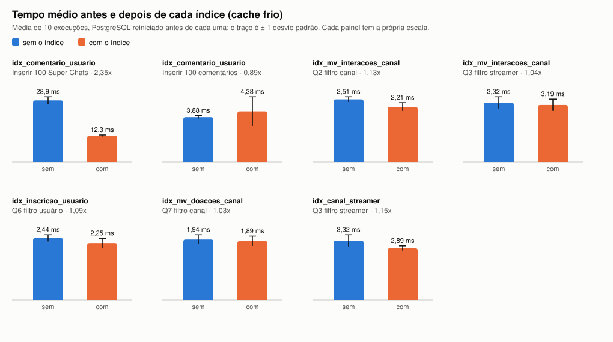

# Medição dos 5 índices

Rodada em 12/11/2026 com `medicoes/medir_indices.py`, do jeito que o professor pediu na consultoria 2.

**Ambiente:** PostgreSQL 18.4, macOS (Apple M4 Pro), banco povoado pelo `03_povoamento.sql` (seed 0.2026), sem o `05_indices.sql`.

**Método:**
- O PostgreSQL é **reiniciado antes de cada execução**, para o cache do banco começar vazio.
- Cada operação roda **10 vezes**. Os números abaixo são **média ± desvio padrão**, em milissegundos.
- O tempo é o `Execution Time` do `EXPLAIN ANALYZE` (tempo gasto dentro do servidor).
- A linha de base é medida sem nenhum dos 5 índices. Depois cada índice é criado sozinho, roda-se `ANALYZE`, medem-se as operações que ele deve acelerar, e o índice é apagado.
- As inserções são medidas dentro de `BEGIN ... ROLLBACK`, para os dados não mudarem.
- Limite: o cache de arquivos do sistema operacional não é esvaziado (isso exige senha de administrador). O script esvazia só o cache do PostgreSQL.

As 130 execuções estão em `tempos.csv`. O gráfico antes/depois está em `grafico_indices.svg`.



## Resultados

| Índice | Operação | Sem índice (ms) | Com índice (ms) | Ganho |
|---|---|---|---|---|
| `idx_comentario_usuario` | Inserir 100 Super Chats | 28,9 ± 1,68 | 12,3 ± 0,36 | 2,35x |
| `idx_comentario_usuario` | Inserir 100 comentários (overhead) | 3,88 ± 0,12 | 4,38 ± 1,26 | 0,89x |
| `idx_mv_interacoes_canal` | Q2 filtro canal | 2,51 ± 0,10 | 2,21 ± 0,17 | 1,13x |
| `idx_mv_interacoes_canal` | Q3 filtro streamer | 3,32 ± 0,33 | 3,19 ± 0,33 | 1,04x |
| `idx_inscricao_usuario` | Q6 filtro usuário | 2,44 ± 0,13 | 2,25 ± 0,19 | 1,09x |
| `idx_mv_doacoes_canal` | Q7 filtro canal | 1,94 ± 0,15 | 1,89 ± 0,16 | 1,03x |
| `idx_canal_streamer` | Q3 filtro streamer | 3,32 ± 0,33 | 2,89 ± 0,13 | 1,15x |

"Ganho" é o tempo sem índice dividido pelo tempo com índice: acima de 1 significa mais rápido.

## Leitura

1. **Os índices foram escolhidos pela carga de trabalho, não por estes números.** A medição só confere a escolha (critério explicado no `sql/05_indices.sql`).
2. **O I1 confirma com folga.** A trigger T5 varre os comentários do usuário a cada Super Chat; com o índice, inserir 100 Super Chats ficou 2,35 vezes mais rápido, e as faixas de média ± desvio não se sobrepõem.
3. **O overhead de inserção ficou dentro do ruído.** Inserir comentários com o I1 subiu 0,5 ms em média, menos que o desvio de 1,26 ms.
4. **Nos outros quatro, o ganho é pequeno (3% a 15%)** e fica perto do desvio padrão. Com 10.000 linhas, as tabelas ocupam poucas páginas, e quase todo o tempo de uma execução com o cache frio é custo fixo (carregar o catálogo e compilar a function). Sem índice o custo cresce com o tamanho da tabela; com índice, com o tamanho do resultado. O professor comentou que o efeito aparece com algumas centenas de milhares de linhas.
5. **Hash contra B+-tree:** numa medição anterior, com o cache quente, as duas estruturas empataram em todas as buscas por igualdade. Por isso a escolha entre elas é conceitual (ver `sql/05_indices.sql`).

## Reproduzir

```bash
python3 medicoes/medir_indices.py
```

Leva cerca de 3 minutos. O script sobe um PostgreSQL temporário, não mexe em nenhum banco seu, e reescreve `tempos.csv` e `grafico_indices.svg`. Os tempos variam de máquina para máquina; o que importa é a comparação sem/com.
