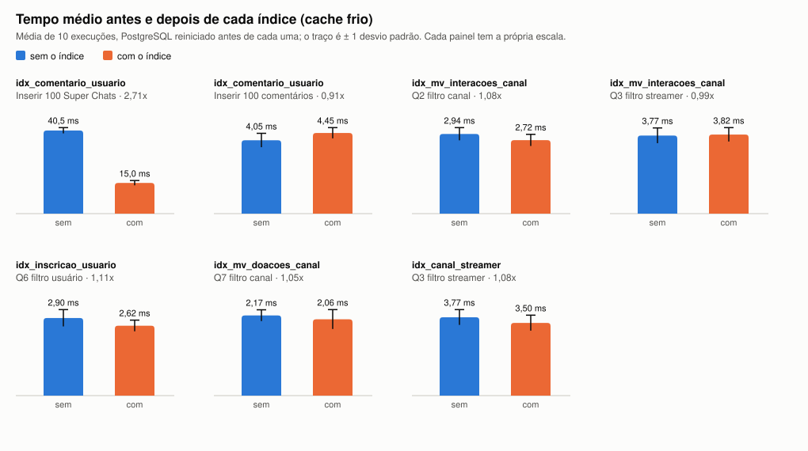

# Medição dos 5 índices

Rodada em 14/11/2026 com `medicoes/medir_indices.py`, do jeito que o professor pediu na consultoria 2.

**Ambiente:** PostgreSQL 18.4, macOS (Apple M4 Pro), banco povoado pelo `3_dados.sql` (gerado com Faker, semente 2026), sem os 5 índices (o script os apaga antes de medir).

**Parâmetros das consultas:** o script os escolhe no próprio banco. Canal = o canal com mais vídeos entre os que receberam doação (nesta base, o 1839); streamer = o dono dele (231); usuário = o membro com mais inscrições (811).

**Método:**
- O PostgreSQL é **reiniciado antes de cada execução**, para o cache do banco começar vazio.
- Cada operação roda **10 vezes**. Os números abaixo são **média ± desvio padrão**, em milissegundos.
- O tempo é o `Execution Time` do `EXPLAIN ANALYZE` (tempo gasto dentro do servidor).
- A linha de base é medida sem nenhum dos 5 índices. Depois cada índice é criado sozinho, roda-se `ANALYZE`, medem-se as operações que ele deve acelerar, e o índice é apagado.
- As inserções são medidas dentro de `BEGIN ... ROLLBACK`, para os dados não mudarem.
- Limite: o cache de arquivos do sistema operacional não é esvaziado (isso exige senha de administrador). O script esvazia só o cache do PostgreSQL.

As 130 execuções estão em `tempos.csv`. O gráfico antes/depois está em `grafico_indices.svg`.



## Resultados

| Índice | Operação | Sem índice (ms) | Com índice (ms) | Ganho |
|---|---|---|---|---|
| `idx_comentario_usuario` | Inserir 100 Super Chats | 40,5 ± 1,40 | 15,0 ± 1,17 | 2,71x |
| `idx_comentario_usuario` | Inserir 100 comentários (overhead) | 4,05 ± 0,38 | 4,45 ± 0,30 | 0,91x |
| `idx_mv_interacoes_canal` | Q2 filtro canal | 2,94 ± 0,23 | 2,72 ± 0,21 | 1,08x |
| `idx_mv_interacoes_canal` | Q3 filtro streamer | 3,77 ± 0,37 | 3,82 ± 0,33 | 0,99x |
| `idx_inscricao_usuario` | Q6 filtro usuário | 2,90 ± 0,31 | 2,62 ± 0,21 | 1,11x |
| `idx_mv_doacoes_canal` | Q7 filtro canal | 2,17 ± 0,15 | 2,06 ± 0,26 | 1,05x |
| `idx_canal_streamer` | Q3 filtro streamer | 3,77 ± 0,37 | 3,50 ± 0,37 | 1,08x |

"Ganho" é o tempo sem índice dividido pelo tempo com índice: acima de 1 significa mais rápido.

## Leitura

1. **Os índices foram escolhidos pela carga de trabalho, não por estes números.** A medição só confere a escolha (critério explicado no `sql/2_plpgsql.sql`, Seção 3).
2. **O I1 confirma com folga.** A trigger T5 varre os comentários do usuário a cada Super Chat; com o índice, inserir 100 Super Chats ficou 2,71 vezes mais rápido, e as faixas de média ± desvio não se sobrepõem.
3. **O overhead de inserção é pequeno.** Inserir 100 comentários com o I1 subiu 0,4 ms em média (cerca de 10%), mais ou menos um desvio padrão. É pouco perto dos 25 ms que o mesmo índice economiza nos Super Chats.
4. **Nos outros quatro, o ganho é pequeno (5% a 11%)** e fica perto do desvio padrão. Na consulta 3, o I2 sozinho não mudou nada (0,99x); quem ajuda nela é o I5. Com até 10.000 linhas por tabela, as tabelas ocupam poucas páginas, e quase todo o tempo de uma execução com o cache frio é custo fixo (carregar o catálogo e compilar a function). Sem índice o custo cresce com o tamanho da tabela; com índice, com o tamanho do resultado. O professor comentou que o efeito aparece com algumas centenas de milhares de linhas.
5. **Hash contra B+-tree:** a escolha entre os dois é conceitual (ver `sql/2_plpgsql.sql`, Seção 3).

## Reproduzir

```bash
python3 medicoes/medir_indices.py
```

Leva cerca de 3 minutos. O script sobe um PostgreSQL temporário, não mexe em nenhum banco seu, e reescreve `tempos.csv` e `grafico_indices.svg`. Os tempos variam de máquina para máquina; o que importa é a comparação sem/com.
